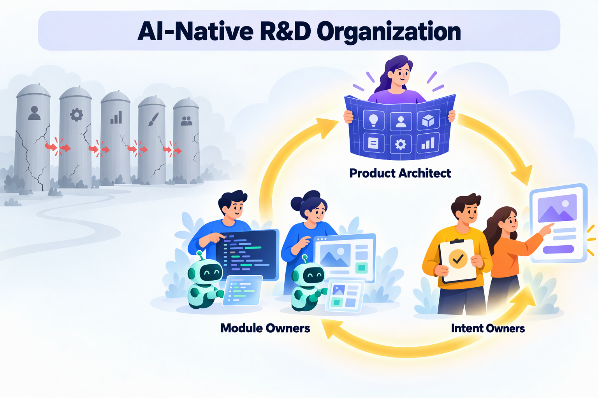
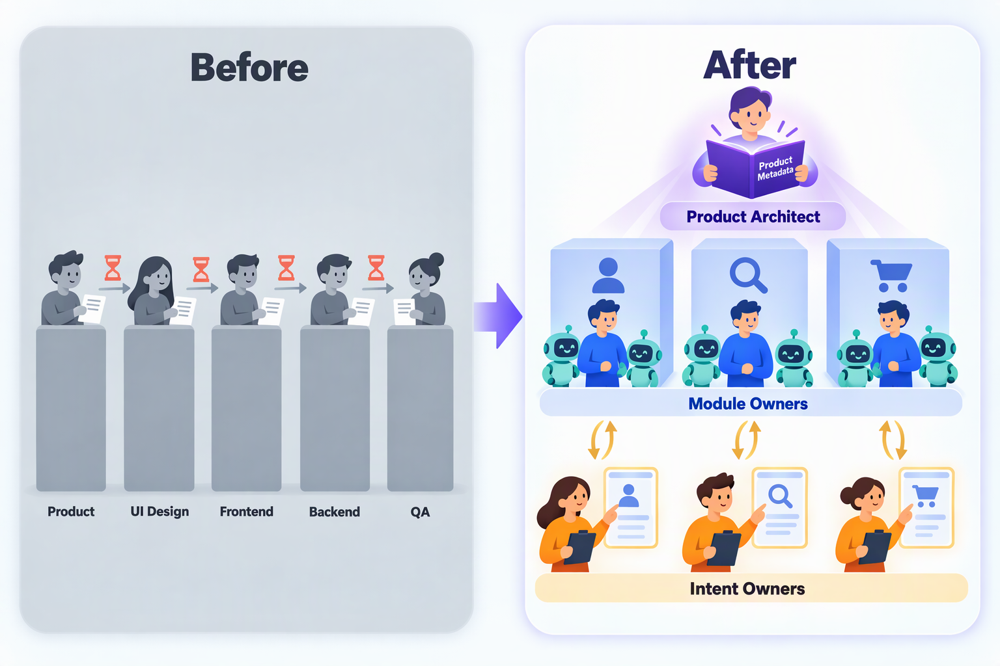
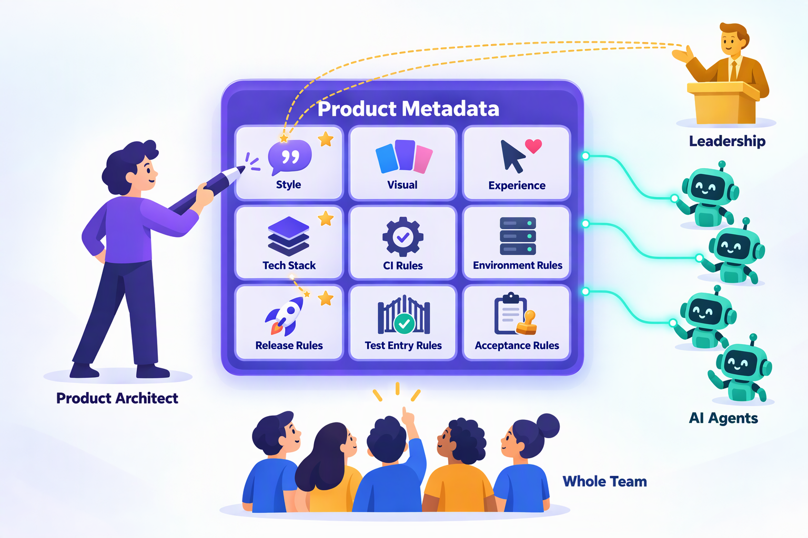
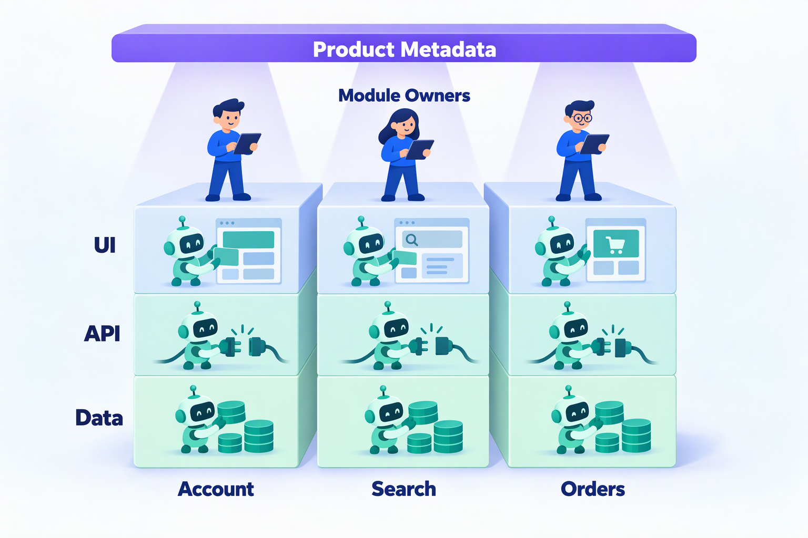
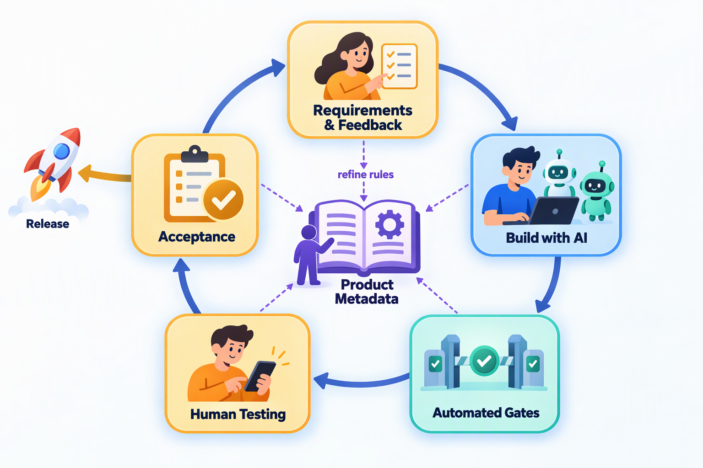
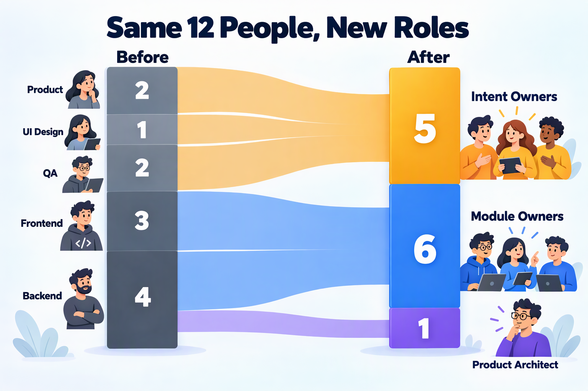
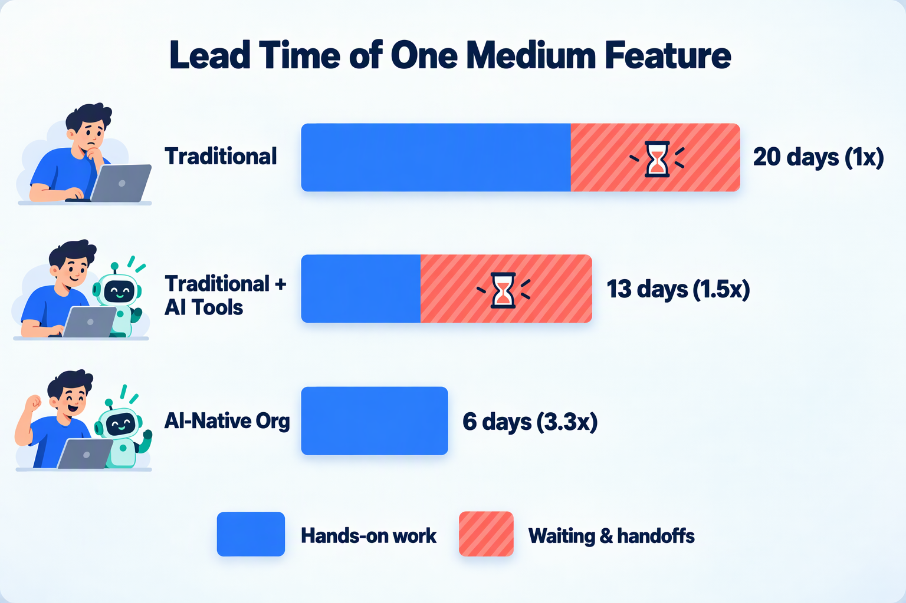
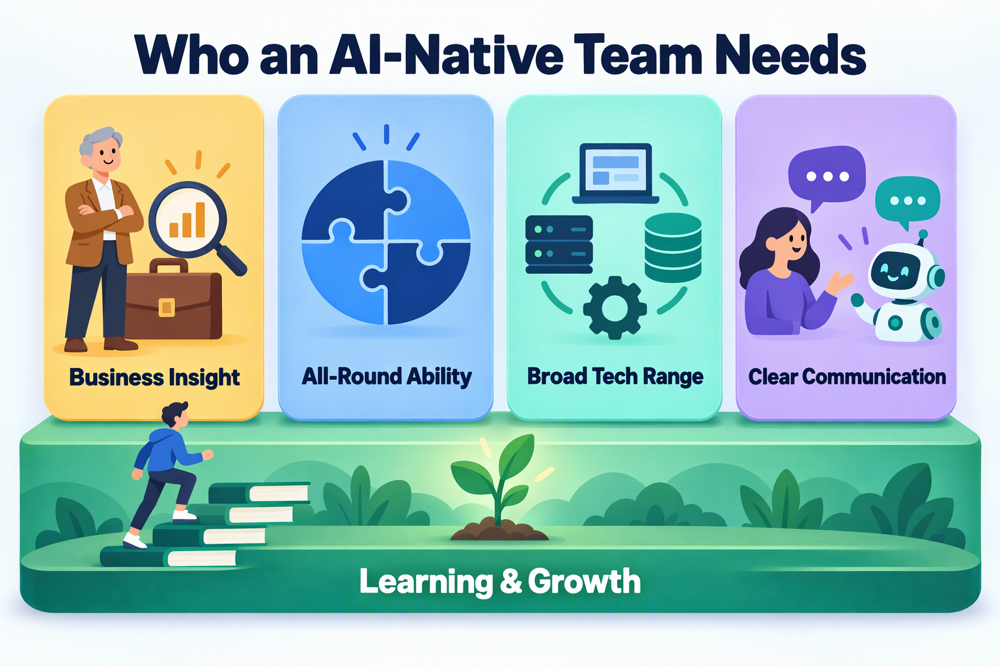

## Introduction

Over the past two years, what AI can do with code has reset our expectations almost every quarter: from line-by-line completion, to editing code through conversation in the IDE, to handing an issue straight to a coding agent that reads the code, changes it, runs the tests and opens a PR on its own. In many scenarios, one skilled engineer working with a few AI agents can already deliver what used to take a whole team.

Yet most teams' org charts have barely changed. Frontend, backend, QA, product and UI design groups each do their own part, and requirements still travel station by station down the same pipeline: "product writes a PRD → design produces mockups → frontend and backend development → testing → release". Even if AI made the coding station ten times faster, the pipeline as a whole would not be ten times faster, because most of the time was never spent writing code in the first place. It goes into waiting, handoffs and alignment.

My view is simple: **in the AI era, the organizational structure and division of labor by function (frontend, backend, QA, product and UI design) should be abolished entirely**. Not by adding an "AI team" to the existing structure, and not by letting each function adopt AI on its own, but by reorganizing from the ground up around just three roles:

* **Product Architect**: the architect role stays, but its scope expands from technical architecture to product architecture; it defines the unified metadata and rules of the whole product.
* **Module Owner**: there is no more frontend versus backend; each module gets one full-stack developer as its owner, who directs AI to build the whole module.
* **Intent Owner**: replaces the traditional product manager and focuses on just two things: managing and confirming requirements, and the final hands-on use and acceptance.

These names are new on purpose. The industry has no established names for these roles yet, and the names will appear verbatim in the rule files, repositories and tool configurations that AI agents read, so they need to be precise and unambiguous.

The rest of this post covers, in order: why the functional split no longer works, what each of the three roles does, how the organization turns like a flywheel, how to staff it, how the existing team transitions, roughly how much more efficient it can be, and what kind of people the new organization needs most.

## Part 1: Why the Functional Split No Longer Works

### 1. The Premise of Specialization Has Changed

Frontend, backend, QA and UI design are, at heart, jobs cut along "execution skills". That made sense in the past: each skill took years to master, and few people could be experts in React, database tuning, test automation and visual design at the same time. So we traded handoffs for depth, and stitched the pieces together with processes and meetings. The cost of handoffs and communication was the price we paid for specialist depth.

That premise is exactly what AI changes. Building components, writing SQL, writing test cases, tweaking styles: most of this "how-to" knowledge can now be handed to AI agents, which are reasonably familiar with nearly every mainstream tech stack. Execution skills are no longer scarce. What is scarce now are three things:

1. **Setting rules**: what the product should look like, which technologies it uses, and the standard it must be delivered to
2. **Setting direction**: what to do next, and what "done" means
3. **Making judgments**: whether what AI delivers is right, whether it is good, and whether it can ship

An organization should be designed around what is scarce, not around what no longer is.

### 2. Handoffs Have Become the Bottleneck

Here is a requirement's typical journey in a traditional team: product writes a PRD, then a review meeting; design produces interaction and visual mockups, then another review meeting; frontend and backend split the tasks and negotiate the interfaces, frontend waits for the backend APIs, backend waits for product to clarify details; when development is done it goes to QA, waits in the testing queue, and gets bounced back when issues turn up... The time actually spent writing code is often a small fraction of the whole cycle.

This is Amdahl's law applied to software delivery: how much a whole system can speed up is limited by the part that is not accelerated. AI has compressed the coding stage to a fraction of what it was, but as long as handoffs, queues and alignment remain, lead time will not improve by an order of magnitude. To turn AI's gains into delivery speed, you have to eliminate the handoffs themselves, and handoffs are a direct product of the division of labor.

### 3. Conway's Law: Systems Mirror the Organizations That Build Them

In 1968, Melvin Conway made the observation that later became known as Conway's law: an organization that designs a system will produce a design whose structure copies the organization's communication structure. Split teams into frontend and backend, and the system naturally splits into a frontend layer and a backend layer, connected by interfaces negotiated across teams; changing a single business feature often spans several teams.

In the AI era, we would rather slice systems vertically by business module: one module, from UI and APIs down to data and tests, owned end to end by one person working with AI. By Conway's law, if you want that system, you first need that organization. This is what the industry calls the "Inverse Conway Maneuver".

### 4. AI Needs Unified Context, but the Functional Split Fragments It

The quality of an AI agent's output depends heavily on the context it gets. In a functionally split team, that context is fragmented: requirements live in product's documents, visual specs in the design tool, test cases in the test management platform, and release rules in the heads of the operations folks. Each function keeps its own set, and they often disagree.

People can align in meetings; AI cannot. AI only knows what it can read. So an organization that really suits AI needs someone to gather this scattered knowledge into a single, explicit, machine-readable body of "product metadata". That is exactly the Product Architect's job.

Here is the traditional functional split next to the AI-native organization:

| Dimension | Traditional functional split | AI-native organization |
| --- | --- | --- |
| Scarce resource | Execution skills: writing code, designing, writing test cases | Rules, direction and judgment |
| How work is sliced | Horizontally by skill: frontend, backend, QA, design | Vertically by module: one owner end to end |
| How people collaborate | Document handoffs, review meetings, testing queues | Shared product metadata; AI executes, people decide and accept |
| Where knowledge lives | Scattered across each function's documents and personal experience | Centralized in the product metadata, readable by people and AI |
| Quality assurance | The QA team guards the gate at the end | Rules up front, automated gates plus human testing |

## Part 2: The New Organization: Only Three Roles



The new organization keeps only three roles, plus the senior leadership that makes the call on key rules:

| Role | Core responsibilities | Main outputs | Headcount |
| --- | --- | --- | --- |
| Product Architect | Defines and maintains the product metadata, divides the product into modules | Product metadata, module boundaries | Few |
| Module Owner | Full-stack development: directs AI through end-to-end development of a module and keeps iterating | Shippable modules, rule improvements | Many |
| Intent Owner | Manages and feeds in requirements, confirms them, human testing, final acceptance and feedback | Requirements, acceptance decisions, targeted feedback | Many |

There is no frontend or backend here, no dedicated QA, no product manager in the traditional sense, and no dedicated UI designer. The work has not disappeared; it is carried differently: execution goes to AI, rules settle into the product metadata, and judgment stays with people.

To be clear: **what we abolish is the division of labor, not the people**. Part 8 covers which new role each existing function can move into.

## Part 3: Product Architect: From Technical Architecture to Product Architecture

### 1. An Expanded Remit: Defining the Product Metadata

A traditional architect mainly owns the technical architecture: how the system is layered, how services are split, which middleware to use. In the new organization the architect stays, but the remit expands to the entire product, hence the name Product Architect. Its core output is a unified body of **Product Metadata**, the definition of all the foundational elements of the product:



| Metadata | What it defines | Concrete form (examples) | Who decides |
| --- | --- | --- | --- |
| Style | Brand tone, copywriting voice, glossary | Style guide, glossary | Leadership |
| Visual | Colors, typography, spacing, icons, components | Design tokens, component library | Product Architect; brand-related parts confirmed by leadership |
| Experience | Interaction patterns, navigation structure, accessibility, performance budgets, error messages | Experience guidelines, performance budgets | Product Architect |
| Tech Stack | Languages, frameworks, databases, cloud services, and the reasons behind each choice | Architecture decision records (ADRs) | Leadership |
| CI Rules | Required checks, branching strategy, code review rules | CI pipelines, branch protection | Product Architect |
| Environment Rules | Definitions of the development, test, staging and production environments; configuration and secret management | Infrastructure as code (IaC), environment templates | Product Architect |
| Release Rules | Release cadence, canary strategy, rollback conditions, change approval | Release pipelines, release runbook | Leadership |
| Test Entry Rules | Conditions a change must meet before it enters human testing | Quality gates | Product Architect |
| Acceptance Rules | How to write acceptance criteria, who accepts, what counts as a pass | Acceptance templates, Definition of Done | Product Architect together with the Intent Owners |

For the items that leadership decides, the Product Architect still drafts the proposal.

### 2. Three Properties of the Product Metadata

**First, it is mainly for AI agents.** The product metadata is not a spec gathering dust on a wiki. It lives as files in the code repository, and AI agents read it every time they work. For example:

```text
.
├── AGENTS.md                      # Single entry point for every AI agent; points to the metadata below
├── .github/
│   ├── copilot-instructions.md    # Repository-wide instructions for GitHub Copilot
│   ├── workflows/                 # CI rules
│   └── skills/                    # Skills shared by the team
├── product/                       # Product metadata
│   ├── style.md                   # Style
│   ├── design-tokens.json         # Visual
│   ├── experience.md              # Experience
│   ├── tech-stack.md              # Tech stack and the reasons behind it
│   ├── environments.md            # Environment rules
│   ├── release.md                 # Release rules
│   ├── test-entry.md              # Test entry rules
│   └── acceptance.md              # Acceptance rules
└── modules/
    ├── account/AGENTS.md          # Module-level rules, maintained by the Module Owner
    └── search/AGENTS.md
```

[AGENTS.md](https://agents.md/) is an open format already supported by many coding agents, and the AGENTS.md closest to the edited file takes precedence, which makes subdirectory files a natural home for module-level rules. `.github/copilot-instructions.md` holds GitHub Copilot's [repository custom instructions](https://docs.github.com/en/copilot/how-tos/copilot-on-github/customize-copilot/add-custom-instructions/add-repository-instructions). Skills package reusable capabilities (see my earlier post [AI Programming Enters the Skill Era](/blog/2026/ai-skills/)). The specific format matters less than this: the rules exist as files, are versioned and reviewable, and AI reads them every time.

**Second, the whole team must understand it.** Although the product metadata is mainly read by AI, it is the "constitution" of the whole product. Every Module Owner and Intent Owner must be able to read it: a Module Owner needs to know the boundaries when directing AI, and an Intent Owner needs to know the standard when accepting work. So it has to be written clearly in natural language. Anyone can propose a change through a pull request, and the Product Architect reviews and merges it.

**Third, decisions are tiered.** The Product Architect defines most of the metadata, but items that touch brand, cost and risk, such as style, tech stack and release rules, should be decided by senior leadership. The Product Architect prepares the options, trade-offs and a recommendation, leadership decides, and the decision is written into the metadata.

### 3. An Example: Test Entry Rules

In a traditional team, test entry criteria are usually an informal "ready for QA" agreement between developers and testers, and how well it is followed depends on goodwill. In the new organization, it becomes a rule that AI and people can both read and machines can check:

```markdown
# Test Entry Rules

Before any change enters human testing, all of the following must hold:

- CI passes: lint, type checks, unit tests, build
- Unit test coverage of new and changed code is at least 80%
- Every acceptance criterion has at least one automated end-to-end test
- Core pages meet the performance budget: LCP under 2.5 seconds (simulated mobile network)
- Security scans report no high-severity issues, and dependencies have no known critical vulnerabilities
- The change description is clear: what changed, how it was verified, which modules it affects
```

AI agents check, test and fix their own work against these rules before submitting; CI automatically checks whatever can be checked automatically; and the rest, such as whether the change description is clear, is up to the Module Owner. Testing expertise has not disappeared. It has moved from "the QA team's experience" to "standards written into the rules".

### 4. Dividing Modules and Assigning Owners

Besides the product metadata, the Product Architect divides the product into modules: by business capability (such as accounts, search, orders and payments), not by technical layer, with modules collaborating through explicit interface contracts. Once the modules are defined, the Product Architect works with management to assign an owner to each one. How well the module boundaries are drawn directly determines whether Module Owners can deliver independently, end to end.

## Part 4: Module Owner: A Full-Stack Developer Who Directs AI to Build a Whole Module



### 1. No More Frontend and Backend

Each module gets one owner, responsible for it end to end: UI, APIs, data, tests, deployment and monitoring, all done with AI. No more "frontend waiting for backend APIs", and no more arguing over "is this a frontend bug or a backend bug", because one person owns it from top to bottom.

"Full-stack" here does not mean one person hand-writes the code of every layer the way specialists used to. It means being able to understand every layer, judge whether AI's approach is right, and trace a problem all the way down when something breaks. Deep specialist knowledge lives partly in the AI and partly in the product metadata and skills; what the owner needs is breadth, judgment and command of the whole module.

### 2. An Owner's Daily Work

A Module Owner's day looks very different from that of an engineer who used to write code:

* **Break down**: turn the requirements and feedback from Intent Owners into tasks AI can execute
* **Direct**: assign tasks to different AI agents, for example one to implement, one to write tests, one to review
* **Review**: examine AI's designs and code, make technical trade-offs, and take final responsibility for quality
* **Self-test**: walk through the whole thing as a developer before handing it to an Intent Owner for acceptance
* **Improve the rules**: when AI keeps making the same kind of mistake, add to the module rules or propose a change to the product metadata to the Product Architect
* **Be on call**: when something goes wrong after release, the owner investigates and fixes it with AI

In one sentence: **people are no longer the producers of code, but the directors of AI and the ones ultimately accountable for quality**.

### 3. How Big Should a Module Be?

Module size depends on whether the owner, working with AI, can deliver at a steady pace and still hold the line on quality. Too big, and the owner becomes the bottleneck; too small, and coordination costs between modules come back. A simple test: the owner can fully explain every feature and every piece of data in the module. Important modules can have a backup owner to avoid a single point of failure.

## Part 5: Intent Owner: Owning Requirements and Acceptance

### 1. Why a New Name?

A traditional product manager does a great many things: market research, competitive analysis, writing PRDs, drawing prototypes, tracking progress, coordinating resources, running reviews, analyzing data... Much of it can either be handed to AI or is simply unnecessary in the new organization: without handoffs between functions, far less coordination is needed. What remains are the two things AI finds hardest to replace:

1. **Knowing what is wanted**: understanding users and the business, and turning vague ideas into clear requirements that can be accepted
2. **Judging whether it is right**: using the product in person and judging whether what was built is what was really wanted

That is why I gave this role a new name: **Intent Owner**. In the AI era, people provide the intent and AI does the execution. The Intent Owner owns the intent all the way through: from the moment it enters development (requirements) to the moment it is realized (acceptance), with the execution in between handled by Module Owners and AI. Keep calling the role "product manager" and everyone will assume it still writes PRDs, draws prototypes and manages projects; a new name draws a clear line around the responsibilities.

It resembles the Product Owner in Scrum, since both are responsible for the backlog. The difference is that an Intent Owner treats hands-on use and acceptance as the core of the job, and carries no project management duties at all.

### 2. First Job: Managing Requirements

The Intent Owner manages the backlog and keeps feeding requirements to the modules. The keyword is "confirm": before a requirement goes into development, the Intent Owner and the Module Owner confirm the intent together, especially the acceptance criteria, that is, what "done" looks like. Requirements do not need a PRD dozens of pages long, but the acceptance criteria must be specific and checkable, because they are used by AI (to generate test cases), by the Module Owner (to self-test) and by the Intent Owner (to accept).

A good requirement looks roughly like this:

```markdown
## Requirement: Filter the order list by status

Intent: Customer support handles a large number of "pending refund" orders every day.
Today they have to page through the list to find them; they want to filter them quickly.

Acceptance criteria:
1. A status filter is added at the top of the order list; several statuses can be selected; no filter by default
2. After selecting "pending refund", only pending-refund orders are shown, and the filter persists across pages
3. The filter is reflected in the URL, so it survives a page refresh or a shared link
4. With up to 10,000 orders, filter results return within 1 second
```

### 3. Second Job: Human Testing and Final Acceptance

Once what AI delivered has passed the automated gates and the Module Owner's self-test, it enters human testing. The Intent Owner uses it like a real user, checks it against the acceptance criteria one by one, and gives a verdict: accepted, or sent back with feedback.

Feedback quality directly determines iteration speed. A Module Owner cannot direct AI to fix "it doesn't feel very usable". Good feedback must be targeted:

```markdown
## Feedback: Order status filter

- Acceptance criterion: #3
- Steps: select "pending refund", copy the page link, open it in a new window
- Expected: the new window still shows only pending-refund orders
- Actual: the filter is lost and all orders are shown
- Screenshot: filter-lost.png
```

A Module Owner can hand feedback like this to AI almost verbatim to reproduce and fix.

### 4. Why You Need Many Intent Owners

When AI makes "building it" cheap, the bottleneck moves to both ends: deciding what to build, and judging whether it was built right. The part of a product that one Intent Owner can use and judge in depth is limited. With too few Intent Owners, Module Owners and their AI either sit idle waiting for requirements or, with nobody accepting the work, build a pile of features nobody wants. So in the new organization, there should be about as many Intent Owners as Module Owners.

## Part 6: Making the Organization Turn: A Flywheel of Requirements, Execution, Acceptance and Rules



Put the three roles together and the whole development process becomes a flywheel that keeps turning:

1. **Input**: the Intent Owner feeds in new requirements (intent plus acceptance criteria) or the feedback from the last round of acceptance
2. **Execution**: the Module Owner breaks down the tasks and directs AI agents to complete development and automated tests within the constraints of the product metadata
3. **Automated gates**: checks run automatically against the CI rules and test entry rules; AI finds and fixes its own problems until everything passes
4. **Human testing**: the Module Owner self-tests first, then hands it to the Intent Owner, who uses and accepts it like a real user
5. **Feedback or release**: if acceptance fails, the Intent Owner gives targeted feedback and the loop returns to step 2; if it passes, it ships according to the release rules
6. **Improve the rules**: for every problem found in a round, ask "can this become a rule?" If so, add it to the module rules or the product metadata so AI does not make the same mistake again

In this flywheel, people do only three things: **set the rules, provide the intent, and make the judgments**. All the remaining execution goes to AI.

Step 6 is what lets this organization speed up over time. In a traditional team, fixing a bug is the end of it, and the same kind of problem shows up somewhere else next time. In the new organization, the goal is to "fix the rule, not just the bug". The better the rules, the more consistent AI's output, the fewer problems human testing finds, and the faster the flywheel turns.

## Part 7: Staffing: Few Product Architects, Many Module Owners and Intent Owners

The three roles differ greatly in headcount:

* **Few Product Architects**: the product metadata is shared across the whole product; once established, it changes incrementally, so one or two Product Architects per product are usually enough. A large product can split the role by domain, for example one focused on experience and visual design and one on engineering and delivery, but the total should stay small, because the metadata must have a single, unified source.
* **Many Module Owners**: the number of modules determines the number of Module Owners; they are the main force of execution.
* **Many Intent Owners too**: the bottleneck has moved to requirements and acceptance, so there should be about as many Intent Owners as Module Owners.

Take a 12-person team. A traditional setup might have 2 product managers, 1 UI designer, 2 QA engineers, 3 frontend and 4 backend developers. Staffed for the new organization, it could be 1 Product Architect, 6 Module Owners and 5 Intent Owners, roughly 1:6:5:



This ratio is not a fixed formula, but the direction is clear: Product Architects are the minority, Module Owners and Intent Owners are the majority, and those two groups are roughly equal in size.

## Part 8: Where the Existing Roles Go

| Former function | New role | Notes |
| --- | --- | --- |
| Architect | Product Architect | Expands from technical architecture to product architecture and owns all of the product metadata |
| Frontend and backend engineers | Module Owner | Fill in the other side's skills with AI's help, moving from "I own the frontend" to "I own this module" |
| QA engineers | Intent Owner or Module Owner | Those good at finding problems from a user's perspective fit the Intent Owner role; those strong in automation and engineering fit the Module Owner role; testing methodology goes into the test entry rules |
| Product managers | Intent Owner | Drop PRDs, prototypes and project management to focus on requirements and acceptance; those good at designing the product as a whole can also become Product Architects |
| UI designers | Product Architect or Intent Owner | Visual and experience standards move into the product metadata, and senior designers can become experience-focused Product Architects; designers with a strong feel for the user experience also make excellent Intent Owners |

In the 12-person example above, one possible transition is: the 2 product managers, 2 QA engineers and 1 UI designer become 5 Intent Owners; of the 7 frontend and backend engineers, 1 senior engineer becomes the Product Architect and the other 6 become Module Owners.

Whatever the path, the transition means broadening skills: frontend developers learn the backend, backend developers learn the UI, testers learn the product, product people learn acceptance, and everyone learns to work with AI and to write rules.

## Part 9: How Much More Efficient? A Rough Estimate

First, a caveat: what follows is a model-based estimate built on assumptions, not measured data. I list every assumption, so you can substitute your own team's numbers and redo the math.

### 1. What the Research Says: AI Tools Alone Do Not Make an Organization More Efficient

Published research does not agree on how much AI speeds up software development:

* **Individual level**: in a controlled experiment with GitHub Copilot published in 2023, developers were asked to implement an HTTP server in JavaScript, and the group with access to Copilot finished 55.8% faster than the control group.
* **Real projects**: METR ran a randomized controlled trial with experienced open-source developers in the first half of 2025. Working in large repositories they maintain themselves, the developers took 19% longer when allowed to use the AI tools of the time. Follow-up data from early 2026 began to show signs of speedup, but the confidence intervals still included zero; and because more and more developers declined to take part since they no longer wanted to work without AI, the researchers themselves consider it only very weak evidence.
* **Organizational level**: DORA's 2024 report found that AI adoption improved individual productivity, flow and job satisfaction, but had a negative impact on software delivery throughput and stability. DORA's 2025 report puts it even more directly: AI's primary role is that of an amplifier, magnifying an organization's existing strengths and weaknesses, and the greatest returns on AI investment come not from the tools themselves but from a strategic focus on the underlying organizational system.

This matches the analysis in Part 1: give everyone AI tools and only the "doing the work" part speeds up; the waiting, handoffs and alignment stay exactly the same.

### 2. Method

Efficiency is measured with two metrics:

* **Lead time**: the calendar time from when a requirement is raised to when it is live; it measures "how fast"
* **Output per person**: how many requirements the same people can deliver per month, derived from the person-days each requirement consumes; it measures "how much"

The most important and most uncertain parameter in the estimate is the **AI execution multiplier s**: once execution work such as design, development and testing is handed to AI, the human time spent on it shrinks to 1/s of what it was. It depends on the AI's capability, how complete the product metadata is, and the state of the codebase, so I use three levels: conservative s = 2, neutral s = 4, optimistic s = 6.

### 3. Doing the Math: One Medium-Sized Requirement

Take a medium-sized requirement such as an "order refund flow": a few pages, a few APIs and one database schema change. In a traditional organization, product, design, frontend, backend and QA all take part. The table compares its lead time and effort in the two organizations (the new organization uses the neutral assumptions):

| Stage | Traditional organization | New organization (neutral) | Why it changes |
| --- | --- | --- | --- |
| Requirements | Write the PRD and review it: 3 days, including 1 day of waiting | Confirm the intent and acceptance criteria: 1 day | No long PRD; the Intent Owner and Module Owner confirm face to face |
| Design | Interaction and visual mockups, review: 3 days, including 1 day of waiting | Part of AI execution | Visual design and experience are defined by the product metadata; AI generates the UI to spec |
| Scheduling | Waiting for a development slot: 2 days | None | The Module Owner pulls work straight from the backlog |
| Development and testing | Frontend and backend development, integration: 5 days; QA queue and testing: 3 days, including 1 day of waiting | AI execution (design, development, automated tests, gates): 2.5 days | Execution goes to AI, tests run automatically per the entry rules, and there is no frontend-backend integration |
| Acceptance and fixes | Fixes, regression testing and product acceptance: 2 days, including 0.5 days of waiting | Human testing and acceptance: 1 day; fixes from feedback: 1 day | Feedback goes straight to the Module Owner, and AI fixes it |
| Release | Waiting for a release window: 2 days | Release per the release rules: 0.5 days | Continuous release, no waiting for a release window |
| Lead time | 20 days | 6 days | About 3.3x |
| Effort | 20 person-days: product 3, design 2, frontend 4, backend 5, QA 4, reviews and communication 2 | 7 person-days: Intent Owner 2, Module Owner 4, Product Architect (amortized) 0.5, communication 0.5 | About 2.9x |

Of the traditional organization's 20 days, only 5 go to writing code, while pure waiting (for reviews, for scheduling, in the QA queue, for regression testing, for the release window) takes 7.5 days. The new organization's speedup comes from three sources: waiting and handoffs essentially disappear; execution work such as design, development and testing goes to AI; and the acceptance and feedback loop gets shorter, so when an Intent Owner finds a problem, the Module Owner can direct AI to fix it the same day.

### 4. For Comparison: AI Tools Only, No Organizational Change

Assume exactly the same AI capability (again s = 4), but no organizational change, with each function using AI for its own work: the hands-on time shrinks from 12.5 days to about 5.5 days, but not a single day of the 7.5 days of waiting goes away. Lead time is about 13 days, only about 1.5x faster. On paper, effort per requirement can drop to about 10 person-days, but each function's headcount is fixed: once development speeds up, the bottleneck quickly moves to product and QA, whose headcount has not changed, so the real throughput gain is smaller still.



### 5. Results: About 3x in the Neutral Case

| Setup | Lead time | Speedup | Effort per requirement | Output per person |
| --- | --- | --- | --- | --- |
| Traditional organization (baseline) | 20 days | 1x | 20 person-days | 1x |
| Traditional organization + AI tools (s = 4) | About 13 days | About 1.5x | About 10 person-days | About 2x on paper, limited by bottlenecks in practice |
| New organization, conservative (s = 2) | 10 days | 2x | 11.5 person-days | About 1.7x |
| New organization, neutral (s = 4) | 6 days | About 3.3x | 7 person-days | About 2.9x |
| New organization, optimistic (s = 6) | 3.5 days | About 5.7x | 5 person-days | 4x |

The conservative and optimistic cases use the same method as the neutral one; only s differs, and the human steps (confirming requirements, acceptance, rounds of fixes from feedback) take correspondingly longer or shorter.

So my conclusion is: **under the neutral assumptions, the new organization cuts lead time to about a third of what it was and raises output per person to about 3x**. In the conservative case, lead time still halves and output per person rises about 1.7x; in the optimistic case, delivery is more than 5x faster and output per person is about 4x. In terms of a 12-person team: assuming 20 working days per person per month, all spent on requirements, the team used to deliver about 12 medium-sized requirements a month; the new organization can deliver more than 30 in the neutral case.

### 6. Two Conclusions Worth Noting

**First, the human steps set the ceiling on efficiency.** The larger s gets, the fewer person-days Module Owners spend, but the human steps (confirming intent, human testing and acceptance, rule maintenance and communication) do not disappear as AI gets stronger. Under the neutral assumptions they take about 3 person-days per requirement, which puts the theoretical ceiling on output per person at about 20 ÷ 3 ≈ 6.7x. This is Amdahl's law again: the stronger AI gets, the more the bottleneck concentrates on human judgment. So keep making requirement confirmation and acceptance more efficient, for example by writing acceptance criteria that are more specific and checkable, and handing every acceptance step that can be automated to end-to-end tests.

**Second, staffing ratios must follow the workload.** Under the neutral assumptions, each requirement takes about 4 person-days of Module Owner time and about 2 of Intent Owner time, so a balanced 12-person team would be roughly 1:7:4. As AI gets stronger, Module Owners need fewer person-days, the share of Intent Owners rises, and the ratio gradually moves toward the 1:6:5 of Part 7. Get the ratio wrong and the bottleneck role caps throughput: if there are still only 2 Intent Owners (as many as the original product managers), each with 20 working days a month and 2 person-days per requirement, then no matter how strong AI gets, at most 20 requirements a month can be accepted.

### 7. Assumptions and Risks

The estimate rests on a few preconditions:

* **The product metadata is complete enough**: the more complete the rules, the more consistent AI's output and the larger s; with missing rules, AI keeps repeating the same mistakes and s drops to the conservative level or below
* **Module boundaries are clear**: when modules are tightly coupled, coordination costs between Module Owners come back
* **Intent Owners can write checkable acceptance criteria**: vague requirements multiply the rounds of feedback and fixes
* **You accept a ramp-up period**: writing rules, learning to direct AI and filling in full-stack skills all take time, and efficiency may drop rather than rise early in the transition

Finally, verify the multiplier with your own data: on the pilot module, record lead time, person-days per requirement, first-pass acceptance rate and rework, and compare them with the numbers before the transition instead of going by gut feeling. METR's research is a reminder that developers' own sense of how much AI speeds them up is often unreliable.

## Part 10: What Kind of People the New Organization Needs

The estimate in the previous part leads to one conclusion: the stronger AI gets, the more the efficiency bottleneck concentrates on human judgment. So in the new organization, the most valuable thing is no longer "mastering a particular framework", but judgment, breadth and communication. Specifically, the new organization needs more of the following kinds of people:



| Who is needed more | Why | Roles where they shine |
| --- | --- | --- |
| Senior people who know the business | AI does not know your business; whether something was "built right" can only be judged with business experience | Intent Owner, Product Architect |
| People with strong all-round ability | One person owns a module end to end, from understanding requirements and making technical decisions to quality and release | Module Owner |
| People with broad technical range | They must understand every layer, judge whether AI's approach is sound, and trace problems all the way down | Module Owner, Product Architect |
| People who communicate clearly | Instructions to AI, requirements and feedback to people, and rules written into the metadata are all, at heart, communication | Every role, especially Intent Owner |

### 1. Senior People Who Know the Business

AI can write almost any code, but it does not know why your customers always pile up refund requests at the end of the month, or that a certain rule exists because of a serious incident in the past. That business knowledge is exactly what confirming requirements, accepting results and setting rules need most.

"Senior" here means truly understanding the business, not years of service. Senior people who know the business make excellent Intent Owners, whether they used to work in product, development or QA; those with the deepest understanding of the product as a whole can become Product Architects and write their experience into the product metadata, so AI and the whole team can use it.

### 2. People with Strong All-Round Ability

A Module Owner is no longer someone who just "writes their own layer well", but someone accountable for the outcome of a whole module: confirming intent with the Intent Owner, breaking down tasks, directing multiple AI agents, reviewing designs, controlling quality and handling production issues. That takes all-round ability: understanding requirements, making technical decisions, organizing work and owning results. People who are only good at one step and used to waiting for others to hand work over will struggle in the new organization.

### 3. People with Broad Technical Range

Full-stack developers live on technical breadth. Frontend, backend, databases, testing, deployment, monitoring: you need to understand every layer to judge whether AI's approach is sound, and to trace a problem all the way down when it breaks. Technical depth is still valuable, but in the new organization depth mostly settles into rules and skills that every person and every AI shares; breadth determines how large a module one person can own independently.

### 4. People Who Communicate Clearly

In the AI era, communication is productivity. The instructions a Module Owner gives to AI, the requirements, acceptance criteria and feedback an Intent Owner writes, and the rules a Product Architect writes into the product metadata are all, at heart, communication: the clearer they are, the more precisely AI executes and the less rework there is.

At the same time, the new organization removes the layers of handoffs, so collaboration between people becomes direct conversation. How quickly Intent Owners and Module Owners can align on intent, and whether the Product Architect can explain the rules so that everyone understands them, directly determines how fast the flywheel turns.

### 5. Junior Roles Stay; What Matters More Is the Ability to Learn and Grow

None of this means the new organization has no place for junior staff. A team that only hires senior people will, a few years later, have nobody growing into the next generation of senior people. What changes is what we ask of people: knowing a particular framework matters less; **what matters more is the ability to learn and grow**. That applies to everyone, for three reasons:

1. **AI and tools change too fast**: today's best practice may be obsolete in a few months, so senior people must keep learning too; and the advantage of junior people is precisely that they learn fast and carry less baggage.
2. **The new organization offers better conditions for growth**: the product metadata turns the team's experience into rules, so newcomers can quickly understand the product's standards by reading them; and AI is a mentor at their side that can explain any unfamiliar technology or compare approaches at any time.
3. **The growth path is clearer**: a junior can start as the backup owner for a senior Module Owner, beginning with reviews, self-testing and adding rules, then gradually take full ownership of a small module; or start as the Intent Owner of a small business area and build up business experience through acceptance work.

One thing to watch for: juniors can easily turn into people who "only know how to make AI do the work, without understanding it themselves". So measure a junior's growth not by how much code they produced, but by whether they can explain why AI did what it did, whether it is right, and whether there is a better approach. Only when they can explain it have they truly learned it.

The same shift applies to hiring and training: ask less about "do you know framework X" and look more at business understanding, technical breadth, communication and learning speed. In an interview, for example, give the candidate an unfamiliar business scenario and see whether they can quickly ask the key questions, explain their approach clearly, and direct AI to build a working prototype.

## Part 11: Common Objections

### 1. Can One Person Really Be "Full-Stack"?

They don't need to be an expert in every layer. With AI's help, an experienced engineer can fill in the other side's skills far more easily than before. Where real depth is needed, such as database performance or complex interaction animations, experts can write their experience into rules and skills that every owner's AI can use, instead of stepping in personally on every requirement.

### 2. Without a QA Team, Who Guarantees Quality?

Quality should never have depended only on a final gate. The new organization splits quality into three layers: test entry rules define the standard, AI and CI enforce it automatically, and human testing makes the final judgment. The QA team's expertise is not thrown away; it is written into the rules and applied to every single change, not just when a build is handed to QA.

### 3. Without UI Designers, Will the Product Get Ugly?

No; if anything, it may become more consistent. In traditional teams, visual inconsistency often comes from all the manual translation between design mockups and implementation. In the new organization, visual design and experience are first-class product metadata: design tokens and the component library are defined once and apply everywhere, and every interface AI generates follows the same standard. Design talent is concentrated on setting the standard instead of producing mockups one screen at a time.

### 4. Will the Product Architect Become the New Bottleneck?

The product metadata changes far less often than requirements, and most of the time the Product Architect is reviewing rule changes proposed by others rather than doing everything personally. Anyone can propose a change; the Product Architect keeps the whole consistent. As a product grows, two or three Product Architects can split the work by domain, but there should never be an "architecture department" again.

## Part 12: How to Start the Transition

You don't need to reorganize the whole department at once. Proceed in this order:

1. **Write the product metadata first**: gather the rules scattered across wikis, documents and people's heads, and put them into the repository as files. Start with the tech stack, CI rules, test entry rules and acceptance rules, which pay off fastest.
2. **Pilot with one module**: pick a module with clear boundaries, assign one Module Owner and one Intent Owner, run the flywheel for 2–4 weeks, record lead time, person-days per requirement and rework, and compare them with the numbers before the transition using the method in Part 9.
3. **Change how performance is measured**: stop measuring by function (how much code was written, how many test cases were run) and measure modules by delivery results and acceptance quality; judge the Product Architect by the quality of the rules and the consistency of AI's output.
4. **Change hiring and training**: hire and develop people by the criteria in Part 10, and give juniors a growth path from backup owner to full owner.
5. **Dissolve the functional teams step by step**: once the pilot works, regroup by module and gradually dissolve the old functional teams.
6. **Review the rules every week**: set a fixed time to go over the week's feedback and turn every problem that can be captured into a rule.

## Conclusion

The functional split was designed for an era when execution capacity was scarce. Today, execution is becoming a utility, available on tap like water and electricity, and what is truly scarce is rules, direction and judgment. Organizations should be rebuilt around those three things:

* **Product Architects** set the rules, so that AI and people alike know what the product should be;
* **Module Owners** build their modules end to end with AI and keep improving the rules;
* **Intent Owners** provide the intent and accept the results in person, keeping the product pointed at what users really need.

By the estimate in Part 9, under the neutral assumptions such an organization cuts lead time to about a third and raises output per person to about 3x; the stronger AI gets, the higher the multiplier, with the ceiling set by how efficient the human judgment steps are.

And what really makes this organization turn are people who know the business, have strong all-round ability and broad technical range, communicate clearly, and keep learning and growing.

The tools have changed. It's time for organizations to change too.

## References

* Melvin E. Conway, [How Do Committees Invent?](https://www.melconway.com/Home/Committees_Paper.html), Datamation, April 1968
* Martin Fowler, [Conway's Law](https://martinfowler.com/bliki/ConwaysLaw.html)
* Thoughtworks Technology Radar, [Inverse Conway Maneuver](https://www.thoughtworks.com/radar/techniques/inverse-conway-maneuver)
* Wikipedia, [Amdahl's law](https://en.wikipedia.org/wiki/Amdahl%27s_law)
* [AGENTS.md](https://agents.md/)
* GitHub Docs, [Adding repository custom instructions for GitHub Copilot](https://docs.github.com/en/copilot/how-tos/copilot-on-github/customize-copilot/add-custom-instructions/add-repository-instructions)
* VS Code Docs, [Use Agent Skills in VS Code](https://code.visualstudio.com/docs/agent-customization/agent-skills)
* Design Tokens Community Group, [Design Tokens Format Module](https://www.designtokens.org/tr/drafts/format/)
* [The Scrum Guide](https://scrumguides.org/scrum-guide.html)
* web.dev, [Largest Contentful Paint (LCP)](https://web.dev/articles/lcp)
* Sida Peng et al., [The Impact of AI on Developer Productivity: Evidence from GitHub Copilot](https://arxiv.org/abs/2302.06590), 2023
* METR, [Measuring the Impact of Early-2025 AI on Experienced Open-Source Developer Productivity](https://metr.org/blog/2025-07-10-early-2025-ai-experienced-os-dev-study/), 2025
* METR, [We are Changing our Developer Productivity Experiment Design](https://metr.org/blog/2026-02-24-uplift-update/), 2026
* DORA, [Accelerate State of DevOps Report 2024](https://dora.dev/research/2024/dora-report/)
* DORA, [State of AI-assisted Software Development 2025](https://dora.dev/research/2025/dora-report/)
