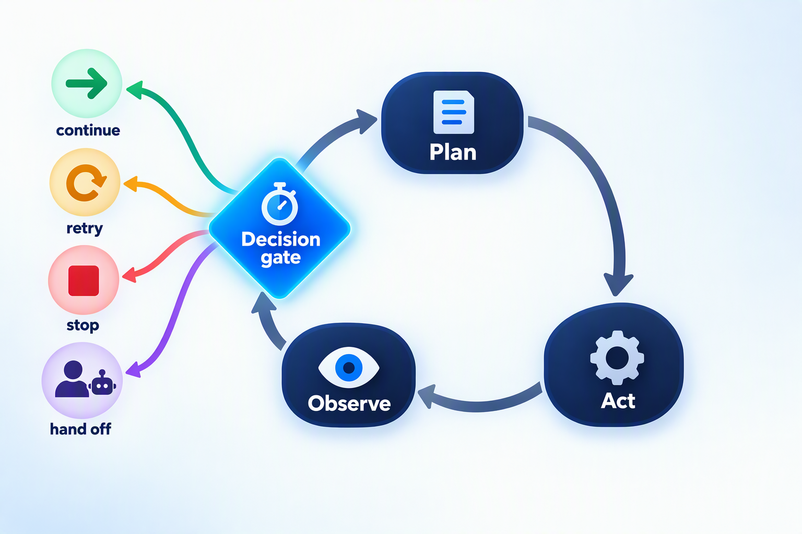
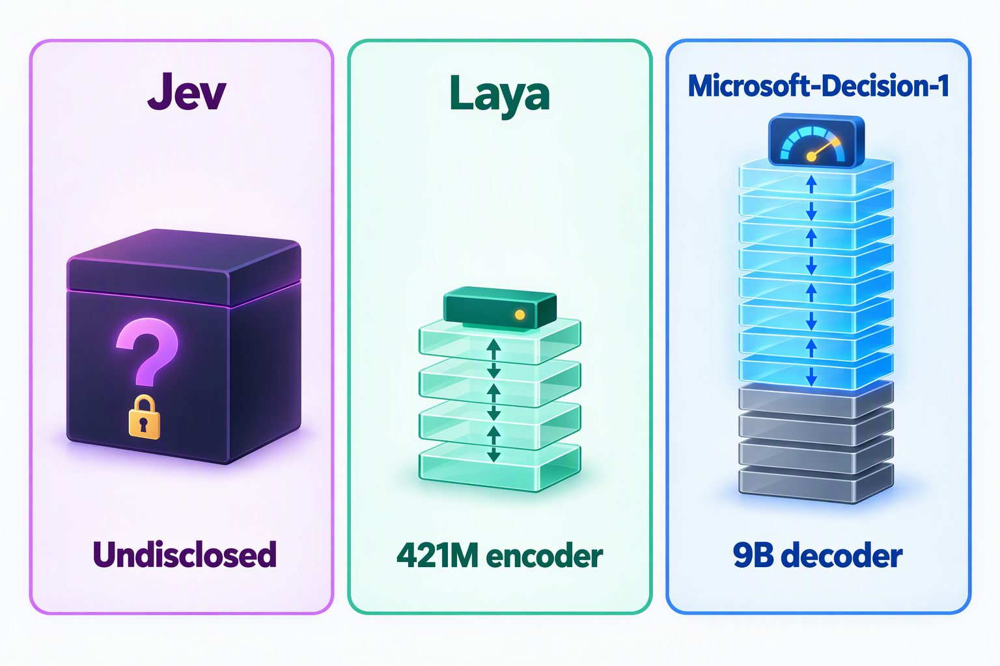
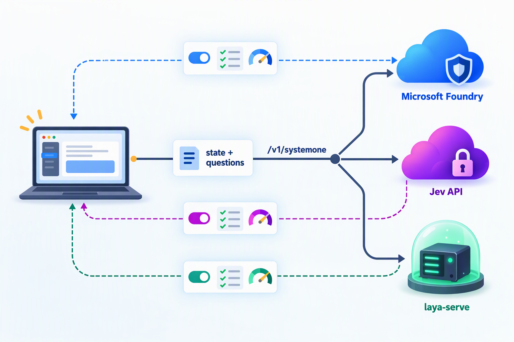

## Introduction

Last month I wrote [Jev vs Laya](/blog/2026/jev-vs-laya/), comparing TypeSafe AI's closed-source decision model Jev with the community's open-source Laya. Back then, "decision models" were a brand-new category: Jev launched on September 15, and Laya was open-sourced three days later.

Just three weeks later, the field is crowded: on October 6, OpenAI opened its Decisions API built on GPT-6 Luna; companies such as Liquid AI and Inception have launched their own decision APIs; and the third-party leaderboard JevBench now ranks more than 140 open-weight systems. On October 9, Microsoft joined the race with **Microsoft-Decision-1**.

Compared with the other newcomers, Microsoft-Decision-1 stands out in several ways:

* **A big vendor building on an open-source base model**: it is post-trained from Alibaba's open-source Qwen3.5-9B, and Microsoft says it will later move it onto its own MAI models and OpenAI models;
* **Exactly the same price as Jev**: $0.042 per million input tokens, with output free;
* **An API that is almost Jev-compatible**: the same state + questions, and the same three question types, noul / choice / score;
* **Impressive official numbers**: the highest average accuracy in a comparison across 36 benchmarks and nearly 150,000 questions, and a median latency about 35 times faster than GPT-6 Sol.

But the official numbers are only half the story. The day after Microsoft's launch, the third-party leaderboard JevBench finished an independent evaluation, and its conclusions don't fully agree. This article covers:

1. What Microsoft-Decision-1 is and how it was built
2. How its technical approach and API differ from Jev and Laya
3. How to read the official benchmarks and the third-party results
4. The strengths and weaknesses of Microsoft-Decision-1
5. Use cases, selection advice, and code examples

## A One-Minute Recap: What Is a Decision Model?

A decision model (System One Model) doesn't chat or write articles. It does only one thing: **it takes a piece of state and a set of predefined questions, and directly returns typed decisions with probabilities**. All three models support the same three question primitives:

| Primitive | Question it answers | What it returns |
| --- | --- | --- |
| `noul` | Is it true? | The probability of "yes" (0–1) |
| `choice` | Which one? | The chosen option, plus a probability for every option |
| `score` | How much? | A score on an ordered scale, plus a probability for every level |

Because the answer space is fixed in advance, the model cannot return malformed output or made-up options, and calibrated probabilities can go straight into an `if` statement: act automatically on high confidence, send medium confidence to a stronger model for review, and hand low confidence to a human. A reasonable division of labor in an AI system is: **code provides the skeleton, decision models make the quick calls, and LLMs do the deep thinking**.

For a more detailed introduction to the concepts and to confidence-based routing, see the previous article; I won't repeat them here.

## What Is Microsoft-Decision-1?

### 1. The Basics

On October 9, 2026, Achint Srivastava, VP of Software Engineering in Microsoft's Office of the CTO, announced Microsoft-Decision-1 on Command Line, Microsoft's technical blog. The post opens with this definition of decision models:

> Unlike LLMs, which are designed to generate text or reason through complex problems, decision models are purpose-built to deliver structured outputs that software can immediately act on.

Microsoft positions it as a "fast decision-scoring" model for routing, classification, prioritization, verification, and workflow control. The key facts:

| Item | Details |
| --- | --- |
| Release date | October 9, 2026 |
| Publisher | Microsoft's Office of the CTO |
| Base model | Qwen3.5-9B (post-trained), with plans to move to MAI and OpenAI models |
| Model type | Decision, text classification, zero-shot classification |
| Question types | `noul` (yes / no), `choice` (pick one), `score` (ordered rating), plus rubric-based grading of AI responses and agent actions |
| Input | Text only (a string or JSON), up to 32K tokens per request; no image, audio, or video |
| Output | The chosen option and a calibrated probability for every candidate; no explanations or rationales |
| Availability | The Microsoft Foundry model catalog (model name `Microsoft-Decision-1`, version `1`), and also through OpenRouter |
| Deployment types | `GlobalStandard`; `DataZoneStandard` in selected regions |
| Endpoint | `{Foundry resource endpoint}/providers/microsoft/v1/systemone` |
| Authentication | Microsoft Entra ID (recommended) or an API key |
| Price | $0.042 per million input tokens; output is free |

At this price, if each decision consumes 1,000 input tokens on average, one million decisions cost about $42, exactly the same as Jev.

### 2. How It Was Built

Microsoft has not disclosed many technical details, but a few points stand out:

* **Post-trained on an open-source base**: Microsoft post-trained Qwen3.5-9B for "fast, single-pass decision scoring". Given a fixed set of candidate answers, the model directly outputs a calibrated probability for each option instead of generating text token by token.
* **The base model is replaceable**: Microsoft says explicitly that it will soon rebase the model on other models, including Microsoft's own MAI models and OpenAI's models.
* **What remains undisclosed**: the training data, the post-training method, and how the scoring is implemented have not been published, and the weights are not released; the model is only available as a hosted API.


In its blog post, Microsoft describes five challenges in building a reliable decision model, along with its own results:

| Challenge | Why it matters | Microsoft's own results |
| --- | --- | --- |
| Speed | Decisions in agent workflows are often sequential: adding 100 ms to each of 20 sequential decisions adds 2 seconds | P50 latency is about 1/35 of GPT-6 Sol's |
| Generalization | It is easy to overfit to one benchmark; you need to know whether quality holds on tasks the model wasn't trained on | Evaluated on dozens of benchmarks kept blind from training (routing, ranking, long context, multilingual, out-of-distribution tasks, reasoning, safety); compared with the top models on the JevBench leaderboard across 36 additional public and private benchmarks, it had the highest average accuracy |
| Robustness | In production, states and instructions get paraphrased, options get reordered, and keys change; none of these equivalent changes should alter the decision | Across 8 perturbations of the same request, the decision flips 1.3% of the time on average, and never flips when option descriptions are paraphrased or options are reversed or shuffled |
| Calibration | The probability itself is part of the API: applications use it to decide whether to act, defer, or ask for review, so a 90% prediction should be right about 9 times out of 10 on representative cases | A calibration score of 92.2 (out of 100) across the 36 benchmarks, third among the 7 models scored and 1.5 points behind Jev |
| Safety | The model should recognize harmful requests without needlessly blocking harmless ones | Tested on 5,250 requests across 11 benchmarks (harmful content, jailbreaks, prompt injection); it refused harmful behavior while retaining a high degree of utility |

### 3. Four Internal Pilots at Microsoft

Microsoft also shared several internal pilots (all self-reported):

| Team / scenario | Task | Result |
| --- | --- | --- |
| Xbox Research: data labeling | Sort more than 10,000 open-ended pieces of feedback from surveys, Steam, and Twitter/X into a fixed set of themes defined by researchers | Quality comparable to GPT-6 Sol, over 14 times faster, and about 200 times cheaper |
| Copilot: quality control | Evaluate the quality of chat and agentic responses | Comparable to GPT-5.6 Luna and about 100 times faster |
| Incident response | Retrieve relevant knowledge from logs, tickets, calls, and messages for on-call engineers handling live incidents | Better and faster than an LLM-based approach |
| Microsoft Discovery: science | An agent grades the previous experiment against a rubric, revises its approach, and iterates until it reaches its objectives | Scores 46 times more consistent than LLM-based scoring at 3 times the speed, making adaptive replanning nearly 4 times faster overall |

For the three Xbox datasets, Microsoft published more detailed numbers:

| Dataset | Size | Mean time per item (GPT-6 Sol → Decision-1) | Cost of one full pass (GPT-6 Sol → Decision-1) |
| --- | --- | --- | --- |
| Reviews of a racing title | 753 reviews | 2.8 s → 159 ms (about 18x) | $1.83 → $0.009 (about 213x) |
| Reviews of a first-person shooter | 341 reviews | 2.6 s → 188 ms (about 14x) | $1.03 → $0.005 (about 212x) |
| Posts about a studio livestream | 1,030 posts | 2.6 s → 143 ms (about 18x) | $2.92 → $0.013 (about 223x) |

Scaled to one million texts, GPT-6 Sol would cost about $2,434 and Microsoft-Decision-1 about $11 (Microsoft notes that the costs are estimates). Both read the same task brief, so their input token counts match; the gap comes from the unit price and from the fact that GPT-6 Sol also pays for output.

### 4. Where It Fits

Microsoft lists 16 suggested use cases in its post, which fall roughly into four groups:

| Group | Use cases |
| --- | --- |
| Agent control | Evaluate an agent's proposed next step and decide whether to continue, stop, retry, or hand off to another model, tool, or human; apply the rules of a skill to choose the next action without repeatedly processing a long list of instructions; choose the next UI action in computer and UI use; choose among predefined robot actions |
| Routing and classification | Model routing, intent analysis, incident triage and routing, content classification and filtering, data labeling |
| Evaluation and verification | AI judging (accept, revise, or reject a response against defined criteria), data validation, code scanning, safety and security screening (allow, block, or escalate) |
| Ranking and recommendation | Recommendations, search relevance, and screening hypotheses, compounds, and experiments in scientific discovery |

The most interesting of these is **agent control**. Today's agents make lots of "small calls" at every step: Did the last step succeed? Should I retry? Does this tool call touch production data? If all of these go to an LLM, latency and cost add up linearly with the number of steps. Putting a decision model that answers in about a hundred milliseconds in front of an agent as a "gate" is the most promising use of this kind of model. Microsoft also showed a computer-use demo: on the task of "buying a backpack", Microsoft-Decision-1 chooses the next UI action and finishes noticeably faster than GPT-6 Sol.



Another scenario worth mentioning is **model routing**: picking the best model for a request based on its quality, cost, and latency requirements. I previously wrote [Let Models Choose Models: Embedding-Driven Smart Routing for LLMs](/blog/2026/llm-smart-router/), and decision models offer another approach: instead of relying on vector similarity, you simply treat "which model should handle this?" as a `choice` question.

## Three Technical Approaches



Put side by side, the three models represent three very different technical approaches:

| Dimension | Jev | Laya | Microsoft-Decision-1 |
| --- | --- | --- | --- |
| Architecture | Undisclosed (the community guesses it is closer to an encoder model) | Bidirectional encoder (ModernBERT / mmBERT) + decision head | A decoder LLM, Qwen3.5-9B, post-trained |
| Parameters | Undisclosed | 322M–421M | About 9B |
| Training | RLCD (reinforcement learning for calibrated decisions; details undisclosed) | RLCD (strictly proper scoring rules + group-baseline policy gradient; published) | Post-training for single-pass decision scoring (details undisclosed) |
| Inference | A custom parallel sampler | A `[MASK]` token before each option, scored in a single forward pass | Single-pass scoring |
| Weights | Closed | Open source under Apache 2.0 | Not released (the base model is open source) |

A few points are worth expanding on:

1. **The sizes differ by more than an order of magnitude.** Laya uses a roughly 400M-parameter encoder to get extreme speed and local deployment; Microsoft-Decision-1 uses a 9B-parameter decoder for stronger zero-shot generalization, at the cost of much higher compute requirements and, for now, availability only as a hosted cloud service.
2. **Base models are becoming replaceable parts.** On the JevBench leaderboard, most of the top open-source decision models are also post-trained on Qwen or Gemma, such as H2O-Lightning-4B (based on Qwen3.5-4B) and Quyet-1.0-Large (based on Gemma-4-31B). Microsoft chose Alibaba's open-source model as the base and openly said it will later switch to MAI or OpenAI models, which suggests that the competitive edge of these models comes mainly from post-training data, evaluation systems, and calibration methods, not from the base model itself.
3. **"Single pass" is now the consensus.** Whether it's Laya's encoder or Microsoft-Decision-1's decoder, the core idea is the same: no text generation, just one forward pass that yields probabilities for all candidates. This is the fundamental reason decision models can be one to two orders of magnitude faster than general-purpose LLMs.

## One API, Three Backends



For developers, one very practical change is that **all three accept almost the same request format**:

* Jev's official API is `POST https://api.typesafe.ai/v1/systemone`;
* Microsoft-Decision-1's endpoint is `/providers/microsoft/v1/systemone` under a Foundry resource, and Microsoft's docs state directly that its request pattern is similar to a System One API;
* Laya also provides `laya-serve`, which serves the same `POST /v1/systemone` protocol locally and returns the same structure as Jev, so an existing Jev client only needs a new `baseUrl`.

Here is how they differ in the details:

| Item | Microsoft-Decision-1 | Jev | Laya (laya-serve) |
| --- | --- | --- | --- |
| Endpoint | `{Foundry resource endpoint}/providers/microsoft/v1/systemone` | `https://api.typesafe.ai/v1/systemone` | `http://{host}:8000/v1/systemone` |
| Authentication | An Entra ID bearer token, or an `api-key` header | `Authorization: Bearer {API key}` | None by default; a bearer token once `LAYA_API_KEY` is set |
| `model` field | The deployment name | A model version or alias, such as `jev-1.13.0` | A checkpoint name; when omitted, the Router picks one |
| Request limit | 32K tokens | 64K tokens, with the state plus the longest single question capped at 32K | 512 / 1024 tokens by default, up to 8,192 for the multilingual checkpoint |
| Batching | Multiple questions per state | Same | Same, plus `/v1/systemone/batch` for up to 64 states per call |

This means the `state + questions` style of API is becoming the de facto standard for decision models, much as OpenAI's Chat Completions API did for LLMs. With Microsoft pricing its model exactly like Jev and offering a nearly identical API, it's hard not to read this as a deliberate move to lower the switching cost for Jev users. For users, switching keeps getting cheaper; for vendors, the moat can only come from quality, latency, per-decision cost, compliance capabilities, and ecosystem.

## Key Differences at a Glance

| Dimension | Microsoft-Decision-1 | Jev | Laya |
| --- | --- | --- | --- |
| Publisher | Microsoft | TypeSafe AI (startup) | Convai Innovations (independent researcher) |
| Released | October 9, 2026 | September 15, 2026 | September 18, 2026 |
| Open source | Weights not released | Closed source | Apache 2.0 |
| Deployment | Hosted on Azure (Foundry), also available through OpenRouter | TypeSafe's cloud (US West Coast) | Local, private cloud, or offline |
| Architecture and size | Qwen3.5-9B, post-trained | Undisclosed | Encoder + decision head, 322M–421M |
| Question primitives | noul / choice / score + rubrics | noul / choice / score | noul / choice / score |
| Context | 32K tokens | 64K tokens | 512 / 1024 tokens by default |
| Zero-shot ability | Strong | Strong | Weak; needs fine-tuning |
| Customization | Tune the state, instructions, and options | Tune the state, instructions, and criteria | Fine-tune on your own data and fit calibration temperatures |
| Official latency | p50 about 85 ms in the same region | 70–500 ms | About 33 ms per question on a T4 |
| Price | $0.042 per million input tokens; output free | Same | The model is free; bring your own compute |
| Enterprise integration | Azure subscription billing, Entra ID, RBAC, data zone deployments | API key; zero data retention for enterprise customers only | Fully under your control |
| Multilingual | No supported languages listed; the evaluation includes multilingual tasks | English first | The multilingual checkpoint covers more than 100 languages |

## How to Read the Benchmarks

### 1. The Comparison Published by Microsoft

Microsoft compared Microsoft-Decision-1 with several top models from the JevBench leaderboard, Jev, and GPT-6 Sol on 36 public and private benchmarks totaling 147,137 questions (higher accuracy and calibration are better; lower latency is better):

| Model | Average accuracy | Median latency (p50) | Calibration (100 = perfect) |
| --- | --- | --- | --- |
| **Microsoft-Decision-1** | **83.5%** | **85 ms** | 92.2 |
| Jev 1.13.0 | 82.3% | 240 ms | **93.7** |
| Quyet-1.0-Large | 81.9% | 380 ms | 93.1 |
| Surogate Rune 26B-A4B | 79.7% | 380 ms | 91.8 |
| GPT-6 Luna Decisions | 79.4% | 300 ms | 89.9 |
| deck-31B | 77.8% | 400 ms | 83.5 |
| H2O-Lightning-4B v1.1 | 77.2% | 210 ms | 91.8 |
| GPT-6 Sol (reference) | Not ranked | 3,010 ms | Not scored |

Note: Microsoft-Decision-1's latency was measured through Foundry in the same region, while the other models' latencies are JevBench v1.6.1 adjusted median latencies (as of October 7). AWS's Strands-Decider 2B could answer only 23 of the 36 benchmarks and averaged 54.8%, so it is left out of the table. Microsoft also updated its post after publication to add Jev's accuracy and calibration numbers.

By these numbers, Microsoft-Decision-1 ranks first in average accuracy and is the fastest: 2.5 times faster than the runner-up, H2O-Lightning-4B v1.1, about 2.8 times faster than Jev, and about 35 times faster than GPT-6 Sol. It ranks third on calibration.

Note that Microsoft claims the highest **average** accuracy across the 36 benchmarks, not first place on every one of them; some reports, particularly in Chinese-language media, describe it as "first on all 36 benchmarks", which is inaccurate.

### 2. The Third-Party JevBench Results

JevBench is a community leaderboard independent of TypeSafe (part of Benchmark Heaven, an open-source project maintained by one person). It evaluates decision models on 1,500 decisions (1,200 sealed and 300 public) along four axes: Intelligence, Calibration, Speed, and Cost. On October 10, the day after Microsoft-Decision-1 launched, JevBench completed a full evaluation through the native Azure Foundry API. Here are selected results from its API leaderboard:

| Rank | System | Composite | Capability | Cost per 1,000 decisions | Median latency |
| --- | --- | --- | --- | --- | --- |
| 1 | Sage 1.3.0 (Levanto Labs) | 74.0 | 78.6 | About $0.025 | 0.15 s |
| 2 | d1 (Liquid AI) | 73.0 | 74.4 | $0.017 | 0.27 s |
| 3 | Mercury Decide (Inception) | 72.4 | 73.6 | About $0.018 | 0.33 s |
| 4 | **Jev 1.13.0** | **71.5** | **77.1** | $0.032 | 0.24 s |
| 5 | wity-1 | 70.8 | 79.1 | $0.024 | 1.57 s |
| 6 | **Microsoft-Decision-1** | **69.1** | **70.8** | $0.019 | 0.46 s |
| 8 | OpenAI Decisions (gpt-6-luna) | 62.5 | 73.5 | $0.052 | 0.30 s |

Comparing Jev and Microsoft-Decision-1 head to head:

| Axis | Jev 1.13.0 | Microsoft-Decision-1 |
| --- | --- | --- |
| Intelligence | **63.6** | 57.2 |
| Calibration | **90.6** | 84.4 |
| Cost per 1,000 decisions | $0.032 | **$0.019** |
| Median latency | **0.24 s** | 0.46 s |

JevBench's Intelligence score is chance-corrected (0 means no better than random guessing, 100 means every answer is correct), Capability is the average of Intelligence and Calibration, and Composite combines all four axes. None of them is the same metric as the "average accuracy" in Microsoft's table, and they cannot be converted directly.

### 3. Five Things to Keep in Mind

**First, the self-reported and third-party results disagree.** On Microsoft's 36 benchmarks, Microsoft-Decision-1's average accuracy is 1.2 percentage points higher than Jev's; on JevBench, Jev clearly leads in both Intelligence (63.6 vs 57.2) and Capability (77.1 vs 70.8). The two use completely different questions, scoring methods, and statistics, and neither represents the "absolute truth". A fair reading is that Microsoft-Decision-1 has made it into the top tier, but it has not surpassed Jev across the board. Once again, **the most reliable benchmark is always your own data**.

**Second, calibration is still Jev's strength.** Even in Microsoft's own numbers, Microsoft-Decision-1's calibration score (92.2) trails Jev (93.7) and Quyet-1.0-Large (93.1); on JevBench the gap is wider (84.4 vs 90.6). For systems that route on confidence thresholds, calibration quality often matters more than one or two points of accuracy.

**Third, latency depends mostly on where you deploy.** Microsoft's 85 ms was measured in the same region as the Foundry deployment, while the other models' latencies in its table come from JevBench's own test environment. JevBench measured a median latency of 459 ms when calling Microsoft-Decision-1 natively; on the same leaderboard, Jev's is 240 ms. Neither number is wrong; they were simply measured under different conditions. The computation in a decision model takes only tens of milliseconds, and what really determines the experience is network distance: create the Foundry resource in the region closest to your application, choose `DataZoneStandard` if you have data residency requirements, and always measure with real traffic.

**Fourth, the same unit price, different per-decision costs.** Both list $0.042 per million input tokens, but on the same set of questions JevBench measured about $0.019 per 1,000 decisions for Microsoft-Decision-1 and about $0.032 for Jev, roughly 40% cheaper for the former. The difference comes from how many tokens each counts for the same input. At high volume, this gap is worth including in your total cost.

**Fifth, Laya is running a different race.** Microsoft's comparison doesn't include Laya. JevBench ran zero-shot tests on Laya's three checkpoints, and their Intelligence scores are only 0.3–5.5, practically random guessing. This is consistent with how Laya's author positions it: a fast base model meant to be fine-tuned on your own data, not a zero-shot decision engine. Combined with a default context of only 512 / 1024 tokens, Laya was bound to struggle on an exam like JevBench, full of long texts and open-ended domains. Its value lies in local deployment and in the speed and cost it achieves once specialized, which the previous article discussed in detail.

In addition, JevBench includes 23 very long questions of roughly 77,000–81,000 tokens. Microsoft-Decision-1 failed 21 of them because they exceeded its context limit, and Jev also refused all 23 as outside its accepted input range; all of these were scored as wrong.

### 4. Takeaway

A fair conclusion is: **Microsoft-Decision-1 has entered the top tier of decision models, with its strengths in same-region latency, per-decision cost, and the Microsoft ecosystem; Jev still leads on calibration and long context; and Laya is running a different race, suited to teams that have data and need to stay local.**

## Microsoft-Decision-1: Strengths and Weaknesses

### Strengths

1. **Enterprise integration**: as a Foundry model sold directly by Azure, it is billed through your Azure subscription, covered by Azure SLAs, and supported by Microsoft; it supports Entra ID authentication and RBAC, and can be managed alongside your existing Azure networking, monitoring, and compliance setup. Companies already on Azure hardly need to bring in a new vendor.
2. **Low same-region latency**: Microsoft measured a p50 of about 85 ms and a p95 of about 125 ms in the same region, and each decision takes a single forward pass, which makes it a good fit for multi-step agent loops.
3. **Top-tier zero-shot ability**: it works without any training data; it has the highest average accuracy on Microsoft's 36 benchmarks and ranks 6th of 27 API offerings in JevBench's composite ranking.
4. **Robustness**: across 8 equivalent perturbations of the same request, the decision flips only 1.3% of the time on average, and never when options are paraphrased or reordered. In production, where prompts and options keep evolving, this matters a lot.
5. **Lower per-decision cost**: the same list price as Jev, yet about 40% cheaper per 1,000 decisions in JevBench's measurements.
6. **Compatible API, low migration cost**: the request format is almost the same as Jev's System One style API, so existing question designs and routing logic can be reused directly (the thresholds need recalibration).
7. **Concrete reference cases**: the internal pilots at Xbox, Copilot, incident response, and Microsoft Discovery offer usage patterns you can learn from, although these results are self-reported too.

### Weaknesses

1. **Mostly self-reported data, and the third-party results are less impressive**: on JevBench, both its Intelligence and Calibration scores are lower than Jev's, and it ranks 6th on the composite API leaderboard.
2. **Not the best calibrated**: by both official and third-party numbers, its calibration trails Jev's, so be sure to calibrate thresholds on your own data before going live.
3. **Only 32K of context**: shorter than Jev's 64K, so long email threads, long contracts, or long agent trajectories need to be truncated, summarized, or chunked first.
4. **No open weights and no fine-tuning**: although the base model is the open-source Qwen3.5-9B, the model itself is only available as a hosted API and cannot be deployed locally or offline; the current docs only describe tuning through the state, instructions, and options, with no way to fine-tune on your own data.
5. **Both the version and the base model may change**: there is only version `1` so far, and Microsoft has said it will move the model onto MAI or OpenAI base models. Once the base changes, the probability distributions are likely to change too, and tuned thresholds will need recalibration.
6. **No explanations, and sensitive to wording**: the model only returns numbers, not reasons. The official docs also warn that the wording and order of questions and options can change the scores, that calibration is strongest on familiar task types, that the model's knowledge may be outdated, and that, as a safety filter, it may miss subtle harmful content or flag benign content.
7. **Cross-border access and data residency**: teams in mainland China currently have to call it through Foundry on global Azure, which means accounting for both cross-border network latency and data export compliance; `GlobalStandard` deployments may process inference in any region, so choose `DataZoneStandard` when data residency matters.

## Compared with Jev and Laya: How to Choose

### 1. Scenario Matrix

| Scenario | Recommendation | Reason |
| --- | --- | --- |
| Already on Azure and need unified billing, Entra ID authentication, and enterprise compliance | Microsoft-Decision-1 | No new vendor; managed together with your existing Azure resources |
| Multi-step agent control (continue, retry, hand off), AI judging, choosing the next step in computer use | Microsoft-Decision-1 | Low same-region latency, with explicit support for rubric-based questions |
| Massive classification and labeling in the cloud, optimizing for per-decision cost | Microsoft-Decision-1 | Same unit price, lower measured per-decision cost |
| Threshold routing that demands the best confidence calibration | Jev | Leads on calibration in both official and third-party numbers |
| Long-text judgments (32K–64K tokens) | Jev | 64K context |
| Fine-grained classification with many options (dozens to hundreds) | Jev | Supports up to 255 options and does well on fine-grained intent classification such as Banking77 |
| Data can't leave your environment, or you need to run offline | Laya | The only one of the three that can be deployed locally |
| Real-time decisions at dozens per second or more, on-device apps | Laya | Local inference with no network round trip |
| Vertical tasks with plenty of labeled data | Laya (fine-tuned) | Faster, more accurate, and cheaper once specialized |
| Chinese and other non-English workloads | Test all three | Jev is English first; Laya needs its multilingual checkpoint; Microsoft-Decision-1 hasn't published details on language support |

### 2. Questions to Answer When Choosing

Work through these questions in order:

```
1. Can the data leave your environment (and your country)?
   └─ No → Laya (a hard constraint that overrides everything else)
2. Already on Azure, and need unified billing, Entra ID, RBAC, and data zones?
   └─ Yes → Evaluate Microsoft-Decision-1 first
3. Do you rely heavily on confidence thresholds, or do inputs often exceed 32K tokens?
   └─ Yes → Evaluate Jev first
4. Do you have labeled data and need dozens of decisions per second or more?
   └─ Yes → Fine-tune Laya and deploy it locally
5. None of the above is a hard constraint?
   └─ Test Microsoft-Decision-1 and Jev on the same set of questions,
      and choose based on accuracy, calibration, latency, and per-decision cost
```

### 3. Combine Them: You Don't Have to Pick One

Because the three APIs are nearly identical, combining them costs little:

1. **Multi-vendor failover**: configure Microsoft-Decision-1 and Jev as backup cloud backends for each other, and switch automatically when one is rate limited or down. Their probability distributions differ, so calibrate thresholds separately.
2. **Shadow testing**: serve production traffic from one backend while asynchronously sending the same requests to the other, collect the cases where they disagree, and have a human or an LLM adjudicate them; this gives you evidence for future model choices and threshold tuning.
3. **Tiered cascade**: a local Laya handles high-frequency, short-text, high-confidence requests first; low-confidence or long-text requests escalate to Microsoft-Decision-1 or Jev; anything still uncertain goes to a reasoning LLM or a human.
4. **Routing by data sensitivity**: requests with sensitive data go only to the local Laya, and everything else goes to the cloud.

## Code Example: One Set of Questions, Three Backends

### 1. Deploy Microsoft-Decision-1

You can search for Microsoft-Decision-1 in the Foundry portal's model catalog and deploy it with one click, or use the Azure CLI:

```bash
az cognitiveservices account deployment create \
  --name <ACCOUNT_NAME> \
  --resource-group <RESOURCE_GROUP> \
  --deployment-name decision-1 \
  --model-name "Microsoft-Decision-1" \
  --model-format Microsoft \
  --model-version "1" \
  --sku-name GlobalStandard \
  --sku-capacity 1
```

To keep inference within a data zone, change `--sku-name` to `DataZoneStandard` (where your region supports it).

### 2. Start Laya Locally

```bash
pip install "laya[serve]"
# Listen on localhost only; to expose it, set LAYA_API_KEY and put it behind a gateway
LAYA_HOST=127.0.0.1 LAYA_DEVICE=cuda LAYA_PRELOAD=1 laya-serve
```

### 3. Call the Three Backends with the Same Questions

The example below uses `requests` and `azure-identity` (`pip install requests azure-identity`). Note the `cannot_tell` option in the `team` question, which follows a recommendation in Microsoft's docs: when the model shouldn't be forced to choose, give it a way to say "can't tell".

```python
import os

import requests
from azure.identity import DefaultAzureCredential

payload = {
    "state": {
        "message": "Checkout is down again. This is my third request.",
        "customer_contact_count": 3,
    },
    "questions": {
        "team": {
            "type": "choice",
            "instructions": "Which team should handle this request?",
            "criteria": {
                "billing": "Charges, invoices, and refunds",
                "engineering": "Bugs, errors, and outages",
                "support": "How-to and account questions",
                "cannot_tell": "The message does not say enough to decide",
            },
        },
        "severity": {
            "type": "score",
            "instructions": "How severe is this issue?",
            "criteria": ["Cosmetic", "Minor", "Major", "Critical"],
        },
        "repeat_contact": {
            "type": "noul",
            "instructions": "Has the customer contacted support before?",
        },
    },
}


def decide(url: str, headers: dict, model: str | None = None) -> dict:
    body = {**payload, "model": model} if model else payload
    resp = requests.post(url, headers=headers, json=body, timeout=10)
    resp.raise_for_status()
    return resp.json()["answers"]


# 1) Microsoft-Decision-1 (Foundry): model is the deployment name; Entra ID auth is recommended
token = DefaultAzureCredential().get_token("https://cognitiveservices.azure.com/.default").token
answers = decide(
    f"{os.environ['AZURE_ENDPOINT'].rstrip('/')}/providers/microsoft/v1/systemone",
    {"Authorization": f"Bearer {token}"},
    os.environ["DEPLOYMENT_NAME"],
)
print("decision-1:", answers["team"]["choice"])

# 2) Jev (TypeSafe): pin the version so tuned thresholds don't break when the alias moves
answers = decide(
    "https://api.typesafe.ai/v1/systemone",
    {"Authorization": f"Bearer {os.environ['TYPESAFE_API_KEY']}"},
    "jev-1.13.0",
)
print("jev:", answers["team"]["choice"])

# 3) Laya (local laya-serve): omit model and let the Router pick a checkpoint by language
answers = decide("http://127.0.0.1:8000/v1/systemone", {})
print("laya:", answers["team"]["choice"])
```

To call Microsoft-Decision-1 with an API key instead, use the header `{"api-key": os.environ["AZURE_API_KEY"]}`.

All three backends key their `answers` by question name, but a few details deserve attention:

* For Jev and Laya, a `choice` result contains `choice`, `probabilities`, and `confidence`. However, Laya computes `confidence` differently from Jev, so it also returns `x_jev_confidence`, computed with Jev's formula, to make thresholds tuned on Jev easier to reuse;
* Microsoft-Decision-1's docs say the response contains the chosen option and a probability for each option; print a full response once to confirm the field names before you write threshold logic;
* Microsoft-Decision-1's `score` is the probability-weighted average of the level indexes (0–3 on a four-level scale, so it can fall between levels), and the docs recommend using it for relative ordering and thresholds rather than as an absolute, calibrated rating.

## Practical Notes

Microsoft-Decision-1's official docs offer plenty of practical advice, and it applies equally to Jev and Laya:

1. **Validate on representative data first**: test accuracy and latency on your own labeled samples before deciding to go live.
2. **Set thresholds by the cost of errors**: set confidence thresholds based on the cost of false positives and false negatives, and add a "can't tell" option when the model shouldn't be forced to choose.
3. **Use neutral wording and randomize option order**: test whether changing the order of the options affects the results.
4. **Iterate on question design with a coding agent**: have a coding agent generate several candidate states, instructions, and option sets, evaluate and compare them on a labeled set, and review the changes before shipping them.
5. **Keep humans in consequential decisions about people**: in credit, hiring, housing, healthcare, legal, and similar scenarios, use the model only for decision support, and tell affected users when AI contributes to a decision; avoid unnecessary sensitive attributes, and keep monitoring outcomes for disparities between groups.
6. **Don't copy thresholds across backends**: the three models have different probability distributions and possibly different confidence formulas, so calibrate separately whenever you switch or mix backends.
7. **Pin versions and keep monitoring**: pin the model version of your deployment, recalibrate thresholds after upgrades (including base model changes), and keep monitoring probability distributions and calibration drift.

## Conclusion

To sum up the three in one sentence:

> **Microsoft-Decision-1 is "an enterprise decision component inside Azure", Jev is "a ready-to-use cloud generalist", and Laya is "a local specialist you can fine-tune".**


* If you are already on Azure and need unified billing, identity, and compliance, or you want to add a low-latency "decision gate" to your agents, Microsoft-Decision-1 is the easiest choice;
* If you care most about confidence calibration and long context, Jev is still the safer bet for now;
* If your data can't leave your premises, or you need millisecond-level decisions at massive scale and can prepare labeled data, Laya remains irreplaceable.

Looking at the bigger picture, Microsoft-Decision-1 is more than "yet another decision model". Microsoft entering the market with an open-source base, the same price as Jev, and a nearly identical API says two things: first, the `state + questions` style of decision API is becoming a de facto standard, and switching costs keep falling; second, base models are becoming replaceable parts, and competition is shifting to post-training data, evaluation systems, calibration quality, and distribution channels. For developers, that's good news: **pulling decisions out of LLMs has gone from an experiment by startups and the open-source community to an engineering practice that big tech endorses.**

## References

* [Microsoft Command Line: Introducing Microsoft-Decision-1, our model for fast decision-making](https://commandline.microsoft.com/microsoft-decision-1-model-foundry/)
* [Microsoft Learn: Deploy and use Microsoft-Decision-1 in Microsoft Foundry](https://learn.microsoft.com/en-us/azure/foundry/foundry-models/how-to/use-foundry-models-microsoft-decision)
* [Microsoft Learn: Foundry Models sold by Azure](https://learn.microsoft.com/en-us/azure/foundry/foundry-models/concepts/models-sold-directly-by-azure)
* [Microsoft Foundry model catalog: Microsoft-Decision-1](https://ai.azure.com/catalog/models/Microsoft-Decision-1)
* [JevBench: Hosted decision API benchmark](https://benchmarkheaven.com/jev-models/api)
* [JevBench: Open-weights decision model leaderboard](https://benchmarkheaven.com/jev-models)
* [TypeSafe docs: Models](https://docs.typesafe.ai/models)
* [Laya GitHub repository](https://github.com/NandhaKishorM/laya)
* [Jev vs Laya: Comparing and Choosing Between Closed-Source and Open-Source System One Decision Models](/blog/2026/jev-vs-laya/)
