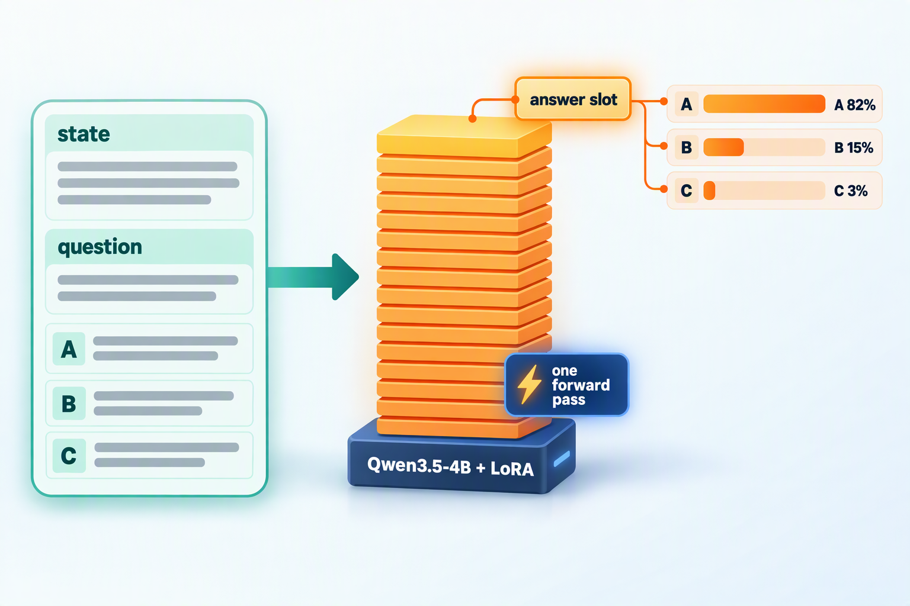
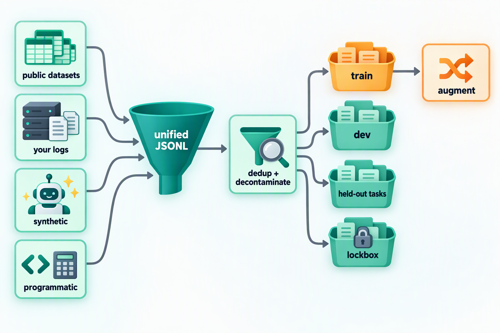
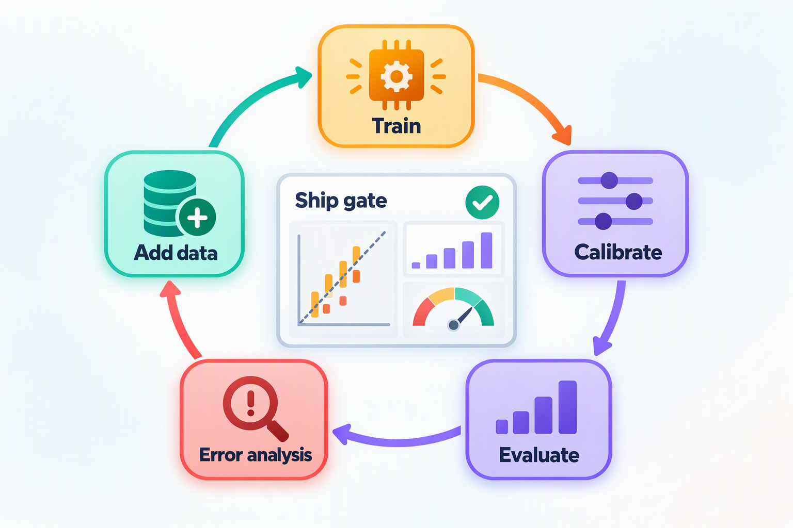

## Introduction

Over the past month I've written two articles on decision models: [Jev vs Laya](/en/blog/2026/jev-vs-laya/) compared the closed-source Jev with the open-source Laya, and [Microsoft-Decision-1 Explained](/en/blog/2026/microsoft-decision-1/) added Microsoft to the picture. The question I've been asked most since then is: **can I train one myself?**

Yes, you can, and the bar is lower than you might think. Just look at the third-party leaderboard JevBench: as of mid-October, its open-weights board ranks more than 160 systems, the vast majority built by the community and small teams. The ones at the top aren't mysterious either: H2O-Lightning-4B, first on the composite score, is a fine-tune of Alibaba's open-source Qwen3.5-4B; Quyet-1.0-Large, first on the capability score, is Gemma-4-31B plus an adapter; and Microsoft's own Microsoft-Decision-1 is also built on the open-source Qwen3.5-9B.

That tells us something: **the competitive edge of a decision model lies not in its architecture but in its data, its training objective, and its evaluation system.** All three are within reach of an ordinary team.

This article walks through the whole process of training "your own Jev" in the order of a real project:

1. Principles: what a decision model actually learns, and why the training objective must be a "strictly proper scoring rule"
2. Data: where to find it, and how to unify, clean, augment, and split it
3. Compute: how much GPU memory, how many GPU hours, and how much money
4. Base model: how to choose one
5. Training: writing a ready-to-run LoRA training script from scratch
6. Evaluation: which metrics to use, and how to compare with the models on JevBench
7. Tuning: what to try when the scores disappoint

I actually ran every script in this article on Qwen3.5-0.8B (CPU smoke tests, only to verify that the code is correct). All leaderboard and model figures come from public sources, linked at the end.

## Part 1: What Does a Decision Model Actually Learn?

### 1. At Its Core, a Conditional Probability

First, a quick recap of the decision-model interface: the caller provides a piece of state and a question whose candidate answers are defined in advance, and the model returns a probability for each candidate. All three question primitives boil down to the same thing:

| Primitive | Candidate answers | What it really is |
| --- | --- | --- |
| `choice` | K options defined by the caller | K-way classification |
| `noul` | Yes / no | Binary classification |
| `score` | K ordered levels | Ordinal K-way classification |

So training a decision model means teaching it to estimate `P(option | state, question)`. Compared with an ordinary text classifier, there are two key differences:

* **The classes are not fixed**: every request comes with different questions and options, so the model has to understand what the options mean instead of memorizing a fixed label set. That's why it needs zero-shot generalization.
* **The probability is the product**: downstream code branches directly on the probabilities, so they must be "honest", that is, calibrated. This drives the choice of training objective, covered in detail below.

### 2. Three Technical Approaches

Community projects roughly fall into three camps:

| Approach | Examples | How it works | Pros | Cons |
| --- | --- | --- | --- | --- |
| Encoder + decision head | Laya | Puts a `[MASK]` in front of every option, runs a bidirectional encoder, and scores the hidden states at those positions | Extremely fast: 400M parameters, 33–40 ms per question on a T4 | Weak zero-shot ability, short context, must be fine-tuned for each task |
| Decoder + option letters | Quyet-1.0-Large, H2O-Lightning-4B | Labels the options A, B, C, …; after reading the prompt, the model takes the next-token probabilities of those letters | Reuses the LLM's knowledge and its language-model head; strong zero-shot ability | Large; the number of options is limited by how many single-token labels exist |
| Decoder + decision head | jiwo, ClassOne | Feeds the decoder's hidden states into a separately trained scoring head | More flexible in option count and output format | The head is trained from scratch, so it depends more on data |

The JevBench data sends a clear signal:

* The encoder-based systems all score in the single digits on zero-shot intelligence (Laya 1.8, modernbert-jev v2 2.6, open-jev-deberta-v3-large 2.8), barely better than random guessing;
* Reading the logits of Qwen3-4B-Instruct-2507 directly, without any decision fine-tuning, already scores 34.0;
* H2O-Lightning-4B, decision-tuned on Qwen3.5-4B, reaches 60.0, close to Jev 1.13.0's 63.6;
* The larger Gemma-4-31B base (Quyet-1.0-Large) reaches 73.4.

The conclusion is clear: **if you want a "zero-shot generalist" like Jev, take the decoder route.** The knowledge an LLM picks up in pre-training is the source of its zero-shot ability, and decision fine-tuning "aligns" that knowledge with option probabilities. If you only serve one or two fixed tasks, have extreme latency requirements, and have plenty of labeled data, an encoder like Laya is still the most cost-effective choice.

This article follows the second approach: **decoder + option letters**. Inference works like this:



1. Combine the state, the question, and the letter-labeled options into a chat prompt that ends where the assistant's reply begins;
2. Run one forward pass through the model (prefill only, no token-by-token generation);
3. At the last position (the answer slot), take the logits of the letter tokens A, B, C, …, apply softmax over just those K logits, and get a probability for each option.

The H2O-Lightning-4B model card sums this up as "one forward pass and one output token". Since no text is generated, the cost is almost entirely input tokens; and since the output space is limited to K letters, the model cannot answer anything outside the options. This route has one more built-in advantage: the letter probabilities a large model gives in a multiple-choice format are already reasonably well calibrated (Kadavath et al., 2022), so decision fine-tuning starts from a good place.

### 3. The Training Objective: Why It Must Be a Strictly Proper Scoring Rule

The probabilities a decision model outputs go straight into a program's branches, so we need more than right answers; we also need **calibration**: among all the answers given with 80% confidence, about 80% should actually be right.

**The first trap: rewarding only correct answers destroys calibration.** Suppose the true distribution for a question is p (say, 70% A and 30% B) and the model reports a distribution q. If we treat the model as a policy that samples an answer from q and earns 1 point for a correct one, the expected reward is `Σ p_k · q_k`. That's linear in q, so the optimum puts all the probability on the most likely option, that is, sets the probability of A to 1. The model learns to be "always 100% sure": accuracy stays the same, but the probabilities become meaningless.

**The fix is to use a strictly proper scoring rule as the objective.** By definition, the expected score is maximized only when the reported distribution q equals the true distribution p, so telling the truth is the only optimal strategy (see Gneiting and Raftery's 2007 paper for the classic treatment). Four rules are common:

```
Let q = (q_1, …, q_K) be the model's distribution and y the label (one-hot or soft)

Log score (higher is better)           S_log(q, y) = Σ y_k · log q_k            the negative cross-entropy
Brier score (lower is better)          B(q, y)     = Σ (q_k − y_k)²
Spherical score (higher is better)     S_sph(q, y) = Σ y_k · q_k / ‖q‖          between 0 and 1, gentler gradients than the log score
Ranked probability score (lower)       RPS(q, y)   = Σ (Q_i − Y_i)² / (K − 1)   Q, Y are cumulative distributions; for ordinal score questions
```

Here's a fact that's often overlooked: **cross-entropy is itself strictly proper** (it *is* the log score). So why are neural networks trained with cross-entropy so often overconfident? The cause is not the loss but the finite training data: the model memorizes the training examples and pushes their probabilities toward 1, so on unseen data its confidence exceeds its actual accuracy (Guo et al.'s 2017 paper analyzes this systematically). That leaves two things to do:

1. **During training**: use a strictly proper scoring rule as the objective; when the labels themselves are uncertain (annotators disagree, teacher models split their votes), use soft labels instead of one-hot ones so the model learns to be "honestly uncertain"; and don't train for too many epochs.
2. **After training**: apply **temperature scaling** on a held-out dev set, `p = softmax(z / T)`, fitting one temperature T per question type. It doesn't change the ranking, so accuracy is unaffected; it only corrects the confidence.


Temperature scaling often makes a big difference. After refitting temperatures per "question type × option count", Laya's shipped checkpoints dropped their mean ECE (expected calibration error) from 0.466 to 0.081. H2O-Lightning-4B, on the other hand, ships temperatures of 0.75 for choice, 0.8 for noul, and 0.65 for score, all below 1, which means its raw outputs are actually on the cautious side and need "sharpening". The direction differs from model to model; you have to measure it rather than guess.

### 4. RLCD: The Reinforcement Learning Recipe Laya Published

Jev calls its training method RLCD (Reinforcement Learning for Calibrated Decisions) but hasn't disclosed the details. Laya adopted the name and published a concrete implementation:

* **Reward**: a combination of three strictly proper scores, `Reward = S_log + 0.5 × S_sph − RPS`, where RPS only applies to ordinal score questions;
* **Exploration**: for each question, 8 sets of Gaussian noise are added to the logits (the noise is centered across the options, because adding the same constant to all logits doesn't change the softmax), with the standard deviation decaying from 1.0 to 0.3;
* **Advantage**: the 8 rewards minus the group mean, divided by the group standard deviation, the same idea as GRPO's group baseline (for how GRPO works, see my earlier [PPO vs GRPO](/en/blog/2026/ppo-vs-grpo/));
* **Update**: a REINFORCE-style policy gradient using the Gaussian log-density, with no cross-entropy loss at all.

My take: **when the model outputs the full probability distribution, the scoring rule itself is differentiable. Taking its gradient directly (that is, using the scoring rule as the loss) and estimating that gradient with reinforcement learning point in the same direction in expectation, and the former has lower variance and is simpler.** The RL formulation becomes truly irreplaceable when the reward can't be differentiated with respect to the output: for example, when it comes from whether a multi-step agent task eventually succeeds, from real user feedback, or from the multi-turn sales conversations Laya handles, where the reward is whether the deal finally closes and TD(λ) is needed to spread that outcome over the turns.

To test this, I ran two small experiments with the `reward()` function from the training script later in this article. First, with the target distribution set to [0.7, 0.2, 0.1], gradient ascent on the combined score converged to an output distribution of exactly [0.7, 0.2, 0.1], confirming that the combined score really "only rewards the truth". Second, for the same set of logits, the gradient estimated the RLCD way (20,000 perturbations, σ = 0.05) pointed in almost exactly the same direction as the gradient from direct differentiation (cosine similarity 0.999).

So the training script in this article supports both: by default it optimizes the scoring rule directly (`--objective proper`), and you can switch to Laya-style RLCD (`--objective rlcd`) to compare for yourself.

### 5. From Probabilities to Actions: Costs Set the Threshold

Once the probabilities are calibrated, you no longer have to guess when to act automatically and when to hand off to a human. Laya designed a cost matrix for its Act / Escalate head: +1 for a correct action, −3 for a wrong one, and −0.5 for escalating to a human. The expected payoff of acting is `p × 1 + (1 − p) × (−3)`, which beats −0.5 exactly when `p > 0.625`. In general:

```
act threshold = (payoff of escalating − payoff of a wrong action) / (payoff of a right action − payoff of a wrong action)
              = (−0.5 − (−3)) / (1 − (−3)) = 0.625
```

As long as the probabilities are calibrated, this threshold falls straight out of the business costs, and a separately trained "should I act?" head isn't really necessary (Laya's README admits that its Act head currently carries almost no signal and recommends gating on confidence instead). H2O-Lightning-4B reports what thresholds do in practice on 3,474 held-out questions:

| Confidence threshold | Escalated | Accuracy on the rest | Passed but wrong (share of all questions) |
| --- | --- | --- | --- |
| None | 0% | About 83% | About 17% |
| 0.8 | 37.7% | 95.8% | 2.6% |
| 0.9 | 53.1% | 98.5% | 0.7% |

This is exactly the table you'll want to produce for your own model once it's trained.

### 6. The Whole Workflow at a Glance

Put into engineering terms, a complete training project looks roughly like this loop:

```
① Define the questions and acceptance criteria: metrics, thresholds, ship gates; write them down before seeing results
        │
② Find data → unify the format → dedupe and decontaminate → split by task
        │
③ Zero-shot baseline: read the base model's option-letter probabilities to know where you start
        │
④ LoRA fine-tuning: shuffled options + a strictly proper scoring rule (or RLCD)
        │
⑤ Fit temperatures on dev; score on held-out tasks, the public set, and a private lockbox
        │
⑥ Error analysis by slice → add data → back to ④
        │
⑦ Merge the weights, serve behind /v1/systemone, roll out gradually, keep monitoring
```

The rest of the article follows this order.

## Part 2: Data — Where to Find It and How to Prepare It

Data sets the ceiling of a decision model. Almost every lesson the H2O-Lightning-4B model card lists is about data: keep a sealed evaluation set that never touches training, write the ship criteria down before seeing results, dedupe the training data against every evaluation set (both exact and near duplicates), hunt for gaps by topic and question type and fill them with new data, and take labels only from human annotation or from agreement among several independent strong models.

### 1. Where the Data Comes From

| Source | Examples | Pros | Caveats |
| --- | --- | --- | --- |
| Public human-labeled datasets | Intent: Banking77, CLINC150, MASSIVE (51 languages); topic: AG News, TNEWS; reasoning: BoolQ, MNLI, XNLI, OCNLI; sentiment and rating: SST-5, Yelp review stars, HelpSteer2; safety: toxicity detection, prompt injection | Reliable labels, large volume, broad coverage | Check every license, since many academic datasets are research-only; formats vary and must be rewritten as decision questions |
| Your own business data | Tickets, emails, review records, agent execution logs, plus human-reviewed outcomes | Matches the production distribution; the most valuable | Anonymize it; early labels can be noisy and need spot checks |
| Synthetic data | Generate states and questions in bulk with an open-source LLM, have several independent models answer them, and keep only the items they agree on, or use the vote shares as soft labels | Quickly fills long-tail scenarios and weak spots | Label with a single model and you learn that model's mistakes; some commercial APIs' terms forbid using their outputs to train competing models, so check first |
| Programmatically generated, verifiable data | Date arithmetic, counting, rule checks (e.g., "reject if the amount exceeds the threshold and there is no approval"), state tracking in games and simulations | Labels are computed by code: 100% correct, unlimited volume | Items tend to look templated; vary the wording and structure a lot |

A few lessons worth borrowing:

* **Laya insists on "zero synthetic data"**: all of its training data comes from human-labeled public datasets (support intents, natural language inference, content safety, jailbreaks and injections, rubric ratings, multi-turn conversation outcomes, and more). The reasoning: training a calibration model on model-generated labels only calibrates it to the "teacher's" mistakes.
* **H2O-Lightning-4B's data mix**: by use case, documents, policies, and rules 37%; numbers, dates, and probability 22%; games and simulations 12%; everyday language and knowledge 10%; support and operations 10%; safety and guardrails 7%; coding and tool calls 2%. By question type, choice 54%, noul 29%, score 16%. Over 99% of it is English. Training ran in three stages: broad coverage first, then a focus on long documents and numeric reasoning, and finally everything mixed back together.
* **Task diversity matters more than per-task volume**: the FLAN line of research found that the more kinds of tasks instruction tuning covers, the better models do on unseen tasks, and the same holds for decision models. For the same total amount of data, covering more distinct tasks usually helps zero-shot generalization more than piling up examples on a few.

If you're building a specialist for one vertical domain, a few thousand to a few tens of thousands of high-quality labels already make a clear difference: Laya's typed-decisions checkpoint was fine-tuned on about 30,000 questions and went from 0.362 to 0.766 accuracy, and a community member fine-tuned Laya on a single 16 GB GPU into the action decider of a browser agent, raising the rate of picking the right target among about 45 candidate elements from 0.10 to 0.66.

### 2. A Unified Data Format

I recommend reusing Jev's request format directly, with one decision per line:

```json
{"task": "ticket_routing", "state": "Checkout returns HTTP 500 for every customer since 09:10.",
 "question": {"type": "choice", "instructions": "Which team should handle this ticket?",
              "criteria": {"billing": "Charges, invoices and refunds",
                           "engineering": "Bugs, errors and outages",
                           "support": "How-to and account questions"}},
 "answer": "engineering"}
{"task": "refund_check", "state": {"subject": "Charged twice", "body": "Please refund the duplicate."},
 "question": {"type": "noul", "instructions": "Does the customer ask for a refund?",
              "criteria": {"true": "yes, a refund is requested", "false": "no refund is requested"}},
 "answer": true}
{"task": "urgency", "state": "Payroll export fails and payroll runs today.",
 "question": {"type": "score", "instructions": "How urgent is this request?",
              "criteria": ["not urgent", "soon", "today", "blocking right now"]},
 "answer": 2}
{"task": "intent_soft", "state": "I was billed twice and the app keeps crashing.",
 "question": {"type": "choice", "instructions": "What is the main topic?",
              "criteria": {"billing": "payments", "technical": "bugs"}},
 "target": {"billing": 0.6, "technical": 0.4}}
```

A few conventions:

* The example is wrapped for readability; in the actual file each record sits on one line (JSONL);
* `answer` is the option name for choice, a boolean for noul, and the level index for score; samples with inherent uncertainty use `target` to give a soft label;
* The `task` field records which task a sample comes from; splitting and slice analysis both rely on it;
* This format is almost identical to that of JevBench's public items (which store the answer in an `expected` field), so the evaluation script later in the article can read JevBench's public items directly.

### 3. Cleaning and Augmentation

**Cleaning** comes down to three things:

1. **Deduplication**: do exact deduplication after normalization first, then near-duplicate removal with something like MinHash, so the same record doesn't show up several times with different punctuation;
2. **Decontamination**: compare every evaluation set (your lockbox, JevBench's public items, and so on) with the training set and remove any overlap from training. JevBench requires models trained on its public items to disclose it, and models that score much better on the public items than on the sealed ones get penalized, so "gaming" the public items is pointless;
3. **Balancing**: cap each task so no big dataset dominates training, and control the mix of question types, languages, and option counts.

**Augmentation** aims to teach the model to "read the content, not the form":

| Augmentation | What it guards against |
| --- | --- |
| Shuffle the option order every time | Position bias: Laya measured that 5 options with identical text get logits ranging from +1.68 down to −1.91 purely because of where they sit |
| Rephrase the question; switch option names between meaningful words and neutral labels | Keying on keywords, or being swayed by option names like `yes` and `true` |
| Switch the state between plain text and nested JSON; use synonyms for field names | Only recognizing one input format |
| Add irrelevant fields and distracting paragraphs to the state | Attention being diluted by irrelevant content |
| Add a "cannot tell" option and build samples with insufficient information | Being forced to pick even when information is missing |
| Build negated question pairs: ask Q and "not Q" about the same state | The two probabilities not summing to 1 |
| Inject prompt-injection text into the state while keeping the label | Being hijacked by instructions inside the state |
| Sample "the correct answer + a few distractors" from a large option set | A single fixed option count; this also solves having more options than letters |

Mind the order: **split first, then augment**, and augment only the training set. Otherwise variants of the same question end up in both the training and the evaluation sets, and the evaluation scores are inflated.



### 4. Splitting: Always Hold Out Whole Tasks

The most important ability of a decision model is generalizing to questions it hasn't seen, so evaluation needs several layers:

| Evaluation set | How it's built | What it tells you |
| --- | --- | --- |
| dev | About 5% randomly held out from the training tasks | Whether training converges; used to fit temperatures |
| held-out tasks | Entire tasks excluded from training | Zero-shot generalization, the closest match to how Jev is used |
| Public benchmark | JevBench's 231 public items | Head-to-head comparison with other models |
| lockbox | Questions you wrote yourself and never use for tuning | A one-time acceptance test before release, guarding against overfitting to your evaluation sets |

In a real project, each question type should have several tasks, so that after you hold out whole tasks, the training set still contains other tasks of the same type.

Below is a minimal data preparation script. It turns four public datasets into decision questions: Banking77 (intent, choice), BoolQ (yes/no, noul), SST-5 (sentiment, score), and OCNLI (Chinese natural language inference, choice). It then dedupes and decontaminates them and splits them by task:

```python
# prepare_data.py
"""Turn a few public datasets into decision records, remove duplicates and eval overlap, split by task."""
import hashlib
import json
import random
from pathlib import Path

from datasets import load_dataset

random.seed(13)
SST5_LEVELS = ["very negative", "negative", "neutral", "positive", "very positive"]
OCNLI = {"entailment": "前提为真时，假设一定为真",
         "neutral": "前提为真时，假设可能为真也可能为假",
         "contradiction": "前提为真时，假设一定为假"}


def banking77():
    ds = load_dataset("mteb/banking77", split="train")
    intents = sorted(set(ds["label_text"]))
    for row in ds:
        # 77 intents do not fit 26 letters: show the gold intent among 9 random distractors
        shown = random.sample([i for i in intents if i != row["label_text"]], 9) + [row["label_text"]]
        random.shuffle(shown)
        yield {"task": "banking77", "state": row["text"],
               "question": {"type": "choice",
                            "instructions": "Which banking intent does the customer's message express?",
                            "criteria": {i: i.replace("_", " ") for i in shown}},
               "answer": row["label_text"]}


def boolq():
    for row in load_dataset("google/boolq", split="train"):
        yield {"task": "boolq", "state": row["passage"],
               "question": {"type": "noul", "instructions": row["question"].capitalize() + "?",
                            "criteria": {"true": "yes, according to the passage",
                                         "false": "no, according to the passage"}},
               "answer": row["answer"]}


def sst5():
    for row in load_dataset("SetFit/sst5", split="train"):
        yield {"task": "sst5", "state": row["text"],
               "question": {"type": "score", "instructions": "How positive is this movie review?",
                            "criteria": SST5_LEVELS},
               "answer": row["label"]}


def ocnli():
    ds = load_dataset("clue/clue", "ocnli", split="train")
    names = ds.features["label"].names
    for row in ds:
        if row["label"] >= 0:  # -1 marks unlabeled rows
            yield {"task": "ocnli", "state": {"前提": row["sentence1"], "假设": row["sentence2"]},
                   "question": {"type": "choice", "instructions": "假设和前提是什么关系？", "criteria": OCNLI},
                   "answer": names[row["label"]]}


def key(record):
    text = json.dumps([record["state"], record["question"]["instructions"]], ensure_ascii=False)
    return hashlib.sha1(" ".join(text.lower().split()).encode()).hexdigest()


def write(path, rows):
    with open(path, "w", encoding="utf-8") as f:
        f.writelines(json.dumps(r, ensure_ascii=False) + "\n" for r in rows)


def main():
    held_out_tasks = {"banking77"}  # whole tasks never trained on (choice is still covered by ocnli)
    banned = {key(json.loads(line)) for p in Path("eval").glob("*.jsonl")
              for line in open(p, encoding="utf-8")}  # JevBench public files, your lockbox, ...
    seen, train, dev, held_out = set(), [], [], []
    for source in (banking77, boolq, sst5, ocnli):
        rows = list(source())
        random.shuffle(rows)
        for r in rows[:20000]:  # cap every task so no single dataset dominates the mix
            k = key(r)
            if k in seen or k in banned:
                continue
            seen.add(k)
            if r["task"] in held_out_tasks:
                held_out.append(r)
            elif random.random() < 0.05:
                dev.append(r)
            else:
                train.append(r)
    random.shuffle(train)
    Path("data").mkdir(exist_ok=True)
    write("data/train.jsonl", train)
    write("data/dev.jsonl", dev)
    write("data/heldout_tasks.jsonl", held_out)
    print(f"train {len(train)}  dev {len(dev)}  held-out tasks {len(held_out)}")


if __name__ == "__main__":
    main()
```

Put JevBench's public files and your own lockbox in the `eval/` directory and run it to get three files under `data/`. My run produced 36,044 training records, 1,917 dev records, and 9,993 held-out-task records (Banking77). This is only a demo; a real project needs dozens to hundreds of tasks, but the process is exactly the same: **every new data source is just one more conversion function like these.**

## Part 3: GPU Resources — How Many Cards Do You Need?

### 1. Estimating Memory

Training memory has three main parts: model weights, gradients plus optimizer state, and activations. The first two can be estimated in "bytes per parameter":

| Training method | Per parameter | Breakdown |
| --- | --- | --- |
| Full fine-tuning | 16 bytes | bf16 weights 2 + bf16 gradients 2 + fp32 master weights 4 + AdamW's two moments 8 |
| LoRA | 2 bytes | Frozen bf16 weights; the adapter and its optimizer state usually take under 1 GB |
| QLoRA | 0.5–0.6 bytes | Frozen 4-bit weights |

By this rule, the memory needed before activations is roughly:

| Base model | Full fine-tuning | LoRA | QLoRA |
| --- | --- | --- | --- |
| Qwen3.5-0.8B | About 13 GB | About 1.6 GB | About 0.5 GB |
| Qwen3.5-2B | About 32 GB | About 4 GB | About 1.1 GB |
| Qwen3.5-4B | About 64 GB | About 8 GB | About 2.2 GB |
| Qwen3.5-9B | About 144 GB | About 18 GB | About 5 GB |
| Gemma-4-31B | About 500 GB | About 62 GB | About 17 GB |

Activations scale with batch size and sequence length. With gradient checkpointing on, what remains is mostly the hidden states at each layer boundary. Taking Qwen3.5-4B (32 layers, hidden size 2560) as an example, one 4K-token sample needs about `32 × 4096 × 2560 × 2 bytes ≈ 0.7 GB`, or about 3 GB for a batch of 4, plus the peak from recomputing a single layer and CUDA's own overhead. So **a single 24 GB card can usually handle LoRA on a 4B model** (with sequences under 4K and a modest batch), while an 80 GB card lets you raise both the batch size and the sequence length.

There's a big trap specific to decision models here: **the language-model head's logits**. Qwen3.5 has a vocabulary of 248,320 tokens. If you compute logits at every position as in ordinary SFT, the fp32 logits of a single 4K-token sample alone take `4096 × 248320 × 4 bytes ≈ 4 GB`, plus another copy during backpropagation. A decision model only needs the logits at the last position, so passing `logits_to_keep=1` in the forward pass shrinks this to about 1 MB. The training script below does exactly that.

### 2. Estimating Time

Training compute can be estimated with a rule of thumb: about `6 × number of parameters` floating-point operations per training token (LoRA with gradient checkpointing: 2N forward, 2N recompute, 2N backward; full fine-tuning with gradient checkpointing is about 8N). For example, LoRA on Qwen3.5-4B with 200,000 questions averaging 600 tokens each, trained for 2 epochs:

```
Training tokens    ≈ 200,000 × 600 × 2 = 2.4e8
Training compute   ≈ 6 × 4e9 × 2.4e8 ≈ 5.8e18 FLOPs
H100 throughput    ≈ 989 TFLOPS (bf16 dense peak) × 35% utilization ≈ 350 TFLOPS
Training time      ≈ 5.8e18 / 3.5e14 ≈ 16,500 s ≈ 4.6 hours
```

The same job takes about 3 times as long on an A100. Actual utilization depends on sequence length, padding ratio, and kernel implementations, so trust your own profiler numbers. Qwen3.5 is a hybrid of Gated DeltaNet linear attention and gated full attention, so be sure to install `flash-linear-attention` and `causal-conv1d` before training; otherwise it falls back to a pure PyTorch implementation that is much slower (a warning is printed when the model loads).

### 3. Recommended Setups


| Scenario | Base model and method | Recommended hardware | Notes |
| --- | --- | --- | --- |
| Encoder route | ModernBERT-large / mmBERT + decision head | 2 T4s (Kaggle's free tier) or any 16 GB GPU | Laya's official notebook: about 30,000 questions, 4 epochs, 4–5 hours |
| Quick validation | Qwen3.5-0.8B / 2B + LoRA | One 24 GB GPU (RTX 4090, L4, A10) | Get the pipeline working and run data experiments |
| Main setup | Qwen3.5-4B + LoRA | One H100 / A100 80 GB | The best value; 24 GB also works with short sequences |
| Advanced | Qwen3.5-9B + LoRA | 1–2 H100s | Use 2 for long-context training |
| Full fine-tuning | 4B–9B, all parameters | 8 H100s (FSDP or ZeRO-3) | When you have lots of data and want every last bit of quality |

As for cost, at an on-demand H100 price of $2–3 per hour (JevBench's GPU cost calculator defaults to $2.89 per hour for an H100 PCIe), one LoRA run on a 4B model costs about $15. The real spending is in iteration: a project usually goes through dozens of "change the data, retrain, evaluate" rounds, so the total GPU bill is on the order of a few hundred dollars. **Compute isn't the expensive part; data and evaluation are.**

Deployment is even cheaper. H2O-Lightning-4B's bf16 weights are about 9.1 GB; served with vLLM on a single 32 GB RTX PRO 4500, a standard decision takes about 30 ms at p50. JevBench's calculator estimates that self-hosting it on an RTX 5090 costs about $0.008 per 1,000 decisions, roughly a quarter of Jev's measured cost on JevBench ($0.032 per 1,000 decisions).

## Part 4: Choosing a Base Model

### 1. Selection Criteria

1. **Zero-shot foundation**: prefer instruct versions (aligned chat models); they already know how to answer multiple-choice questions and start higher, while base versions need more data to catch up. JevBench includes a few "base model controls" (no decision fine-tuning, raw logits) that show directly where different base models start.
2. **Language**: for Chinese workloads, look at Qwen first; note that over 99% of H2O-Lightning-4B's training data is English, so test it yourself before using it on Chinese.
3. **Size and latency**: decision models are meant to make quick calls in tens of milliseconds, and around 4B is currently the sweet spot for latency, cost, and capability.
4. **Context length**: JevBench includes 23 extra-long items of 77,000–81,000 tokens; Jev and quite a few other models refuse them for exceeding their context, and they're scored as wrong. Qwen3.5 natively supports 262K, but the longer the sequences, the faster training memory and time climb.
5. **License**: the whole Qwen3.5 family, Gemma 4, and ModernBERT are Apache 2.0, and mmBERT is MIT, which keeps commercial use simple.
6. **Ecosystem**: training needs Transformers and PEFT support, and deployment needs vLLM, SGLang, and llama.cpp support. Also, each option letter must be a single token (the training script asserts this).

### 2. Candidates

| Base model | Size | License | Good for | Community examples |
| --- | --- | --- | --- | --- |
| Qwen3.5-0.8B / 2B | 0.8B / 2B | Apache 2.0 | On-device use, ultra-low latency, pipeline validation | jiwo 0.8b, ClassOne Qwen 3.5 2B |
| Qwen3.5-4B | 4B | Apache 2.0 | The main recommendation; strong in Chinese | H2O-Lightning-4B, Kahn1 4B |
| Qwen3.5-9B | 9B | Apache 2.0 | Stronger zero-shot ability | Microsoft-Decision-1, ClassOne Qwen 3.5 9B |
| Gemma-4-12B-it | 12B | Apache 2.0 | Multilingual; balances capability and cost | decider-12b, torchcast-decision-12b |
| Gemma-4-31B-it / Qwen3.5-27B | 27B–31B | Apache 2.0 | Aiming for the top of the leaderboard | Quyet-1.0-Large, deck-31B |
| ModernBERT-large / mmBERT | 0.3B–0.4B | Apache 2.0 / MIT | Encoder route; ultra-fast inference for a single task | Laya |

### 3. My Recommendations

* **Start with Qwen3.5-4B (instruct) + LoRA**: it's strong in Chinese, the community has shown it can get close to Jev, and a single GPU is enough to train and serve it;
* **Get the pipeline working on 0.8B / 2B first**: validate the data format, evaluation scripts, and threshold strategy on a small model before moving to a larger base; it saves a lot of trial and error;
* **Move up to 9B–31B only when you're chasing a higher capability score**: the gains are real (Quyet-1.0-Large's intelligence score is more than 13 points above H2O-Lightning-4B's), but training and inference costs multiply too;
* **Turn off thinking mode for Qwen3.5**: it thinks before answering by default, so pass `enable_thinking=False` when building the prompt; the first token of the assistant's reply is then the answer letter.

## Part 5: Writing the Training Scripts, Step by Step

This part gives a complete, ready-to-run set of code. It's deliberately lean and doesn't depend on any dedicated training framework, so you can follow what every step does.

### 1. Setting Up the Environment

```bash
pip install torch transformers peft accelerate datasets fastapi uvicorn
# On GPU machines, also install the fast kernels for Qwen3.5's linear-attention layers
pip install flash-linear-attention causal-conv1d
```

The project layout:

```
my-jev/
├── prepare_data.py      # data preparation (previous part)
├── decision_format.py   # prompt rendering and single-pass scoring, shared by training, evaluation, and serving
├── train.py             # LoRA training
├── evaluate.py          # scoring and temperature fitting
├── serve.py             # /v1/systemone server
├── eval/                # JevBench public items and your own lockbox
└── data/                # output of prepare_data.py
```

### 2. The Shared Module: One Question, One Forward Pass

Training, evaluation, and online serving must use **exactly the same** prompt format; otherwise the probabilities you trained won't hold up in production. So this part goes into a shared module first:

```python
# decision_format.py
"""Shared by training, evaluation and serving: render a decision as a prompt and read option probabilities."""
import json
import string

import torch
from transformers import AutoModelForCausalLM, AutoTokenizer

LETTERS = string.ascii_uppercase  # up to 26 options per question
SYSTEM = ("You are a decision model. Read the state and the question, "
          "then answer with the letter of exactly one option.")


def load(base, dtype=torch.bfloat16):
    tok = AutoTokenizer.from_pretrained(base)
    tok.padding_side = "left"  # every row then ends at its answer slot
    model = AutoModelForCausalLM.from_pretrained(base, dtype=dtype)  # Qwen3.5 loads text-only here
    ids = [tok.encode(c, add_special_tokens=False) for c in LETTERS]
    assert all(len(i) == 1 for i in ids), "every option letter must be a single token"
    return tok, model, torch.tensor([i[0] for i in ids])


def options(question):
    """[(key, description)] in the caller's order; noul is shown as yes / no."""
    kind, crit = question["type"], question.get("criteria")
    if kind == "noul":
        crit = crit or {}
        return [("yes", crit.get("true", "")), ("no", crit.get("false", ""))]
    if kind == "score":
        return [(str(i), desc) for i, desc in enumerate(crit)]
    return list(crit.items()) if isinstance(crit, dict) else [(c, "") for c in crit]


def target(record, opts):
    """Target distribution over opts: a soft label if the record has one, else one-hot."""
    keys = [k for k, _ in opts]
    if "target" in record:  # e.g. {"billing": 0.7, "technical": 0.3}
        dist = [float(record["target"].get(k, 0.0)) for k in keys]
    else:
        ans = record.get("answer", record.get("expected"))
        if record["question"]["type"] == "noul":
            ans = "yes" if ans in (True, "yes", "true") else "no"
        dist = [1.0 if k == str(ans) else 0.0 for k in keys]
    if sum(dist) <= 0:
        raise ValueError(f"answer is not one of the options: {record.get('id', record['question'])}")
    return [d / sum(dist) for d in dist]


def prompt(tok, record, order, max_state_tokens=6000):
    """Chat prompt whose next token is the answer letter; slot s shows option order[s]."""
    q, opts, state = record["question"], options(record["question"]), record["state"]
    if not isinstance(state, str):
        state = json.dumps(state, ensure_ascii=False, indent=1)
    ids = tok.encode(state, add_special_tokens=False)
    if len(ids) > max_state_tokens:  # cut the state, never the options or the answer slot
        state = tok.decode(ids[:max_state_tokens]) + "\n[truncated]"
    lines = [f"{LETTERS[s]}. {opts[i][0]}" + (f": {opts[i][1]}" if opts[i][1] else "")
             for s, i in enumerate(order)]
    user = (f"<state>\n{state}\n</state>\n\nQuestion ({q['type']}): {q['instructions']}\n"
            "Options:\n" + "\n".join(lines) + "\n\nAnswer with the letter of one option.")
    messages = [{"role": "system", "content": SYSTEM}, {"role": "user", "content": user}]
    return tok.apply_chat_template(messages, tokenize=False, add_generation_prompt=True,
                                   enable_thinking=False)


def option_logits(model, tok, letter_ids, prompts, ks, device):
    """One forward pass for a batch: logits of the shown option letters at the answer slot."""
    enc = tok(prompts, return_tensors="pt", padding=True, add_special_tokens=False).to(device)
    out = model(input_ids=enc.input_ids, attention_mask=enc.attention_mask, logits_to_keep=1)
    z = out.logits[:, -1, letter_ids[: max(ks)].to(device)].float()
    mask = torch.arange(z.shape[1], device=device)[None, :] < torch.tensor(ks, device=device)[:, None]
    return z.masked_fill(~mask, -1e4), mask
```

Key points:

* **Left padding**: prompts in a batch have different lengths; after padding on the left, the last position of every row is the answer slot, so with `logits_to_keep=1` the language-model head only computes one position. Because Qwen3.5 has linear-attention layers, I checked this specifically: scoring a question on its own versus inside a left-padded batch changes the logits by at most 6×10⁻⁵;
* **Loading only the text part**: Qwen3.5 is natively multimodal, but loading it with `AutoModelForCausalLM` gives you the text-only `Qwen3_5ForCausalLM` without the vision encoder, which saves memory and keeps LoRA off the vision layers;
* **Softmax over just the K letters**: the code takes the logits for A, B, C, … and fills the unused slots with a very small value, so the output always lands on a valid option;
* **Truncate only the state when it's too long**: the question, the options, and the answer slot must stay intact;
* **noul is always rendered as two options, "yes / no"**, and the returned P(yes) is the noul answer; score levels stay in order, which RPS needs;
* **Assert that every letter is a single token**: when you switch base models, this line catches problems immediately. In the Qwen3.5 tokenizer, A through Z are all single tokens, and appending a letter at the answer slot adds exactly one token.

### 3. The Main Training Script

```python
# train.py
"""LoRA fine-tuning of a decision model with strictly proper scoring rules, or Laya-style RLCD."""
import argparse
import json
import math
import random

import torch
from accelerate import Accelerator
from peft import LoraConfig, get_peft_model
from torch.utils.data import DataLoader
from transformers import get_cosine_schedule_with_warmup

from decision_format import load, option_logits, options, prompt, target


def reward(z, mask, y, ordinal):
    """Laya's composite of strictly proper scores: log + 0.5 * spherical - RPS (RPS for score only)."""
    logq = z.log_softmax(-1)
    q = logq.exp()
    s_log = (y * logq).sum(-1)                      # log score = minus cross-entropy
    s_sph = (y * q).sum(-1) / q.norm(dim=-1)        # spherical score, bounded in [0, 1]
    k = mask.sum(-1).clamp(min=2)
    rps = ((q.cumsum(-1) - y.cumsum(-1)) ** 2).sum(-1) / (k - 1)  # ranked probability score
    return s_log + 0.5 * s_sph - ordinal * rps


def rlcd_loss(z, mask, y, ordinal, sigma, group=8):
    """Policy gradient over Gaussian-perturbed logits with a group-mean baseline, as Laya describes RLCD."""
    m = mask.float()
    eps = torch.randn(group, *z.shape, device=z.device) * m
    eps = (eps - eps.sum(-1, keepdim=True) / m.sum(-1, keepdim=True)) * m  # softmax ignores a common shift
    sample = z.detach() + eps
    with torch.no_grad():
        r = reward(sample, mask, y, ordinal)            # [group, batch]
        adv = (r - r.mean(0)) / (r.std(0) + 1e-6)
    logp = -(((sample - z) ** 2) * m).sum(-1) / (2 * sigma**2)  # Gaussian log-density up to a constant
    return -(adv * logp).mean()


class Collate:
    def __init__(self, tok, max_state_tokens):
        self.tok, self.max_state_tokens = tok, max_state_tokens

    def __call__(self, records):
        prompts, ks, ys, ordinal = [], [], [], []
        for r in records:
            opts = options(r["question"])
            order = list(range(len(opts)))
            if r["question"]["type"] != "score":  # score levels keep their order, RPS relies on it
                random.shuffle(order)
            y = target(r, opts)
            prompts.append(prompt(self.tok, r, order, self.max_state_tokens))
            ys.append([y[i] for i in order])
            ks.append(len(opts))
            ordinal.append(float(r["question"]["type"] == "score"))
        y = torch.zeros(len(records), max(ks))
        for row, t in enumerate(ys):
            y[row, : len(t)] = torch.tensor(t)
        return {"prompts": prompts, "ks": ks, "y": y, "ordinal": torch.tensor(ordinal)}


def main():
    ap = argparse.ArgumentParser()
    ap.add_argument("--base", default="Qwen/Qwen3.5-4B")
    ap.add_argument("--train", default="data/train.jsonl")
    ap.add_argument("--out", default="out/my-jev")
    ap.add_argument("--objective", choices=["proper", "rlcd"], default="proper")
    ap.add_argument("--epochs", type=int, default=2)
    ap.add_argument("--lr", type=float, default=1e-4)
    ap.add_argument("--batch-size", type=int, default=4)
    ap.add_argument("--grad-accum", type=int, default=8)
    ap.add_argument("--lora-r", type=int, default=32)
    ap.add_argument("--max-state-tokens", type=int, default=3000)
    ap.add_argument("--mixed-precision", default="bf16")
    args = ap.parse_args()

    acc = Accelerator(mixed_precision=args.mixed_precision, gradient_accumulation_steps=args.grad_accum)
    tok, model, letter_ids = load(args.base)
    model.gradient_checkpointing_enable(gradient_checkpointing_kwargs={"use_reentrant": False})
    model = get_peft_model(model, LoraConfig(
        r=args.lora_r, lora_alpha=2 * args.lora_r, lora_dropout=0.05, target_modules="all-linear"))
    if acc.is_main_process:
        model.print_trainable_parameters()

    records = [json.loads(line) for line in open(args.train, encoding="utf-8")]
    loader = DataLoader(records, batch_size=args.batch_size, shuffle=True,
                        collate_fn=Collate(tok, args.max_state_tokens))
    opt = torch.optim.AdamW([p for p in model.parameters() if p.requires_grad], lr=args.lr, weight_decay=0.0)
    total = args.epochs * math.ceil(len(loader) / args.grad_accum)
    sched = get_cosine_schedule_with_warmup(opt, max(1, int(0.03 * total)), total)
    model, opt, loader, sched = acc.prepare(model, opt, loader, sched)

    step, n_batches = 0, args.epochs * len(loader)
    for epoch in range(args.epochs):
        model.train()
        for batch in loader:
            with acc.accumulate(model):
                z, mask = option_logits(model, tok, letter_ids, batch["prompts"], batch["ks"], acc.device)
                if args.objective == "rlcd":
                    sigma = 1.0 - 0.7 * step / n_batches  # exploration decays from 1.0 to 0.3
                    loss = rlcd_loss(z, mask, batch["y"], batch["ordinal"], sigma)
                else:
                    loss = -reward(z, mask, batch["y"], batch["ordinal"]).mean()
                acc.backward(loss)
                if acc.sync_gradients:
                    acc.clip_grad_norm_(model.parameters(), 1.0)
                opt.step()
                sched.step()
                opt.zero_grad()
            step += 1
            if step % 20 == 0:
                acc.print(f"epoch {epoch + 1} step {step}/{n_batches} loss {loss.item():.4f}")
        acc.wait_for_everyone()
        if acc.is_main_process:
            acc.unwrap_model(model).save_pretrained(f"{args.out}/epoch{epoch + 1}")
    acc.end_training()


if __name__ == "__main__":
    main()
```

What this code does:

1. **Training objective**: `reward()` is the Laya combined score described earlier (log score + 0.5 × spherical score − RPS). The default `--objective proper` uses its negative directly as the loss, while `--objective rlcd` follows Laya's approach and runs a policy gradient with 8 Gaussian perturbations and a group baseline, with the exploration noise decaying from 1.0 to 0.3. Because of the spherical term, the loss for choice and noul questions bottoms out at −0.5 (fully confident and correct), so negative values in the log are normal. The RLCD loss, meanwhile, is a surrogate objective for the policy gradient, and its value means nothing on its own. With either objective, go by the evaluation metrics;
2. **Shuffled options**: `Collate` reshuffles the options of choice and noul questions every time it builds a batch, moving the labels along with them. This is the simplest and most effective defense against position bias; score questions keep their level order;
3. **LoRA**: `target_modules="all-linear"` covers every linear layer in the attention, Gated DeltaNet, and MLP blocks. On Qwen3.5-0.8B with r=8, that's about 5.41 million trainable parameters, just 0.71% of the total;
4. **Saving memory**: gradient checkpointing is on, and only the logits at the answer slot are computed;
5. **One codebase for one GPU or many**: Accelerate handles devices, mixed precision, and gradient accumulation, and switches to data parallelism on multiple GPUs.

### 4. Launching Training

```bash
# Single GPU: effective batch = 4 × 8 = 32 questions
python train.py --base Qwen/Qwen3.5-4B --train data/train.jsonl --out out/my-jev

# 8-GPU data parallelism: effective batch = 4 × 2 × 8 = 64 questions
accelerate launch --num_processes 8 train.py --base Qwen/Qwen3.5-4B \
  --train data/train.jsonl --out out/my-jev --grad-accum 2

# Comparison run: switch to Laya-style RLCD
python train.py --base Qwen/Qwen3.5-4B --train data/train.jsonl --out out/my-jev-rlcd --objective rlcd
```

Each epoch saves a LoRA adapter (`out/my-jev/epoch1`, `epoch2`, …), and the evaluation in the next part decides which one to keep. Hyperparameters can start from here:

| Parameter | Starting point | Notes |
| --- | --- | --- |
| Learning rate | 1e-4 for LoRA, 1e-5 for full fine-tuning | Cosine decay with 3% warmup |
| LoRA rank / alpha | 32 / 64 | Can go up to 64 with lots of data and many tasks |
| Effective batch | 32–64 questions | `batch-size × grad-accum × number of GPUs` |
| Epochs | 1–3 | Watch the log loss on held-out tasks and stop once it gets worse |
| State truncation length | 3,000 tokens | Raise it for long-document tasks, and include enough long samples in the training data |
| Option order | Reshuffled every batch | Score questions keep their level order |

I smoke-tested this script on Qwen3.5-0.8B on a CPU (a few dozen questions, one run with each training objective) and confirmed that it trains and saves correctly. Do the real training on GPUs.

## Part 6: Evaluation — How Do You Know the Model Is Any Good?

### 1. Which Metrics to Watch

Accuracy alone is far from enough. A proper decision-model evaluation should include at least these metrics:

| Metric | Meaning | How to read it |
| --- | --- | --- |
| Accuracy | Whether the most probable option is correct | Always read it against the baseline of "always guess the most common answer" |
| Chance-corrected accuracy | `(accuracy − chance accuracy) / (1 − chance accuracy)` | The idea behind JevBench's intelligence score: 0 means guessing, 100 means all correct |
| Log loss | Mean negative log probability of the correct answer | The training objective itself; lower is better, and it punishes "confidently wrong" the hardest |
| Brier score | Sum of squared differences between the probabilities and the label | Lower is better; more robust than log loss |
| ECE | Weighted mean gap between confidence and accuracy across 10 confidence bins | The core calibration metric; the closer to 0, the better |
| RPS | Error between cumulative distributions on score questions | For ordinal questions only: being off by one level costs less than being off by three |
| Reversed-order flip rate | Share of answers that change when the option order is reversed | A direct measure of position bias |
| Threshold curve | Escalation rate and accuracy of the passed answers at different confidence thresholds | Used to pick the production threshold; this is the H2O table from earlier |
| Latency | p50 / p95 per question | The lifeline of a decision model |

Position bias is no small matter. Research has long shown that LLMs answering multiple-choice questions favor particular option positions and option letters (Zheng et al., 2023). JevBench recorded an example as well: on questions that judge whether an answer is adequate, open-alternative-jev scored 72% with the option order its author chose (`A. yes, B. no`) and only 21% with the two options swapped. Beyond the reversed-order flip rate in the script, it's worth adding a few consistency checks before going live: whether the answer holds when the question is rephrased, whether the probabilities of a question and its negation sum to about 1, and whether injected text in the state sways the answer.

### 2. The Evaluation Script

```python
# evaluate.py
"""Evaluate a decision model: accuracy, chance-corrected accuracy, calibration, order robustness, latency."""
import argparse
import json
import statistics
import time

import torch
from peft import PeftModel

from decision_format import load, option_logits, options, prompt, target


@torch.no_grad()
def predict(model, tok, letter_ids, records, batch_size=8, reverse=False):
    """Logits over each record's options, in the caller's order."""
    result = []
    for i in range(0, len(records), batch_size):
        chunk, orders = records[i : i + batch_size], []
        for r in chunk:
            order = list(range(len(options(r["question"]))))
            if reverse and r["question"]["type"] != "score":
                order.reverse()
            orders.append(order)
        prompts = [prompt(tok, r, o) for r, o in zip(chunk, orders)]
        z, _ = option_logits(model, tok, letter_ids, prompts, [len(o) for o in orders], model.device)
        for row, order in enumerate(orders):
            logits = torch.empty(len(order))
            logits[order] = z[row, : len(order)].cpu()  # slot s showed option order[s]
            result.append(logits)
    return result


def ece(conf, correct, bins=10):
    groups = {}
    for c, ok in zip(conf, correct):
        groups.setdefault(min(int(c * bins), bins - 1), []).append((c, ok))
    return sum(len(g) / len(conf) * abs(statistics.mean(o for _, o in g) - statistics.mean(c for c, _ in g))
               for g in groups.values())


def summary(rows):
    conf = [p.max().item() for _, p, _ in rows]
    correct = [float(p.argmax() == y.argmax()) for _, p, y in rows]
    acc = statistics.mean(correct)
    chance = statistics.mean(1 / len(p) for _, p, _ in rows)
    out = {"n": len(rows), "accuracy": acc, "chance_corrected": (acc - chance) / (1 - chance),
           "log_loss": statistics.mean(-(y * p.clamp_min(1e-12).log()).sum().item() for _, p, y in rows),
           "brier": statistics.mean(((p - y) ** 2).sum().item() for _, p, y in rows),
           "ece": ece(conf, correct)}
    ordinal = [(p, y) for kind, p, y in rows if kind == "score"]
    if ordinal:
        out["rps"] = statistics.mean((((p.cumsum(0) - y.cumsum(0)) ** 2).sum() / (len(p) - 1)).item()
                                     for p, y in ordinal)
    return out


def metrics(records, logits, temps):
    rows = []
    for r, z in zip(records, logits):
        kind = r["question"]["type"]
        p = (z / temps.get(kind, 1.0)).softmax(-1)
        rows.append((kind, p, torch.tensor(target(r, options(r["question"])))))
    report = {"all": summary(rows)}
    for kind in ("choice", "noul", "score"):
        if any(row[0] == kind for row in rows):
            report[kind] = summary([row for row in rows if row[0] == kind])
    return report


def fit_temperatures(records, logits):
    """One temperature per question type, chosen to minimise log loss (fit on dev data only)."""
    grid, temps = [round(0.3 + 0.05 * i, 2) for i in range(55)], {}
    for kind in ("choice", "noul", "score"):
        pairs = [(z, torch.tensor(target(r, options(r["question"]))))
                 for r, z in zip(records, logits) if r["question"]["type"] == kind]
        if pairs:
            temps[kind] = min(grid, key=lambda t: sum(-(y * (z / t).log_softmax(-1)).sum().item()
                                                      for z, y in pairs))
    return temps


@torch.no_grad()
def latency_ms(model, tok, letter_ids, records, n=50):
    times = []
    for r in records[:n]:
        k = len(options(r["question"]))
        text = prompt(tok, r, list(range(k)))
        if torch.cuda.is_available():
            torch.cuda.synchronize()
        start = time.perf_counter()
        option_logits(model, tok, letter_ids, [text], [k], model.device)
        if torch.cuda.is_available():
            torch.cuda.synchronize()
        times.append((time.perf_counter() - start) * 1000)
    times.sort()
    return {"p50": times[len(times) // 2], "p95": times[min(len(times) - 1, int(0.95 * len(times)))]}


def main():
    ap = argparse.ArgumentParser()
    ap.add_argument("--base", default="Qwen/Qwen3.5-4B")
    ap.add_argument("--adapter", help="LoRA directory; omit it to score the raw base model")
    ap.add_argument("--data", nargs="+", required=True)
    ap.add_argument("--fit-temperature", help="fit temperatures on --data (dev only) and save them here")
    ap.add_argument("--temperatures", help="temperatures fitted earlier")
    ap.add_argument("--batch-size", type=int, default=8)
    args = ap.parse_args()

    tok, model, letter_ids = load(args.base)
    if args.adapter:
        model = PeftModel.from_pretrained(model, args.adapter).merge_and_unload()
    model.to("cuda" if torch.cuda.is_available() else "cpu").eval()
    records = [json.loads(line) for path in args.data for line in open(path, encoding="utf-8")]

    logits = predict(model, tok, letter_ids, records, args.batch_size)
    temps = json.load(open(args.temperatures)) if args.temperatures else {}
    if args.fit_temperature:
        temps = fit_temperatures(records, logits)
        json.dump(temps, open(args.fit_temperature, "w"), indent=2)
    flipped = predict(model, tok, letter_ids, records, args.batch_size, reverse=True)
    flips = [bool(a.argmax() != b.argmax())
             for r, a, b in zip(records, logits, flipped) if r["question"]["type"] != "score"]

    report = metrics(records, logits, temps)
    report["flip_rate_reversed_options"] = sum(flips) / max(1, len(flips))
    report["temperatures"] = temps
    report["latency_ms"] = latency_ms(model, tok, letter_ids, records)
    print(json.dumps(report, indent=2))


if __name__ == "__main__":
    main()
```

Typical usage takes three steps:

```bash
# 1) Zero-shot baseline: no adapter, read the base model's letter probabilities to see where you start
python evaluate.py --base Qwen/Qwen3.5-4B --data data/dev.jsonl data/heldout_tasks.jsonl

# 2) Evaluate the trained model on dev and fit one temperature per question type
python evaluate.py --base Qwen/Qwen3.5-4B --adapter out/my-jev/epoch2 \
  --data data/dev.jsonl --fit-temperature out/my-jev/temperatures.json

# 3) Score held-out tasks and the JevBench public items with those temperatures (fit temperatures on dev only)
python evaluate.py --base Qwen/Qwen3.5-4B --adapter out/my-jev/epoch2 \
  --temperatures out/my-jev/temperatures.json --data data/heldout_tasks.jsonl
python evaluate.py --base Qwen/Qwen3.5-4B --adapter out/my-jev/epoch2 \
  --temperatures out/my-jev/temperatures.json --data eval/easy.jsonl eval/original.jsonl eval/hard.jsonl
```

As an example, here are the results (excerpted, rounded to three decimals) of the raw Qwen3.5-0.8B model (no adapter) on JevBench's public easy and original sets, 120 questions in total. I ran it on my Mac's CPU, so the latency numbers mean nothing and are left out:

```json
{
  "all":    {"n": 120, "accuracy": 0.642, "chance_corrected": 0.488, "log_loss": 1.326, "brier": 0.523, "ece": 0.108},
  "choice": {"n": 72,  "accuracy": 0.694, "chance_corrected": 0.614, "ece": 0.117},
  "noul":   {"n": 36,  "accuracy": 0.583, "chance_corrected": 0.167, "ece": 0.220},
  "score":  {"n": 12,  "accuracy": 0.500, "chance_corrected": 0.333, "rps": 0.151},
  "flip_rate_reversed_options": 0.620
}
```

A few things stand out:

* noul accuracy is only 58.3%, just 16.7% after removing chance, so the model is essentially guessing;
* **The reversed-order flip rate is a whopping 62%**: simply reversing the option order changes the answer on more than 60% of the questions. I also tried a single question by hand. With the state "Checkout returns HTTP 500 for every customer since 09:10." and the question "Is a production system down?", P(yes) was 0.18 with the options ordered yes, no, and 0.45 with them ordered no, yes. Small models have far more position bias than you'd expect, which is exactly why training keeps shuffling the options and why evaluation must report this metric;
* For comparison, H2O-Lightning-4B gets 119 of the same 120 questions right. The two models differ in size, so the gap isn't all down to fine-tuning, but it shows how much ground decision fine-tuning has to cover.

### 3. Comparing with the Models on JevBench

JevBench's GitHub repository publishes 231 questions (under `datasets/public/`: 48 easy, 72 original, and 111 hard). Their format matches the one used in this article, so `evaluate.py` can read them directly. For reference, H2O-Lightning-4B answers 205 of these 231 correctly (88.7%): 48/48 easy, 71/72 original, and 86/111 hard.

Keep three things in mind, though:

1. **The public items are only a reference**: the leaderboard scores are based on 1,500 questions per release (1,200 sealed items plus 300 public ones, each half of the intelligence score), with chance correction, difficulty weighting, and a penalty for public/sealed gaps, so accuracy on the public items can't be converted into a leaderboard score;
2. **Never train on the public items**: JevBench requires models trained on its public items to disclose it, and the decontamination in `prepare_data.py` is there for exactly that;
3. **Submit if you want to be ranked**: once you submit a model on the JevBench website, the maintainers run the full sealed set on their own GPUs.

If you want to test exactly the way JevBench does, first wrap your model in the same HTTP interface as Jev, then call it with the official evaluation tool.

### 4. Serving: A Jev-Compatible /v1/systemone

```python
# serve.py
"""A minimal /v1/systemone server (Jev wire format) in front of the fine-tuned model."""
import json
import os

import torch
from fastapi import FastAPI, HTTPException
from peft import PeftModel

from decision_format import LETTERS, load, option_logits, options, prompt

BASE = os.environ.get("BASE_MODEL", "Qwen/Qwen3.5-4B")
ADAPTER = os.environ.get("ADAPTER", "out/my-jev/epoch2")
TEMPS = json.load(open(os.environ["TEMPERATURES"])) if os.environ.get("TEMPERATURES") else {}

tok, model, letter_ids = load(BASE)
model = PeftModel.from_pretrained(model, ADAPTER).merge_and_unload()
model.to("cuda" if torch.cuda.is_available() else "cpu").eval()
app = FastAPI()


@app.post("/v1/systemone")
@torch.no_grad()
def systemone(body: dict):
    questions = body.get("questions")
    if not isinstance(questions, dict) or not 0 < len(questions) <= 32:
        raise HTTPException(422, "questions must be an object with 1 to 32 entries")
    names, prompts, ks = list(questions), [], []
    for name in names:
        q = questions[name]
        try:
            k = len(options(q))
            ok = q["type"] in ("choice", "noul", "score") and isinstance(q["instructions"], str)
        except (KeyError, TypeError, AttributeError):
            ok = False
        if not ok or not 2 <= k <= len(LETTERS):
            raise HTTPException(422, f"{name}: malformed question or unsupported option count")
        prompts.append(prompt(tok, {"state": body.get("state", ""), "question": q}, list(range(k))))
        ks.append(k)

    z, _ = option_logits(model, tok, letter_ids, prompts, ks, model.device)
    answers = {}
    for row, name in enumerate(names):
        q, k = questions[name], ks[row]
        p = (z[row, :k] / TEMPS.get(q["type"], 1.0)).softmax(-1).tolist()
        if q["type"] == "noul":
            answers[name] = {"type": "noul", "noul": p[0]}  # P(yes)
        elif q["type"] == "score":
            answers[name] = {"type": "score", "score": sum(i * x for i, x in enumerate(p)),
                             "probabilities": {str(i): x for i, x in enumerate(p)}}
        else:
            probs = {key: x for (key, _), x in zip(options(q), p)}
            best = max(probs, key=probs.get)
            answers[name] = {"type": "choice", "choice": best, "probabilities": probs,
                             "confidence": (k * probs[best] - 1) / (k - 1)}
    used = sum(len(ids) for ids in tok(prompts, add_special_tokens=False).input_ids)
    return {"answers": answers, "usage": {"input_tokens": used, "output_tokens": 0}}
```

Start the server, then check it with curl:

```bash
ADAPTER=out/my-jev/epoch2 TEMPERATURES=out/my-jev/temperatures.json \
  uvicorn serve:app --host 127.0.0.1 --port 8741

curl -s http://127.0.0.1:8741/v1/systemone -H 'Content-Type: application/json' -d '{
  "state": "Checkout returns HTTP 500 for every customer since 09:10.",
  "questions": {
    "team": {"type": "choice", "instructions": "Which team should handle this?",
             "criteria": {"billing": "charges and refunds", "engineering": "bugs and outages"}},
    "outage": {"type": "noul", "instructions": "Is a production system down?"}
  }
}'
```

The response follows Jev's format: every answer carries a `type`; choice returns `choice`, `probabilities`, and a `confidence` computed with Jev's formula `(K·p_max − 1)/(K − 1)`; score returns the expected level plus probabilities keyed by level index; noul returns P(yes) directly; and `usage` only counts input tokens. These are exactly the fields that JevBench's official evaluation tool (its `typesafe` adapter) parses, so you can test with it directly, and existing Jev clients usually only need a new `baseUrl`:

```bash
git clone https://github.com/fstandhartinger/jevbench && cd jevbench
python -m jevbench.cli run \
  --tasks datasets/public/easy.jsonl,datasets/public/original.jsonl,datasets/public/hard.jsonl \
  --adapter typesafe --endpoint http://127.0.0.1:8741 --key-env '' --model my-jev \
  --cost-basis self_hosted_gpu --reserve-usd 0 --delay-s 0 \
  --results RUN/results.jsonl --raw-dir RUN/raw --ledger RUN/ledger.jsonl --manifest RUN/manifest.json

# Summarize the results
python -m jevbench.cli summarize \
  --tasks datasets/public/easy.jsonl,datasets/public/original.jsonl,datasets/public/hard.jsonl \
  --results RUN/results.jsonl --public-export RUN/summary.json
```

This server is only meant for evaluation and demos: it handles one request at a time and has no authentication. For production, I recommend doing what H2O-Lightning-4B does: hand the merged model to vLLM (continuous batching, prefix caching), put a thin protocol-translation layer in front of it, add authentication, rate limiting, and request size limits, and never expose it directly to the internet.

## Part 7: Tuning — What to Do When the Scores Disappoint

### 1. Establish Baselines, Then Look for Problems by Slice

Before tuning anything, pin down two numbers: the zero-shot baseline (no fine-tuning, reading the base model's letter probabilities directly) and the score of "always guess the most common answer". The trained model must be compared against both, or inflated accuracy will fool you.

Then break the results down by slice: question type, task, language, option count, state length, and confidence bucket. Problems the overall score hides are often obvious within a slice. H2O calls this "gap hunting": comparing against other systems by topic and question type, running adversarial sets, and then adding new, verified data where it's needed.

### 2. Symptoms and Remedies

| Symptom | Likely cause | Remedy |
| --- | --- | --- |
| Great on training tasks, poor on held-out tasks | Overfitting to the training tasks' wording and templates | Add more kinds of tasks and phrasings; fewer epochs and a lower learning rate; stop early based on held-out-task log loss |
| Decent accuracy but high ECE | Overconfidence from overtraining, or noisy labels | Temperature scaling; fewer epochs; soft labels for disputed samples |
| Answers change when the options are reversed | Position bias | Shuffle options at every step during training; average over several orders at inference (Laya measured this cutting order-induced answer changes from 16.3% to 6.1%); or use a parallel layout where options can't see each other |
| noul always leans toward "yes" or "no" | Label-word bias, unbalanced positives and negatives | Balance positives and negatives; build paired "question + negated question" data; check the `criteria` wording for slant |
| Large errors on score questions | Little ordinal data, vague level descriptions | Add ordinal rating data and give RPS more weight; spell out the criteria for each level |
| Accuracy drops when there are many options | More options than letters, or options that look alike | Narrow the candidates first with embeddings or group elimination (Laya's tournament raised BANKING77 from 0.430 to 0.610); or split it into a two-level "coarse + fine" question |
| Accuracy drops on long documents | No long samples in training, or truncation | Add a dedicated long-document training stage (H2O's second stage does exactly this); check the truncation rate and raise `max_state_tokens` |
| Mistakes on counting, dates, and arithmetic | An inherent weakness of language models | Add programmatically generated, verifiable data; better yet, leave the computation to code and only the semantic judgment to the model |
| Poor results in Chinese and other non-English languages | Mostly English training data | Add data in those languages; pick a base model with stronger multilingual ability; track metrics per language |
| Zero-shot ability drops after fine-tuning | Catastrophic forgetting | Lower the learning rate and LoRA rank; mix in a little general instruction data; compare held-out-task scores before and after fine-tuning |
| Latency too high | The base model is too large, or the prompts are too long | Switch to a smaller base; trim the state; enable prefix caching; quantize to FP8 (in H2O's test, the FP8 version got only 3 fewer questions right, a statistically insignificant difference) |

### 3. Closing the Loop



Finally, a few process recommendations that matter more than any single hyperparameter:

1. **Write the ship criteria down first**: for example, "chance-corrected accuracy on the lockbox no lower than the previous version, ECE no higher than 0.05 after temperature scaling, a reversed-order flip rate no higher than 5%, and p95 latency under 100 ms." Setting the criteria before seeing the results is the only way to avoid moving the goalposts to fit them.
2. **Use the lockbox only once per release**: day-to-day tuning looks only at dev and the held-out tasks; once the lockbox gets used over and over, it becomes just another dev set.
3. **Change one variable at a time**: if you change the data, the hyperparameters, and the base model all at once, you can't tell which one made the difference.
4. **Pin versions and keep monitoring**: recalibrate the temperatures and thresholds whenever the base model or the data changes; after going live, keep logging the probability distributions and spot-check answers, and go back to the start of the flywheel as soon as the distribution drifts.

## Conclusion

The whole article in a few points:

1. **Approach**: for a zero-shot generalist like Jev, take the "decoder + option letters" route and start with Qwen3.5-4B + LoRA; if you only serve fixed tasks and need maximum speed, the encoder route still pays off.
2. **Objective**: train with a strictly proper scoring rule, then calibrate with temperature scaling. RLCD is one way to implement this, not magic.
3. **Data**: task diversity, label quality, strict decontamination, and splitting by task matter far more than the model architecture.
4. **Compute**: one LoRA run on a 4B model takes a few hours and around $15 on a single H100; the money goes into round after round of iteration.
5. **Evaluation**: beyond accuracy, look at calibration, position bias, threshold curves, and latency; benchmark against JevBench's public items and sign off with your own lockbox.

Jev defined the "decision model" category, and in just one month the open-source community has produced more than a hundred alternatives, the best of which are already on par with Jev on the leaderboard. Training your own decision model has gone from "can it be done?" to "is it worth doing?" If you have your own data, compliance requirements, or a particular sensitivity to latency and cost, the answer is most likely yes.

## References

* [JevBench: Open-weights decision model leaderboard](https://benchmarkheaven.com/jev-models)
* [JevBench: Methodology](https://benchmarkheaven.com/jev-models/methodology)
* [JevBench: Evaluation harness and public items (GitHub)](https://github.com/fstandhartinger/jevbench)
* [H2O-Lightning-4B model card](https://huggingface.co/h2oai/h2o-lightning-4b)
* [Laya GitHub repository](https://github.com/NandhaKishorM/laya)
* [Nandakishor M: I Built Non-Autoregressive Decision Models a Year Ago. Then a Frontier Lab Called It a "Breakthrough".](https://dev.to/nandakishor_m_6cc0adfde9f/i-built-non-autoregressive-decision-models-a-year-ago-then-a-frontier-lab-called-it-a-18me)
* [Qwen3.5-4B model card](https://huggingface.co/Qwen/Qwen3.5-4B)
* [Gneiting & Raftery: Strictly Proper Scoring Rules, Prediction, and Estimation (2007)](https://doi.org/10.1198/016214506000001437)
* [Guo et al.: On Calibration of Modern Neural Networks (2017)](https://arxiv.org/abs/1706.04599)
* [Kadavath et al.: Language Models (Mostly) Know What They Know (2022)](https://arxiv.org/abs/2207.05221)
* [Zheng et al.: Large Language Models Are Not Robust Multiple Choice Selectors (2023)](https://arxiv.org/abs/2309.03882)
* [Wei et al.: Finetuned Language Models Are Zero-Shot Learners (2021)](https://arxiv.org/abs/2109.01652)
* [Hu et al.: LoRA: Low-Rank Adaptation of Large Language Models (2021)](https://arxiv.org/abs/2106.09685)
* [Jev vs Laya: Comparing and Choosing Between Closed-Source and Open-Source System One Decision Models](/en/blog/2026/jev-vs-laya/)
* [Microsoft-Decision-1 Explained: Microsoft Joins the Decision Model Race, Compared with Jev and Laya](/en/blog/2026/microsoft-decision-1/)
* [A Comprehensive Guide to LLM Fine-Tuning: Methods, Comparisons, and Best-Fit Scenarios](/en/blog/2025/llm-fine-tuning/)
* [PPO vs GRPO: Comparing and Choosing Between Two Mainstream LLM Reinforcement Learning Paradigms](/en/blog/2026/ppo-vs-grpo/)
