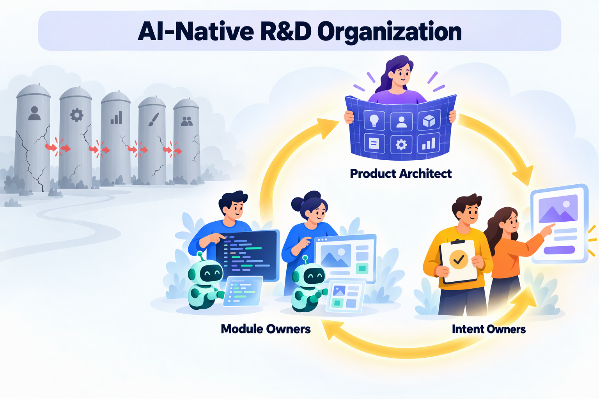
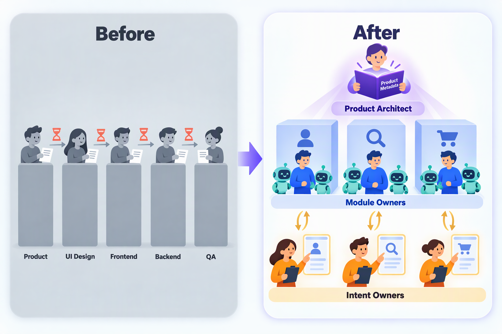
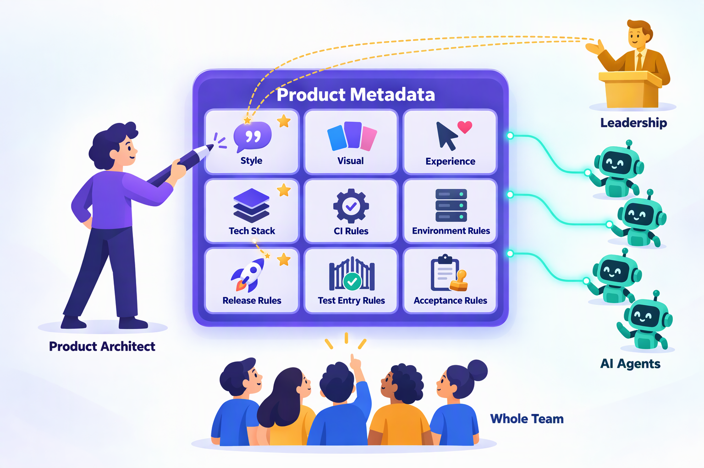
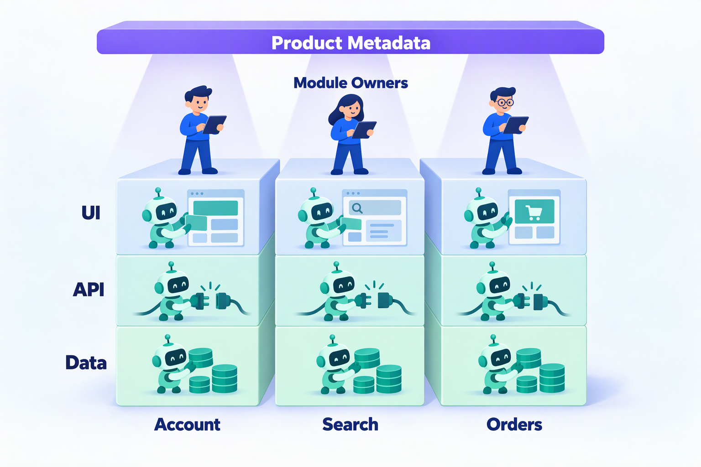
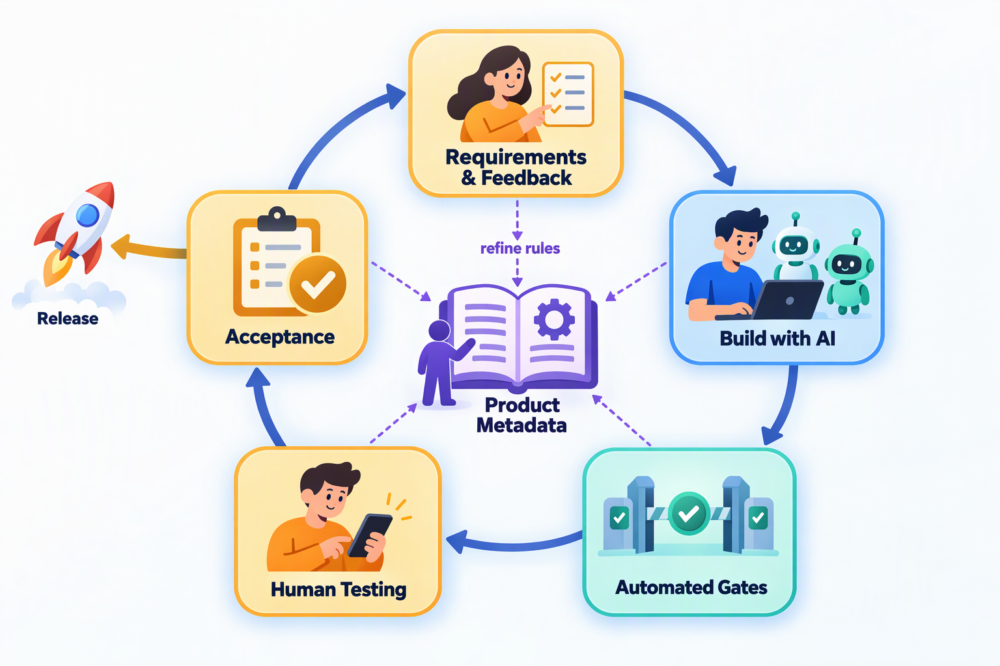
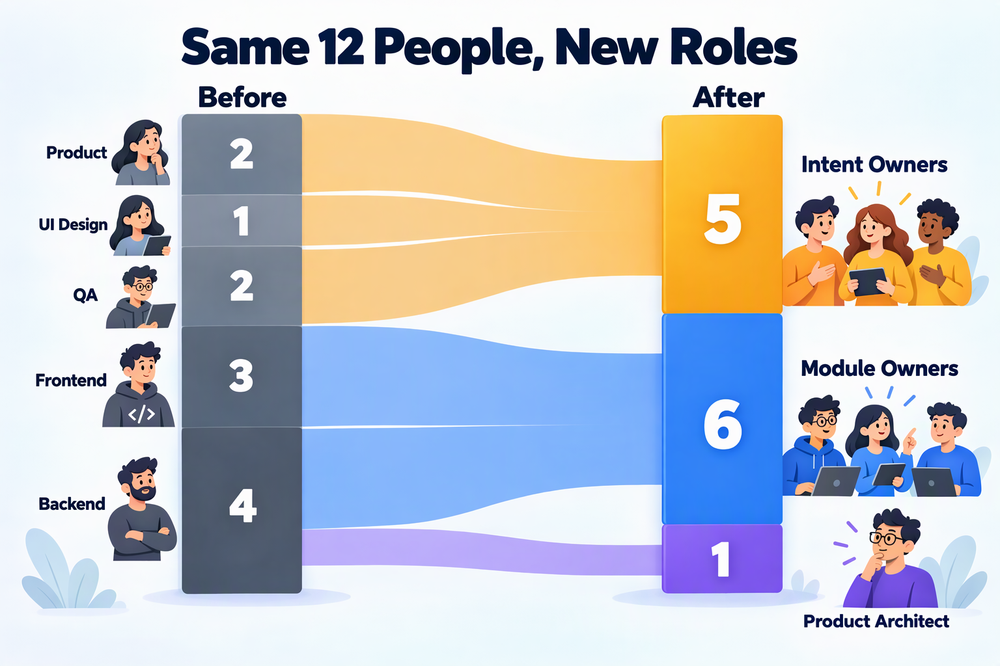
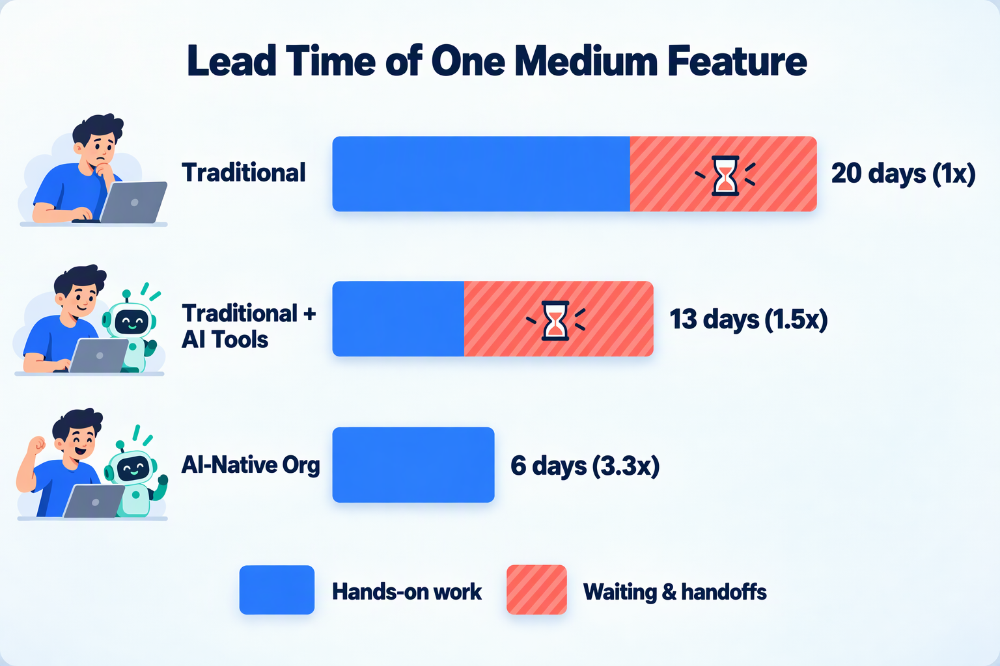
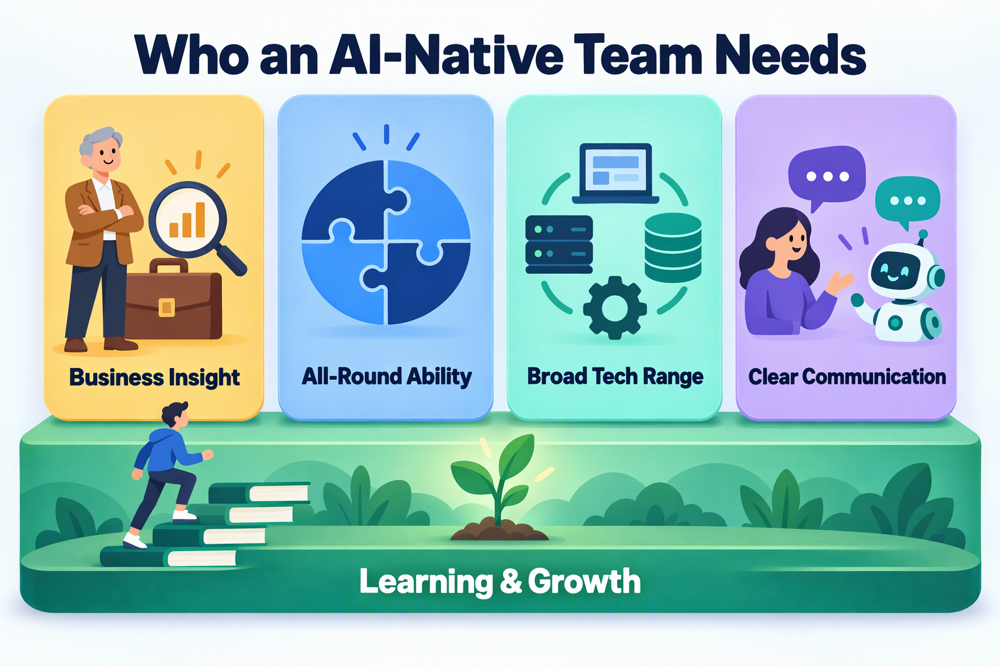

## 引言

这两年，AI 写代码的能力几乎每个季度都在刷新认知：从逐行补全，到在 IDE 里对话改代码，再到把一个 Issue 直接交给 coding agent，让它自己读代码、改代码、跑测试、提 PR。在不少场景里，一个熟练的工程师带着几个 AI agent，已经能完成过去一个小组才能完成的工作量。

但大多数团队的组织架构几乎没有变：前端组、后端组、测试组、产品组、UI 设计组各司其职，需求依然沿着“产品写 PRD → 设计出稿 → 前后端开发 → 测试 → 发布”这条流水线一站一站往下传。就算 AI 让写代码这一站快了十倍，整条流水线也快不了十倍，因为大部分时间本来就不是花在写代码上，而是花在等待、交接和对齐上。

我的观点很直接：**在 AI 时代，前端、后端、测试、产品、UI 设计这种按职能划分的组织架构和分工，应该被彻底废弃**。不是在原有架构上加一个“AI 小组”，也不是让每个职能各自用上 AI，而是从根上换一种组织方式，只保留三种角色：

* **Product Architect（产品架构师）**：保留架构师，但把职责从技术架构扩展为产品架构，负责定义整个产品统一的元数据和规则。
* **Module Owner（模块负责人）**：不再区分前端和后端，每个模块指定一位全能开发者作为 Owner，由他指挥 AI 完成这个模块的整体研发。
* **Intent Owner（意图负责人）**：取代传统的产品经理，只专注两件事：管理和确认需求，以及最终的使用和验收。

角色名我刻意先用英文来定义：一方面，这几个角色在业界还没有统一的中文叫法，英文名更不容易产生歧义；另一方面，这些名字会直接出现在给 AI agent 读的规则文件、代码仓库和工具配置里，用英文更统一。

下面依次讲清楚：为什么职能分工已经不合时宜，三种角色各自做什么，这个组织怎样像飞轮一样转起来，人员比例怎么配，原来的团队怎么转型，效率大概能提升多少倍，以及新组织更需要什么样的人。

## 一、为什么职能分工已经不合时宜

### 1. 分工的前提变了

前端、后端、测试、UI 设计这些岗位，本质上是按“执行技能”切分的。过去这样分是合理的：每一门技能都需要多年积累，一个人很难同时精通 React、数据库调优、自动化测试和视觉设计，于是我们用分工换深度，再用流程和会议把各个环节串起来。交接和沟通的成本，是为专业深度付出的代价。

AI 改变的恰恰是这个前提。写组件、写 SQL、写测试用例、调样式，这些“怎么做”的知识，大部分已经可以交给 AI agent，而且它对几乎所有主流技术栈都相当熟悉。执行技能不再稀缺，稀缺的变成了三样东西：

1. **定规则**：这个产品应该长什么样、用什么技术、按什么标准交付
2. **定方向**：下一步做什么，做到什么程度算完成
3. **做判断**：AI 交出来的东西对不对、好不好、能不能上线

组织架构应该围绕稀缺的东西来设计，而不是围绕已经不再稀缺的东西。

### 2. 交接成了整条链路的瓶颈

一个需求在传统团队里的典型旅程是这样的：产品写 PRD，开评审会；设计出交互稿和视觉稿，再开评审会；前后端拆任务、对接口，前端等后端的接口，后端等产品澄清细节；开发完提测，测试排队，发现问题再打回……真正写代码的时间，往往只占整个周期的一小部分。

这就是软件研发版的阿姆达尔定律（Amdahl's law）：系统整体能提速多少，受限于没有被加速的那部分。AI 把编码这一段压缩到了原来的几分之一，但只要交接、排队、对齐还在，交付周期就不会有数量级的变化。要让 AI 的提效真正变成交付速度，就必须消灭交接本身，而交接正是分工的直接产物。

### 3. 康威定律：组织长什么样，系统就长什么样

1968 年，Melvin Conway 提出了后来被称为康威定律（Conway's law）的观察：设计系统的组织，产出的系统结构会复制这个组织的沟通结构。按前端、后端划分团队，系统自然就被切成前端层和后端层，层与层之间靠跨团队协商的接口连接，一个业务功能的改动，往往要横跨好几个团队。

在 AI 时代，我们更希望系统按业务模块纵向切分：一个模块从界面、接口到数据和测试，由一个人带着 AI 端到端负责。根据康威定律，想要这样的系统，就要先有这样的组织，这也就是业界常说的“逆康威操作”（Inverse Conway Maneuver）。

### 4. AI 需要统一的上下文，职能分工却制造碎片

AI agent 的输出质量，很大程度上取决于它拿到的上下文。可在职能分工的团队里，上下文是碎片化的：需求在产品的文档里，视觉规范在设计工具里，测试用例在测试管理平台里，发布规则在运维同事的脑子里。每个职能各管一套，彼此之间还经常对不上。

人还能靠开会对齐，AI 不能，AI 只认它能读到的东西。所以真正适合 AI 的组织，必须有人把这些分散的知识收拢成一份统一、明确、机器可读的“产品元数据”，这正是 Product Architect 要做的事情。

把传统分工和 AI 原生组织放在一起对比：

| 维度 | 传统职能分工 | AI 原生组织 |
| --- | --- | --- |
| 稀缺资源 | 执行技能：写代码、做设计、写用例 | 规则、方向和判断 |
| 切分方式 | 按技能横向切：前端、后端、测试、设计 | 按模块纵向切：一个 Owner 端到端负责 |
| 协作方式 | 文档交接、评审会、提测排队 | 共享产品元数据，AI 执行，人做决策和验收 |
| 知识载体 | 分散在各职能的文档和个人经验里 | 集中在产品元数据里，人和 AI 都能读 |
| 质量保证 | 测试团队在最后把关 | 规则前置，自动化关卡加人类测试 |

## 二、新组织：只留三种角色



新组织只保留三种角色，外加在关键规则上拍板的更高层决策者：

| 角色 | 中文 | 核心职责 | 主要产出 | 人数 |
| --- | --- | --- | --- | --- |
| Product Architect | 产品架构师 | 定义和维护产品元数据，划分模块 | 产品元数据、模块划分 | 少 |
| Module Owner | 模块负责人 | 全能开发，指挥 AI 完成模块的端到端研发并持续迭代 | 可交付的模块、规则改进 | 多 |
| Intent Owner | 意图负责人 | 管理和输入需求，确认需求，人类测试，最终验收与反馈 | 需求、验收结论、针对性反馈 | 多 |

这里没有前端和后端，没有专职测试，没有传统意义上的产品经理，也没有专职的 UI 设计。这些工作并没有消失，而是换了承载方式：执行交给 AI，规则沉淀进产品元数据，判断留给人。

需要强调的是：**废除的是分工，不是人**。后面会专门讲原来的每个职能可以转向哪个新角色。

## 三、Product Architect：从技术架构到产品架构

### 1. 职责扩展：定义产品元数据

传统的架构师主要负责技术架构：系统怎么分层、服务怎么拆、用什么中间件。在新组织里，架构师保留下来，但职责要扩展到整个产品，所以叫 Product Architect。它的核心产出，是一套统一的**产品元数据（Product Metadata）**，也就是这个产品所有基础元素的定义：



| 元数据 | 定义什么 | 落地形式（举例） | 谁拍板 |
| --- | --- | --- | --- |
| 风格（Style） | 品牌调性、文案语气、术语表 | 风格指南、术语表 | 更高层决策者 |
| 视觉（Visual） | 色彩、字体、间距、图标、组件 | 设计令牌（design tokens）、组件库 | Product Architect，品牌相关部分由决策者确认 |
| 体验（Experience） | 交互模式、导航结构、无障碍、性能预算、错误提示 | 体验规范、性能预算 | Product Architect |
| 主体技术栈（Tech Stack） | 语言、框架、数据库、云服务，以及选型理由 | 技术决策记录（ADR） | 更高层决策者 |
| CI 规则（CI Rules） | 必须通过的检查、分支策略、代码评审规则 | CI 流水线、分支保护 | Product Architect |
| 环境规则（Environment Rules） | 开发、测试、预发、生产环境的定义，配置和密钥的管理 | 基础设施即代码（IaC）、环境模板 | Product Architect |
| 发布规则（Release Rules） | 发布节奏、灰度策略、回滚条件、变更审批 | 发布流水线、发布手册 | 更高层决策者 |
| 测试准入规则（Test Entry Rules） | 进入人类测试之前必须满足的条件 | 质量门禁 | Product Architect |
| 产品验收规则（Acceptance Rules） | 验收标准怎么写、谁来验收、什么算通过 | 验收模板、完成定义（Definition of Done） | Product Architect 与 Intent Owner 共同制定 |

表中由更高层决策者拍板的几项，同样由 Product Architect 起草方案。

### 2. 产品元数据的三个特点

**第一，它主要是给 AI agent 用的**。产品元数据不是一份放在 Wiki 上落灰的规范，而是以文件的形式放在代码仓库里，AI agent 每次干活都会读到。比如：

```text
.
├── AGENTS.md                      # 所有 AI agent 的统一入口，指向下面的产品元数据
├── .github/
│   ├── copilot-instructions.md    # GitHub Copilot 的仓库级指令
│   ├── workflows/                 # CI 规则
│   └── skills/                    # 团队共享的 Skill
├── product/                       # 产品元数据
│   ├── style.md                   # 风格
│   ├── design-tokens.json         # 视觉
│   ├── experience.md              # 体验
│   ├── tech-stack.md              # 主体技术栈和选型理由
│   ├── environments.md            # 环境规则
│   ├── release.md                 # 发布规则
│   ├── test-entry.md              # 测试准入规则
│   └── acceptance.md              # 产品验收规则
└── modules/
    ├── account/AGENTS.md          # 模块级规则，由 Module Owner 维护
    └── search/AGENTS.md
```

[AGENTS.md](https://agents.md/) 是一个已经被很多 coding agent 支持的开放格式，子目录里的 AGENTS.md 会就近生效，正好用来放模块级规则；`.github/copilot-instructions.md` 是 GitHub Copilot 的[仓库级自定义指令](https://docs.github.com/en/copilot/how-tos/copilot-on-github/customize-copilot/add-custom-instructions/add-repository-instructions)；Skill 则可以把一段可复用的能力封装起来，可以参考我之前写的[AI 编程进入 Skill 时代](/zh/blog/2026/ai-skills/)。具体用哪种格式不重要，重要的是：规则以文件的形式存在，有版本，可评审，AI 每次都能读到。

**第二，它必须让整个团队都了解**。产品元数据虽然主要给 AI 读，但它定义的是整个产品的“宪法”。每个 Module Owner 和 Intent Owner 都要读得懂：Module Owner 指挥 AI 时要知道边界在哪里，Intent Owner 验收时要知道标准是什么。所以它要用自然语言写清楚，任何人都可以通过 Pull Request 提出修改，由 Product Architect 评审合入。

**第三，它是分级决策的**。大部分元数据由 Product Architect 定义，但其中一些关系到品牌、成本和风险的内容，比如风格、主体技术栈和发布规则，应该由更高层的决策者拍板。Product Architect 负责把选项、利弊和建议准备好，交给决策者决定，再把决定写进元数据。

### 3. 一个例子：测试准入规则

在传统团队里，测试准入通常是开发和测试之间的一份“提测标准”，执行得好不好全靠自觉。在新组织里，它变成一份 AI 和人都能读、机器能检查的规则：

```markdown
# 测试准入规则（Test Entry Rules）

任何改动进入人类测试之前，必须全部满足：

- CI 全部通过：lint、类型检查、单元测试、构建
- 新增和修改的代码，单元测试覆盖率不低于 80%
- 每一条验收标准，至少对应一个自动化端到端用例
- 核心页面满足性能预算：LCP 小于 2.5 秒（移动网络模拟）
- 安全扫描没有高危问题，依赖没有已知的严重漏洞
- 改动说明写清楚：改了什么、怎么验证的、影响哪些模块
```

AI agent 在提交之前会按这份规则自查、自测、自修；CI 自动检查其中能自动检查的部分；剩下的，比如改动说明是否清楚，由 Module Owner 把关。测试的专业知识并没有消失，而是从“测试团队的经验”变成了“写进规则的标准”。

### 4. 划分模块，指定 Owner

除了产品元数据，Product Architect 还负责划分模块：按业务能力切分（比如账号、搜索、订单、支付），而不是按技术层切分；模块之间通过明确的接口契约协作。模块划好之后，再和管理者一起为每个模块指定一位 Owner。模块边界划得好不好，直接决定了 Module Owner 能不能独立地端到端交付。

## 四、Module Owner：全能开发者，指挥 AI 完成整个模块



### 1. 不再有前端和后端

每个模块指定一位 Owner，对模块端到端负责：界面、接口、数据、测试、部署、监控，全部由他带着 AI 完成。没有“前端等后端接口”，也没有“这个 bug 到底归前端还是后端”的扯皮，因为从上到下都是同一个人。

这里说的“全能”，不是要求一个人像过去的专家那样手写每一层的代码，而是能看懂每一层，能判断 AI 的方案对不对，出了问题能一路定位到底层。深度的专业知识，一部分在 AI 那里，一部分沉淀在产品元数据和 Skill 里；Owner 需要的是广度、判断力和对模块的全局把控。

### 2. Owner 的日常工作

Module Owner 每天的工作，和过去写代码的工程师很不一样：

* **拆解**：把 Intent Owner 输入的需求和反馈，拆成 AI 可以执行的任务
* **指挥**：把任务交给不同的 AI agent，比如一个负责实现，一个负责写测试，一个负责评审
* **评审**：审查 AI 的方案和代码，做技术取舍，对质量负最终责任
* **自测**：交给 Intent Owner 验收之前，先以开发者的视角完整走一遍
* **完善规则**：发现 AI 反复犯同一类错误时，补充模块规则，或者向 Product Architect 提出修改产品元数据
* **值守**：模块上线之后出了问题，由 Owner 带着 AI 排查和修复

一句话：**人不再是代码的生产者，而是 AI 的指挥者和质量的最终责任人**。

### 3. 一个模块多大合适

模块的大小，取决于 Owner 带着 AI 能否以稳定的节奏持续交付，并且兜得住质量。模块太大，Owner 会成为瓶颈；模块太小，模块之间的协调成本又回来了。一个简单的判断标准是：Owner 能完整地说清楚这个模块的每一个功能和每一份数据。重要的模块可以再配一位备份 Owner，避免单点风险。

## 五、Intent Owner：管需求，做验收

### 1. 为什么要起一个新名字

传统的产品经理要做的事情非常多：市场调研、竞品分析、写 PRD、画原型、跟进度、协调资源、组织评审、分析数据……其中很大一部分，要么可以交给 AI，要么在新组织里根本不需要了：没有了职能之间的交接，也就不需要那么多协调。剩下的，恰恰是 AI 最难替代的两件事：

1. **知道要什么**：理解用户和业务，把模糊的想法变成清晰、可验收的需求
2. **判断对不对**：亲自去用产品，判断做出来的东西是不是真正想要的

所以我给这个角色起了一个新名字：**Intent Owner（意图负责人）**。在 AI 时代，人给出意图（intent），AI 负责执行。Intent Owner 对意图负责到底：从意图进入研发（需求），到意图被实现（验收），中间的执行交给 Module Owner 和 AI。如果还叫“产品经理”，大家会默认这个角色还要写 PRD、画原型、管项目；换一个名字，是为了把职责边界划清楚。

它和 Scrum 里的 Product Owner 有些相似，都对需求列表负责；不同的是，Intent Owner 把亲自使用和验收当作核心工作，而且完全不承担项目管理的职责。

### 2. 第一项工作：需求管理

Intent Owner 管理需求池，持续向各个模块输入需求。关键词是“确认”：需求进入开发之前，Intent Owner 要和 Module Owner 一起把意图确认清楚，尤其是验收标准，也就是“做到什么样算完成”。需求不需要写成几十页的 PRD，但验收标准必须具体、可检查，因为它会同时被 AI（生成测试用例）、Module Owner（自测）和 Intent Owner 自己（验收）使用。

一条好的需求大概是这样的：

```markdown
## 需求：订单列表支持按状态筛选

意图：客服每天要处理大量“待退款”订单，现在只能逐页翻找，希望能快速筛出来。

验收标准：
1. 订单列表顶部新增状态筛选，可以多选，默认不筛选
2. 选择“待退款”后，只显示待退款的订单，翻页后筛选条件保持不变
3. 筛选条件体现在 URL 里，刷新页面或分享链接后条件不丢失
4. 订单数在 1 万条以内时，筛选结果在 1 秒内返回
```

### 3. 第二项工作：人类测试与最终验收

AI 交付的东西通过了自动化关卡和 Module Owner 的自测之后，进入人类测试阶段。Intent Owner 要像真实用户一样去使用，对照验收标准逐条判断，然后给出结论：通过，或者带着反馈打回。

反馈的质量直接决定迭代的速度。“感觉不太好用”这样的反馈，Module Owner 没法拿去指挥 AI 修复；好的反馈必须是针对性的：

```markdown
## 反馈：订单状态筛选

- 对应验收标准：第 3 条
- 步骤：选择“待退款”，复制页面链接，在新窗口中打开
- 期望：新窗口里依然只显示待退款订单
- 实际：筛选条件丢失，显示了全部订单
- 截图：filter-lost.png
```

这样的反馈，Module Owner 几乎可以原样交给 AI 去复现和修复。

### 4. 为什么 Intent Owner 要多

当 AI 把“做出来”的成本降得很低，瓶颈就转移到了两头：想清楚做什么，以及判断做得对不对。一个 Intent Owner 能深入使用和判断的产品范围是有限的。Intent Owner 太少，Module Owner 和 AI 要么闲着等需求，要么在没人验收的情况下做出一堆没人要的功能。所以在新组织里，Intent Owner 的数量应该和 Module Owner 相当。

## 六、让组织转起来：需求、执行、验收、规则的飞轮



把三种角色放在一起，整个研发过程就是一个持续转动的飞轮：

1. **输入**：Intent Owner 输入新的需求（意图加验收标准），或者上一轮验收的反馈
2. **执行**：Module Owner 拆解任务，指挥 AI agent 在产品元数据的约束下完成开发和自动化测试
3. **自动化关卡**：按 CI 规则和测试准入规则自动检查，AI 自己发现问题、自己修复，直到全部通过
4. **人类测试**：Module Owner 先自测，再交给 Intent Owner 像真实用户一样使用和验收
5. **反馈或发布**：验收不通过，Intent Owner 给出针对性反馈，回到第 2 步；验收通过，按发布规则发布
6. **完善规则**：每一轮发现的问题都问一句“能不能变成规则？”能，就补进模块规则或产品元数据，让 AI 下次不再犯

在这个飞轮里，人只做三件事：**定规则、给意图、做判断**。其余的执行工作，全部交给 AI。

第 6 步是这个组织能够越转越快的关键。传统团队里，一个 bug 修完就结束了，同类问题下次换个地方还会出现；在新组织里，追求的是“修规则，而不只是修 bug”。规则越完善，AI 的产出越稳定，人类测试发现的问题越少，飞轮就转得越快。

## 七、人员比例：Product Architect 少，Module Owner 和 Intent Owner 多

三种角色的人数差别很大：

* **Product Architect 少**：产品元数据是全产品共享的，一旦建立起来，后续的变化是渐进的，一个产品通常一到两位 Product Architect 就够了。大型产品可以按领域分工，比如一位偏体验和视觉，一位偏工程和交付，但总数依然要少，因为元数据只能有一个统一的出口。
* **Module Owner 多**：模块的数量决定了 Module Owner 的数量，他们是执行的主力。
* **Intent Owner 也多**：瓶颈已经转移到了需求和验收，Intent Owner 的数量应该和 Module Owner 相当。

以一个 12 人的团队为例，传统配置可能是 2 个产品经理、1 个 UI 设计师、2 个测试、3 个前端和 4 个后端。按新组织来配，可以是 1 位 Product Architect、6 位 Module Owner 和 5 位 Intent Owner，大约是 1 : 6 : 5：



这个比例不是固定的公式，但方向是确定的：Product Architect 是少数，Module Owner 和 Intent Owner 是多数，而且两者的数量大致相当。

## 八、原来的角色去哪了

| 原来的职能 | 新角色 | 说明 |
| --- | --- | --- |
| 架构师 | Product Architect | 从技术架构扩展到产品架构，负责全部产品元数据 |
| 前端、后端工程师 | Module Owner | 借助 AI 补齐另一侧的能力，从“我负责前端”变成“我负责这个模块” |
| 测试工程师 | Intent Owner 或 Module Owner | 擅长从用户视角发现问题的，适合做 Intent Owner；擅长自动化和工程的，适合做 Module Owner；测试方法论写进测试准入规则 |
| 产品经理 | Intent Owner | 放下 PRD、原型和项目管理，专注需求和验收；擅长产品体系设计的，也可以成为 Product Architect |
| UI 设计师 | Product Architect 或 Intent Owner | 视觉和体验规范进入产品元数据，资深设计师可以成为偏体验方向的 Product Architect；对体验敏感的设计师，也是很好的 Intent Owner |

上面 12 人的例子里，一种可能的转型路径是：2 个产品经理、2 个测试和 1 个 UI 设计师转为 5 位 Intent Owner；7 个前端和后端工程师里，1 位资深工程师成为 Product Architect，其余 6 位成为 Module Owner。

无论走哪条路，转型都意味着能力的扩展：前端要懂后端，后端要懂界面，测试要懂产品，产品要懂验收，所有人都要学会和 AI 协作、学会写规则。

## 九、效率能提升多少倍？一个粗略的估算

先说明：下面是基于假设的模型估算，不是实测数据。我把每一个假设都列了出来，你可以换成自己团队的数字重新算一遍。

### 1. 先看研究：只加 AI 工具，组织效率不会自动提升

关于 AI 能让研发提效多少，公开研究的结论并不一致：

* **个体层面**：2023 年发表的一项 GitHub Copilot 对照实验，让开发者用 JavaScript 实现一个 HTTP 服务器，能使用 Copilot 的一组比对照组快了 55.8%。
* **真实项目**：METR 在 2025 年上半年对资深开源开发者做了随机对照实验，在他们自己维护的大型代码库里，使用当时的 AI 工具反而让任务多花了 19% 的时间。2026 年初的后续数据开始出现提速的迹象，但置信区间仍然包含零；而且越来越多的开发者因为不愿意离开 AI 工作而不再参加实验，研究者自己也认为这只是很弱的证据。
* **组织层面**：DORA 2024 年的报告发现，AI 的采用提升了个人的生产力、心流和工作满意度，却对软件交付的吞吐和稳定性有负面影响。DORA 2025 年的报告说得更直接：AI 的主要作用是放大器，放大组织已有的长处和短处，AI 投资的最大回报不来自工具本身，而来自对底层组织系统的改造。

这和第一节的分析是一致的：只给每个人加上 AI 工具，加速的只是“干活”的那一段，等待、交接和对齐一点都没有少。

### 2. 估算方法

用两个指标来衡量效率：

* **交付周期**：一个需求从提出到上线的日历时间，衡量“快不快”
* **人均产出**：同样的人每月能交付多少需求，用每个需求消耗的人天来折算，衡量“多不多”

估算里最关键、也最不确定的参数，是 **AI 执行倍数 s**：设计、开发、测试这些执行工作交给 AI 之后，人在其中投入的时间缩短为原来的几分之一。它取决于 AI 的能力、产品元数据的完善程度和代码库的状况，所以分三档：保守 s = 2，中性 s = 4，乐观 s = 6。

### 3. 算一笔账：一个中等需求

以一个中等需求为例，比如“订单退款流程”：涉及几个页面、几个接口和一次数据表变更，在传统组织里，产品、设计、前后端和测试都要参与。下表对比它在两种组织里的交付周期和投入人力（新组织按中性假设）：

| 环节 | 传统组织 | 新组织（中性） | 变化的原因 |
| --- | --- | --- | --- |
| 需求 | 写 PRD、评审：3 天，其中等待 1 天 | 确认意图和验收标准：1 天 | 不写长篇 PRD，Intent Owner 和 Module Owner 当面确认 |
| 设计 | 交互稿、视觉稿、评审：3 天，其中等待 1 天 | 并入 AI 执行 | 视觉和体验由产品元数据定义，界面由 AI 按规范生成 |
| 排期 | 等待开发排期：2 天 | 无 | Module Owner 直接从需求池里拉取 |
| 开发和测试 | 前后端开发、联调：5 天；提测排队、测试：3 天，其中等待 1 天 | AI 执行（设计、开发、自动化测试、关卡）：2.5 天 | 执行交给 AI，测试按准入规则自动完成，也没有了前后端联调 |
| 验收和修复 | 修复、回归和产品验收：2 天，其中等待 0.5 天 | 人类测试与验收：1 天；反馈修复：1 天 | 反馈直接交给 Module Owner，由 AI 修复 |
| 发布 | 等待发布窗口：2 天 | 按发布规则发布：0.5 天 | 持续发布，不用等发布窗口 |
| 交付周期 | 20 天 | 6 天 | 约 3.3 倍 |
| 投入人力 | 20 人天：产品 3、设计 2、前端 4、后端 5、测试 4、评审和沟通 2 | 7 人天：Intent Owner 2、Module Owner 4、Product Architect 分摊 0.5、沟通 0.5 | 约 2.9 倍 |

传统组织的 20 天里，真正写代码的只有 5 天，纯等待（等评审、等排期、提测排队、等回归、等发布窗口）就有 7.5 天。新组织的提速主要来自三个方面：等待和交接基本消失；设计、开发、测试这些执行工作交给 AI；验收和反馈的回路变短，Intent Owner 发现问题，Module Owner 当天就能指挥 AI 修复。

### 4. 对照：只加 AI 工具，不改组织

假设 AI 的能力完全一样（同样是 s = 4），但组织不变，各个职能各自用 AI 干活：实际工作时间从 12.5 天缩短到约 5.5 天，可那 7.5 天的等待一天都没少，交付周期约 13 天，只快了约 1.5 倍。每个需求的人力在纸面上能降到约 10 人天，但各职能的人数是固定的，开发提速之后，瓶颈很快转移到人数没变的产品和测试身上，实际的吞吐提升还要打折扣。



### 5. 结果：中性情况下约 3 倍

| 方案 | 交付周期 | 提速 | 每个需求的人力 | 人均产出 |
| --- | --- | --- | --- | --- |
| 传统组织（基线） | 20 天 | 1 倍 | 20 人天 | 1 倍 |
| 传统组织 + AI 工具（s = 4） | 约 13 天 | 约 1.5 倍 | 约 10 人天 | 纸面约 2 倍，实际受瓶颈限制 |
| 新组织，保守（s = 2） | 10 天 | 2 倍 | 11.5 人天 | 约 1.7 倍 |
| 新组织，中性（s = 4） | 6 天 | 约 3.3 倍 | 7 人天 | 约 2.9 倍 |
| 新组织，乐观（s = 6） | 3.5 天 | 约 5.7 倍 | 5 人天 | 4 倍 |

保守和乐观两档的算法和中性一样，只是 s 不同，人类环节的耗时（确认需求、验收、反馈修复的轮次）也相应地多一些或少一些。

所以我的结论是：**按中性假设，新组织能把交付周期缩短到原来的三分之一左右，人均产出提升到约 3 倍**。保守情况下，交付周期也能缩短一半，人均产出约 1.7 倍；乐观情况下，交付速度能提升 5 倍以上，人均产出约 4 倍。换成 12 人团队的语言：按每人每月 20 个工作日、全部投入需求开发粗算，原来每月大约交付 12 个中等需求，新组织在中性情况下可以交付 30 个以上。

### 6. 两个值得注意的结论

**第一，人类环节决定了效率的上限**。s 越大，Module Owner 投入的人天越少，但确认意图、人类测试和验收、规则维护和沟通这些人类环节，不会随着 AI 变强而消失。按中性假设，这部分每个需求约 3 人天，人均产出的理论上限约为 20 ÷ 3 ≈ 6.7 倍。这又是一次阿姆达尔定律：AI 越强，瓶颈越集中在人的判断上，所以要持续提升需求确认和验收的效率，比如把验收标准写得更具体、更可检查，把能自动化的验收步骤都交给端到端测试。

**第二，人员配比要跟着工作量调整**。按中性假设，每个需求 Module Owner 约 4 人天、Intent Owner 约 2 人天，12 人团队比较均衡的配比约为 1 : 7 : 4；AI 越强，Module Owner 的人天越少，Intent Owner 的占比就越高，配比会逐渐向第七节的 1 : 6 : 5 移动。配比不对，瓶颈角色就会卡住吞吐：如果 Intent Owner 还是只有原来产品经理那 2 个人，每人每月 20 个工作日、每个需求 2 人天，那么不管 AI 多强，每月最多也只能验收 20 个需求。

### 7. 前提和风险

这个估算成立，有几个前提：

* **产品元数据足够完善**：规则越完整，AI 的产出越稳定，s 越大；规则缺失时，AI 会反复犯同样的错，s 会掉到保守档甚至更低
* **模块边界清晰**：模块之间耦合严重时，Module Owner 之间的协调成本又会回来
* **Intent Owner 能给出可检查的验收标准**：模糊的需求会让反馈修复的轮次成倍增加
* **接受一段爬坡期**：写规则、学会指挥 AI、补齐全栈能力都需要时间，转型初期的效率可能不升反降

最后，提效倍数一定要用自己的数据来验证：在试点模块上记录交付周期、每个需求的人天、验收一次通过率和返工次数，和转型前对比，而不是凭感觉。METR 的研究也提醒过，开发者对 AI 提效的自我感觉往往并不可靠。

## 十、新组织更需要什么样的人

上一节的估算有一个结论：AI 越强，效率的瓶颈越集中在人的判断上。所以在新组织里，最有价值的不再是“精通某个框架”，而是判断力、广度和表达。具体来说，新组织更需要下面几类员工：



| 更需要的人 | 为什么 | 最能发挥作用的角色 |
| --- | --- | --- |
| 懂业务的资深员工 | AI 不懂你的业务，“做得对不对”要靠业务经验来判断 | Intent Owner、Product Architect |
| 综合能力强的员工 | 一个人对一个模块端到端负责，从理解需求、技术决策到质量和上线 | Module Owner |
| 技术面广的员工 | 要看懂每一层，判断 AI 的方案是否合理，出了问题能一路定位 | Module Owner、Product Architect |
| 沟通表达能力强的员工 | 给 AI 的指令、给人的需求和反馈、写进元数据的规则，本质上都是表达 | 所有角色，尤其是 Intent Owner |

### 1. 懂业务的资深员工

AI 能写出几乎任何代码，却不知道你的客户为什么总在月底集中申请退款，也不知道某条规则背后曾经有过一次严重的事故。这些业务知识，恰恰是确认需求、验收结果和制定规则最需要的东西。

这里的“资深”，指的是真正懂业务，而不是工龄长。懂业务的资深员工，不管原来是产品、开发还是测试，都很适合做 Intent Owner；其中对产品全局理解最深的人，可以成为 Product Architect，把经验写进产品元数据，让 AI 和整个团队都能用上。

### 2. 综合能力强的员工

Module Owner 不再只是“写好自己那一层”，而是对一个模块的结果负责：和 Intent Owner 一起确认意图，拆解任务，指挥多个 AI agent，评审方案，把控质量，处理线上问题。这需要的是综合能力：理解需求、做技术决策、组织工作、对结果负责。只擅长单一环节、习惯等别人交接的人，在新组织里会很吃力。

### 3. 技术面广的员工

全能开发者靠的是技术广度。前端、后端、数据库、测试、部署、监控，每一层都要看得懂，才能判断 AI 的方案是否合理，才能在出问题时一路定位到底层。技术深度依然有价值，但在新组织里，深度更多沉淀在规则和 Skill 里，被所有人和所有 AI 共享；而广度，决定了一个人能独立负责多大的模块。

### 4. 沟通表达能力强的员工

在 AI 时代，表达能力就是生产力。Module Owner 给 AI 的指令，Intent Owner 写的需求、验收标准和反馈，Product Architect 写进产品元数据的规则，本质上都是表达：说得越清楚，AI 执行得越准，返工越少。

同时，新组织去掉了层层交接，人和人之间的协作变成了直接对话。Intent Owner 和 Module Owner 能不能快速对齐意图，Product Architect 能不能把规则讲到所有人都理解，直接决定了飞轮转得有多快。

### 5. 不是不要初级岗位，更重要的是学习成长能力

这并不意味着新组织不要初级员工。如果一个团队只招资深员工，几年之后就没有人能成长为新的资深员工。变化在于对人的要求：会不会某个具体的框架没那么重要，**更重要的是学习成长能力**。这一点对所有人都一样，原因有三个：

1. **AI 和工具变化太快**：今天的最佳实践，几个月后可能就过时了，资深员工也必须持续学习；而初级员工的优势，恰恰是学得快、包袱少。
2. **新组织的成长条件更好**：产品元数据把团队的经验写成了规则，新人读规则就能快速理解产品的标准；AI 是随身的导师，不懂的技术随时可以让它解释、对比方案。
3. **成长路径更清晰**：初级员工可以先做资深 Module Owner 的备份 Owner，从评审、自测和补充规则做起，再逐步独立负责一个小模块；也可以从一个小业务范围的 Intent Owner 做起，在验收中积累业务经验。

需要警惕的是，初级员工很容易变成“只会让 AI 干活，自己却不理解”。所以衡量初级员工的成长，不看产出了多少代码，而看他能不能讲清楚 AI 为什么这样做、做得对不对、有没有更好的方案。能讲清楚，才算真正学会了。

落到招聘和培养上，标准也要跟着变：少问“会不会某个框架”，多看业务理解、技术广度、表达能力和学习速度。比如面试时给候选人一个陌生的业务场景，看他能不能很快问出关键问题、讲清楚自己的方案，并且指挥 AI 做出一个可用的原型。

## 十一、几个常见的质疑

### 1. 一个人真的能“全能”吗？

不需要每一层都是专家。有了 AI 的帮助，一个有经验的工程师补齐另一侧的能力，比过去容易得多。真正需要深度的地方，比如数据库性能和复杂的交互动效，可以把专家的经验写成规则和 Skill，让所有 Owner 的 AI 都能用上，而不是让专家在每个需求里亲自出手。

### 2. 没有测试团队，质量谁来保证？

质量本来就不应该只靠最后一道关卡。新组织把质量拆成了三层：测试准入规则定义标准，AI 和 CI 自动执行，人类测试负责最后的判断。测试团队的专业能力没有被丢掉，而是被写进了规则，并且在每一次改动上都会执行，而不只是在提测的时候。

### 3. 没有 UI 设计师，产品会不会变丑？

不会，反而可能更一致。传统团队里，视觉不一致往往来自设计稿和实现之间太多的手工转换。在新组织里，视觉和体验是第一等的产品元数据，设计令牌和组件库一次定义、处处生效，AI 生成的每一个界面都遵循同一套规范。设计能力集中用在定标准上，而不是一张一张地出稿。

### 4. Product Architect 会不会成为新的瓶颈？

产品元数据的变化频率远低于需求，大部分时候 Product Architect 是在评审别人提出的规则修改，而不是事事亲为。任何人都可以提出修改，Product Architect 负责保证整体一致。产品规模大了，可以有两三位 Product Architect 按领域分工，但不应该再长出一个“架构部”。

## 十二、怎么开始转型

不需要一次性重组整个部门，可以按下面的顺序推进：

1. **先写产品元数据**：把散落在 Wiki、文档和个人脑子里的规则整理出来，以文件的形式放进仓库。可以从技术栈、CI 规则、测试准入规则和验收规则开始，这几项最容易立刻见效。
2. **选一个模块试点**：挑一个边界清晰的模块，指定一位 Module Owner 和一位 Intent Owner，按飞轮跑两到四周，记录交付周期、每个需求的人天和返工次数，用第九节的方法和转型前对比。
3. **调整考核方式**：不再按职能考核（写了多少代码、测了多少用例），而是按模块的交付结果和验收质量考核；Product Architect 则看规则的质量和 AI 产出的稳定性。
4. **调整招聘和培养**：按第十节的标准招人和培养人，给初级员工安排从备份 Owner 到独立 Owner 的成长路径。
5. **逐步拆掉职能团队**：试点跑通之后，按模块重新组队，原来的职能团队逐步解散。
6. **每周复盘规则**：固定时间回顾一周的反馈，把能沉淀的问题沉淀成规则。

## 结语

职能分工是为“执行能力稀缺”的时代设计的。今天，执行能力正在变得像水电一样随取随用，真正稀缺的是规则、方向和判断。组织架构也应该围绕这三样东西重建：

* **Product Architect** 定规则，让 AI 和人都知道这个产品应该是什么样；
* **Module Owner** 带着 AI 端到端地把模块做出来，并不断完善规则；
* **Intent Owner** 给出意图、亲自验收，让产品始终朝着用户真正需要的方向走。

按第九节的估算，在中性假设下，这样的组织能把交付周期缩短到原来的三分之一左右，人均产出提升到约 3 倍；AI 越强，倍数越高，上限取决于人类判断环节的效率。

而让这个组织真正转起来的，是懂业务、综合能力强、技术面广、善于沟通表达，并且能持续学习成长的人。

工具已经变了，组织也该变了。

## 参考资料

* Melvin E. Conway，[How Do Committees Invent?](https://www.melconway.com/Home/Committees_Paper.html)，Datamation，1968 年 4 月
* Martin Fowler，[Conway's Law](https://martinfowler.com/bliki/ConwaysLaw.html)
* Thoughtworks Technology Radar，[Inverse Conway Maneuver](https://www.thoughtworks.com/radar/techniques/inverse-conway-maneuver)
* Wikipedia，[Amdahl's law](https://en.wikipedia.org/wiki/Amdahl%27s_law)
* [AGENTS.md](https://agents.md/)
* GitHub Docs，[Adding repository custom instructions for GitHub Copilot](https://docs.github.com/en/copilot/how-tos/copilot-on-github/customize-copilot/add-custom-instructions/add-repository-instructions)
* VS Code Docs，[Use Agent Skills in VS Code](https://code.visualstudio.com/docs/agent-customization/agent-skills)
* Design Tokens Community Group，[Design Tokens Format Module](https://www.designtokens.org/tr/drafts/format/)
* [The Scrum Guide](https://scrumguides.org/scrum-guide.html)
* web.dev，[Largest Contentful Paint (LCP)](https://web.dev/articles/lcp)
* Sida Peng 等，[The Impact of AI on Developer Productivity: Evidence from GitHub Copilot](https://arxiv.org/abs/2302.06590)，2023
* METR，[Measuring the Impact of Early-2025 AI on Experienced Open-Source Developer Productivity](https://metr.org/blog/2025-07-10-early-2025-ai-experienced-os-dev-study/)，2025
* METR，[We are Changing our Developer Productivity Experiment Design](https://metr.org/blog/2026-02-24-uplift-update/)，2026
* DORA，[Accelerate State of DevOps Report 2024](https://dora.dev/research/2024/dora-report/)
* DORA，[State of AI-assisted Software Development 2025](https://dora.dev/research/2025/dora-report/)
