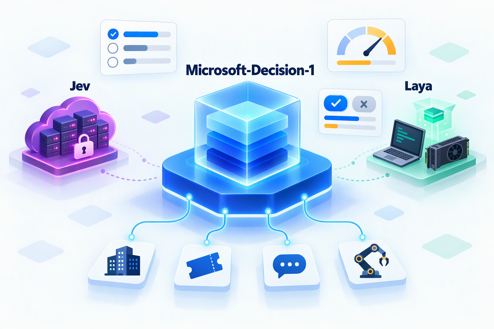
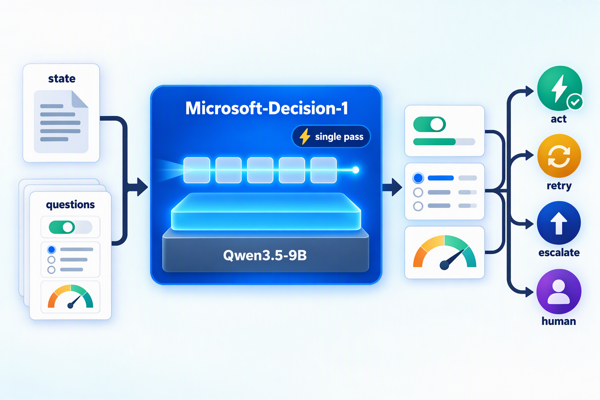
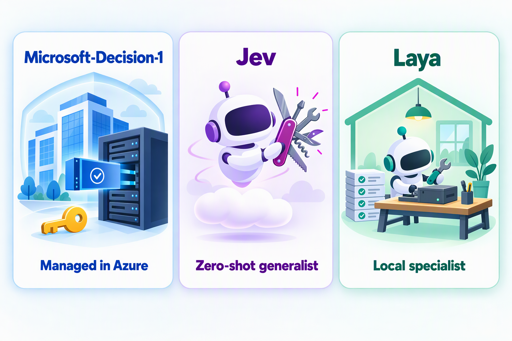

## 引言

上个月我写了一篇 [Jev vs Laya](/zh/blog/2026/jev-vs-laya/)，对比了 TypeSafe AI 的闭源决策模型 Jev 和社区开源的 Laya。那时“决策模型”还是一个刚刚诞生的新品类：9 月 15 日 Jev 发布，三天后 Laya 开源。

仅仅三周之后，这个赛道就挤满了玩家：10 月 6 日，OpenAI 开放了基于 GPT-6 Luna 的 Decisions API；Liquid AI、Inception 等公司也陆续推出了自己的决策 API；第三方榜单 JevBench 上参与排名的开源权重系统已经超过 140 个。10 月 9 日，微软也正式入局，发布了 **Microsoft-Decision-1**。

和其他入局者相比，Microsoft-Decision-1 有几个特别值得关注的地方：

* **出自大厂，底座却是开源模型**：它基于阿里开源的 Qwen3.5-9B 后训练而来，微软还表示后续会迁移到自家的 MAI 系列和 OpenAI 的模型上；
* **价格与 Jev 完全一致**：输入每百万 token 0.042 美元，输出免费；
* **接口几乎与 Jev 兼容**：同样是 state + questions，同样是 noul / choice / score 三种问题类型；
* **官方数据很亮眼**：在 36 项基准、近 15 万道题的对比中平均准确率最高，中位延迟比 GPT-6 Sol 快约 35 倍。

但官方数据只是故事的一半。微软发布的第二天，第三方榜单 JevBench 就完成了独立实测，结论并不完全一致。本文将从以下几个方面展开：

1. Microsoft-Decision-1 是什么，又是怎么做出来的
2. 它与 Jev、Laya 的技术路线和接口有什么不同
3. 官方基准与第三方实测应该怎么看
4. Microsoft-Decision-1 的优势与劣势
5. 适用场景、选型建议与代码示例

## 一分钟回顾：什么是决策模型

决策模型（System One Model）不聊天，也不写文章，它只做一件事：**接收一段状态（state）和一组预先定义好的问题（questions），直接返回带概率的类型化决策**。三家都支持同样的三种问题原语：

| 原语 | 回答的问题 | 返回内容 |
| --- | --- | --- |
| `noul` | 是不是？ | “是”的概率（0～1） |
| `choice` | 选哪一个？ | 选中的选项，以及每个选项的概率 |
| `score` | 有多少？ | 有序等级上的分数，以及每个等级的概率 |

由于答案空间被提前限定，模型不会返回格式错误或凭空编造的选项；校准过的概率则可以直接写进程序的 `if` 语句：高置信度自动执行，中置信度交给更强的模型复核，低置信度转人工。在一个 AI 系统里，比较合理的分工是：**代码负责骨架，决策模型负责快速判断，大模型负责深度思考**。

更详细的概念介绍和置信度分流的思路，可以参考上一篇，这里不再展开。

## Microsoft-Decision-1 是什么

### 1. 基本信息

2026 年 10 月 9 日，微软首席技术官办公室（Office of the CTO）软件工程副总裁 Achint Srivastava 在微软的技术博客 Command Line 上发布了 Microsoft-Decision-1。文章开头是这样定义决策模型的：

> Unlike LLMs, which are designed to generate text or reason through complex problems, decision models are purpose-built to deliver structured outputs that software can immediately act on.
>
> 与生成文本、推理复杂问题的大模型不同，决策模型专门用来输出软件可以立即据此行动的结构化结果。

微软给它的定位是一个“快速决策打分”（fast decision-scoring）模型，面向路由、分类、优先级排序、结果校验和工作流控制。主要信息如下：

| 项目 | 说明 |
| --- | --- |
| 发布时间 | 2026 年 10 月 9 日 |
| 发布方 | 微软首席技术官办公室（Office of the CTO） |
| 底座模型 | Qwen3.5-9B（后训练），计划迁移到 MAI 和 OpenAI 的模型 |
| 模型类型 | 决策、文本分类、零样本分类 |
| 问题类型 | `noul`（是 / 否）、`choice`（多选一）、`score`（有序打分），以及基于评分细则（rubric）评估 AI 回答和 Agent 行为 |
| 输入 | 仅支持文本（字符串或 JSON），单次请求最多 32K token，不支持图像、音频和视频 |
| 输出 | 选中项和每个候选项的校准概率，不生成解释或理由 |
| 获取方式 | Microsoft Foundry 模型目录（模型名 `Microsoft-Decision-1`，版本 `1`），也可以通过 OpenRouter 调用 |
| 部署类型 | `GlobalStandard`，部分区域支持 `DataZoneStandard` |
| 调用端点 | `{Foundry 资源端点}/providers/microsoft/v1/systemone` |
| 认证方式 | Microsoft Entra ID（推荐）或 API Key |
| 价格 | 输入 0.042 美元 / 百万 token，输出免费 |

按这个价格，如果每次判断平均消耗 1000 个输入 token，100 万次判断的费用约为 42 美元，和 Jev 完全相同。

### 2. 它是怎么做出来的

微软公开的技术细节不多，但有几个关键点：

* **在开源底座上后训练**：微软在 Qwen3.5-9B 上做了后训练（post-training），让它学会“单次前向完成决策打分”（fast, single-pass decision scoring）。给定一组固定的候选答案，模型直接为每个选项输出一个校准过的概率，而不是逐 token 生成文字。
* **底座可以替换**：微软明确表示，很快会把它迁移（rebase）到其他底座上，包括微软自研的 MAI 系列和 OpenAI 的模型。
* **没有公开的部分**：训练数据、后训练方法和打分机制的具体实现都没有公开，权重也没有开放，只能以托管 API 的形式使用。



微软在博客里把打造一个可靠决策模型的难点归纳为五个方面，并给出了相应的自测结果：

| 挑战 | 为什么重要 | 微软的自测结果 |
| --- | --- | --- |
| 速度 | Agent 工作流中的决策往往是串行的，每个决策多 100 毫秒，20 个串行决策就会多出 2 秒 | P50 延迟约为 GPT-6 Sol 的 1/35 |
| 泛化 | 模型很容易在单个基准上过拟合，必须验证它在没见过的任务上是否同样可靠 | 在数十个对训练保密的基准（路由、排序、长上下文、多语言、分布外任务、推理、安全）上评测；与 JevBench 榜单上的头部模型在另外 36 个公开和私有基准上对比，平均准确率最高 |
| 鲁棒性 | 生产环境里，state 和指令会被改写，选项会被重排，字段名会变化，这些等价变化不应该改变决策 | 对同一请求做 8 种扰动，平均决策翻转率为 1.3%；改写选项描述、颠倒或打乱选项顺序时，翻转率为 0 |
| 校准 | 概率本身就是 API 的一部分，应用要依据它决定是执行、推迟还是送审，“90% 的把握”应该在代表性样本上 10 次对 9 次 | 36 项基准上的校准分为 92.2（满分 100），在参评的 7 个模型中排第三，比 Jev 低 1.5 分 |
| 安全 | 既要识别有害请求，又不能误伤正常请求 | 在 11 个基准、5250 条请求（有害内容、越狱攻击、提示词注入）上测试，能够拒绝有害行为，同时保持较高的可用性 |

### 3. 微软内部的四个试点

微软还公开了几个内部试用的案例（均为微软自测）：

| 团队 / 场景 | 任务 | 结果 |
| --- | --- | --- |
| Xbox Research：数据标注 | 把来自问卷、Steam 和 Twitter/X 的 1 万多条开放式反馈，归入研究员预先定义好的主题 | 质量与 GPT-6 Sol 相当，速度快 14 倍以上，成本低约 200 倍 |
| Copilot：质量控制 | 评估聊天回答和 Agent 回答的质量 | 与 GPT-5.6 Luna 表现相当，速度快约 100 倍 |
| 事故响应 | 值班工程师处理线上事故时，从日志、工单、通话和消息中检索相关知识 | 比基于大模型的方案更准、更快 |
| Microsoft Discovery：科学研究 | Agent 按评分细则评估上一轮实验的结果，调整方案并反复迭代，直到完成目标 | 打分一致性是大模型打分的 46 倍，速度是 3 倍，自适应重规划整体提速近 4 倍 |

其中 Xbox 的三个数据集，微软给出了更详细的对比数据：

| 数据集 | 样本量 | 平均每条耗时（GPT-6 Sol → Decision-1） | 跑完一遍的成本（GPT-6 Sol → Decision-1） |
| --- | --- | --- | --- |
| 某赛车游戏的评论 | 753 条 | 2.8 秒 → 159 毫秒（约 18 倍） | 1.83 美元 → 0.009 美元（约 213 倍） |
| 某第一人称射击游戏的评论 | 341 条 | 2.6 秒 → 188 毫秒（约 14 倍） | 1.03 美元 → 0.005 美元（约 212 倍） |
| 某工作室直播的帖子 | 1030 条 | 2.6 秒 → 143 毫秒（约 18 倍） | 2.92 美元 → 0.013 美元（约 223 倍） |

按 100 万条文本折算，GPT-6 Sol 约需 2434 美元，Microsoft-Decision-1 约需 11 美元（微软注明成本为估算值）。两者读取的是同一份任务说明，输入 token 数相同，差距来自单价，以及 GPT-6 Sol 还需要为输出付费。

### 4. 适合哪些场景

微软在博客里列出了 16 个推荐场景，大致可以归为四类：

| 类别 | 场景 |
| --- | --- |
| Agent 控制 | 评估 Agent 提出的下一步，决定继续、停止、重试，还是交给其他模型、工具或人；按照 Skill 中的规则选择下一步动作，而不必反复处理一长串指令；在电脑和界面操作中选择下一个 UI 动作；在机器人场景中从预定义的动作里做选择 |
| 路由与分类 | 模型路由、意图识别、事故分级与派单、内容分类与过滤、数据标注 |
| 评估与校验 | AI 评审（按标准决定接受、修改还是拒绝一个回答）、数据校验、代码扫描、安全风险筛查（放行、拦截或升级） |
| 排序与推荐 | 推荐、搜索相关性打分，以及在科学研究中筛选假设、化合物和实验 |

其中最值得关注的是 **Agent 控制**。今天的 Agent 每走一步都要做大量“小判断”：上一步成功了吗？要不要重试？这个工具调用会不会动到生产数据？如果这些判断都交给大模型，延迟和成本会随着步数线性累积。用一个百毫秒级的决策模型给 Agent 加一道“闸门”，是这类模型最有想象空间的用法。微软还演示了一个电脑操作（computer use）的例子：在完成“买一个背包”的任务时，由 Microsoft-Decision-1 选择下一步界面操作，完成速度明显快于 GPT-6 Sol。


另一个值得一提的场景是**模型路由**：根据请求的质量、成本和延迟要求，选择最合适的模型来处理。我之前写过一篇 [让模型自己选模型：Embedding 驱动的 LLM 智能路由机制](/zh/blog/2026/llm-smart-router/)，决策模型提供了另一种思路：不再依赖向量相似度，而是直接把“该交给哪个模型”当成一道 `choice` 题来回答。

## 三条技术路线


把三个模型放在一起，会发现它们代表了三条截然不同的技术路线：

| 维度 | Jev | Laya | Microsoft-Decision-1 |
| --- | --- | --- | --- |
| 模型结构 | 未公开（社区猜测接近 encoder 类模型） | 双向编码器（ModernBERT / mmBERT）+ 决策头 | 解码器大模型 Qwen3.5-9B 后训练 |
| 参数规模 | 未公开 | 322M～421M | 约 9B |
| 训练方法 | RLCD（面向校准决策的强化学习，细节未公开） | RLCD（严格适当评分规则 + 组基线策略梯度，已公开） | 面向单次决策打分的后训练（细节未公开） |
| 推理方式 | 自研的并行采样器 | 每个选项前放一个 `[MASK]`，单次前向打分 | 单次前向打分 |
| 权重 | 闭源 | Apache 2.0 开源 | 不开放（底座开源） |

有几点值得展开说说：

1. **规模相差一个数量级以上**。Laya 用 4 亿参数的编码器换取极致的速度和本地部署能力；Microsoft-Decision-1 用 90 亿参数的解码器换取更强的零样本泛化能力，代价是对算力的要求高得多，而且目前只能以云端托管的方式使用。
2. **底座正在变成可替换的零件**。从 JevBench 榜单看，排名靠前的开源决策模型大多也是在 Qwen 或 Gemma 上后训练出来的，比如基于 Qwen3.5-4B 的 H2O-Lightning-4B、基于 Gemma-4-31B 的 Quyet-1.0-Large。微软直接选用阿里的开源模型做底座，又公开表示后续会换成 MAI 或 OpenAI 的模型，说明这类模型的竞争力主要来自后训练数据、评测体系和校准方法，而不是底座本身。
3. **“单次前向”已经是共识**。无论是 Laya 的编码器还是 Microsoft-Decision-1 的解码器，核心思路都一样：不生成文本，一次前向计算就给出所有候选项的概率。这也是决策模型能比通用大模型快一到两个数量级的根本原因。

## 同一套接口，三种后端


对开发者来说，一个非常实用的变化是：**三者的请求格式几乎一致**。

* Jev 的官方 API 是 `POST https://api.typesafe.ai/v1/systemone`；
* Microsoft-Decision-1 的端点是 Foundry 资源下的 `/providers/microsoft/v1/systemone`，微软文档也直接说明，它的请求模式与 System One API 类似；
* Laya 也提供了 `laya-serve`，在本地以同样的 `POST /v1/systemone` 协议对外服务，返回结构与 Jev 一致，已有的 Jev 客户端只需要修改 `baseUrl`。

三者在细节上的差异如下：

| 项目 | Microsoft-Decision-1 | Jev | Laya（laya-serve） |
| --- | --- | --- | --- |
| 端点 | `{Foundry 资源端点}/providers/microsoft/v1/systemone` | `https://api.typesafe.ai/v1/systemone` | `http://{主机}:8000/v1/systemone` |
| 认证 | Entra ID 的 Bearer Token，或 `api-key` 请求头 | `Authorization: Bearer {API Key}` | 默认无认证，设置 `LAYA_API_KEY` 后使用 Bearer Token |
| `model` 字段 | 部署名称（deployment name） | 模型版本或别名，如 `jev-1.13.0` | 检查点名称，省略时由 Router 自动选择 |
| 单次请求上限 | 32K token | 64K token，其中 state 加最长的单个问题不超过 32K | 默认 512 / 1024 token，多语言检查点最高 8192 |
| 批量 | 同一个 state 可以带多个问题 | 同左 | 同左，另有 `/v1/systemone/batch`，一次最多 64 个 state |

这意味着 `state + questions` 风格的接口正在成为决策模型的事实标准，就像当年 OpenAI 的 Chat Completions 接口之于大模型。微软把价格定得和 Jev 一模一样、接口也几乎一致，很难不让人认为这是在刻意降低 Jev 用户的迁移门槛。对用户来说，切换成本越来越低；对厂商来说，护城河只能来自效果、延迟、单次成本、合规能力和生态。

## 核心差异一览

| 维度 | Microsoft-Decision-1 | Jev | Laya |
| --- | --- | --- | --- |
| 发布方 | 微软 | TypeSafe AI（创业公司） | Convai Innovations（独立研究者） |
| 发布时间 | 2026 年 10 月 9 日 | 2026 年 9 月 15 日 | 2026 年 9 月 18 日 |
| 开源 | 权重不开放 | 闭源 | Apache 2.0 |
| 部署 | Azure 托管（Foundry），也可经 OpenRouter 调用 | TypeSafe 云端（美国西海岸） | 本地、私有云或离线环境 |
| 架构与规模 | Qwen3.5-9B 后训练 | 未公开 | 编码器 + 决策头，322M～421M |
| 问题原语 | noul / choice / score + 评分细则 | noul / choice / score | noul / choice / score |
| 上下文 | 32K token | 64K token | 默认 512 / 1024 token |
| 零样本能力 | 强 | 强 | 弱，需要微调 |
| 定制方式 | 调整 state、instructions 和选项 | 调整 state、instructions 和 criteria | 可在自有数据上微调，并拟合校准温度 |
| 官方延迟 | 同区域 p50 约 85 ms | 70～500 ms | T4 上单个问题约 33 ms |
| 价格 | 输入 $0.042 / 百万 token，输出免费 | 同左 | 模型免费，自备算力 |
| 企业集成 | Azure 订阅计费、Entra ID、RBAC、数据区域部署 | API Key，零数据保留仅面向企业客户 | 完全自主可控 |
| 多语言 | 未列出支持的语言，评测中包含多语言任务 | 以英语为主 | 多语言检查点覆盖 100 多种语言 |

## 基准数据怎么看

### 1. 微软公布的对比数据

微软把 Microsoft-Decision-1 和 JevBench 榜单上的几个头部模型、Jev 以及 GPT-6 Sol 放在一起，在 36 个公开和私有基准、共 147,137 道题上做了对比（准确率和校准分越高越好，延迟越低越好）：

| 模型 | 平均准确率 | 中位延迟（p50） | 校准分（100 为完美） |
| --- | --- | --- | --- |
| **Microsoft-Decision-1** | **83.5%** | **85 ms** | 92.2 |
| Jev 1.13.0 | 82.3% | 240 ms | **93.7** |
| Quyet-1.0-Large | 81.9% | 380 ms | 93.1 |
| Surogate Rune 26B-A4B | 79.7% | 380 ms | 91.8 |
| GPT-6 Luna Decisions | 79.4% | 300 ms | 89.9 |
| deck-31B | 77.8% | 400 ms | 83.5 |
| H2O-Lightning-4B v1.1 | 77.2% | 210 ms | 91.8 |
| GPT-6 Sol（参照） | 未参与排名 | 3010 ms | 未评分 |

注：Microsoft-Decision-1 的延迟是在 Foundry 同区域测得的，其余模型的延迟引用自 JevBench v1.6.1 的调整后中位延迟（10 月 7 日数据）。另外，AWS 的 Strands-Decider 2B 只能回答 36 个基准中的 23 个，平均准确率为 54.8%，未列入上表。微软的文章在发布后还专门更新了一次，补充了 Jev 的准确率和校准数据。

按这组数据，Microsoft-Decision-1 的平均准确率第一，速度最快：比第二快的 H2O-Lightning-4B v1.1 快 2.5 倍，比 Jev 快约 2.8 倍，比 GPT-6 Sol 快约 35 倍；校准分排第三。

需要注意的是，微软说的是 36 项基准的**平均**准确率最高，而不是每一项都排第一，一些报道中“36 项基准全部第一”的说法并不准确。

### 2. 第三方 JevBench 的实测

JevBench 是一个独立于 TypeSafe 的社区榜单（个人维护的开源项目 Benchmark Heaven），用 1500 道决策题（1200 道封存题加 300 道公开题），从智能（Intelligence）、校准（Calibration）、速度和成本四个维度评测决策模型。Microsoft-Decision-1 发布的第二天（10 月 10 日），JevBench 就通过 Azure Foundry 的原生接口完成了完整测试。下面是 API 榜单上的部分结果：

| 综合排名 | 系统 | 综合分 | 能力分 | 每千次决策成本 | 中位延迟 |
| --- | --- | --- | --- | --- | --- |
| 1 | Sage 1.3.0（Levanto Labs） | 74.0 | 78.6 | 约 $0.025 | 0.15 s |
| 2 | d1（Liquid AI） | 73.0 | 74.4 | $0.017 | 0.27 s |
| 3 | Mercury Decide（Inception） | 72.4 | 73.6 | 约 $0.018 | 0.33 s |
| 4 | **Jev 1.13.0** | **71.5** | **77.1** | $0.032 | 0.24 s |
| 5 | wity-1 | 70.8 | 79.1 | $0.024 | 1.57 s |
| 6 | **Microsoft-Decision-1** | **69.1** | **70.8** | $0.019 | 0.46 s |
| 8 | OpenAI Decisions（gpt-6-luna） | 62.5 | 73.5 | $0.052 | 0.30 s |

把 Jev 和 Microsoft-Decision-1 单独拿出来比较：

| 维度 | Jev 1.13.0 | Microsoft-Decision-1 |
| --- | --- | --- |
| 智能分 | **63.6** | 57.2 |
| 校准分 | **90.6** | 84.4 |
| 每千次决策成本 | $0.032 | **$0.019** |
| 中位延迟 | **0.24 s** | 0.46 s |

JevBench 的智能分是扣除随机猜测之后的得分（0 表示和随机猜测相当，100 表示全部答对），能力分是智能分和校准分的平均值，综合分则把智能、校准、速度和成本四个维度放在一起计算。它们和微软表格里的“平均准确率”不是同一个指标，不能直接换算。

### 3. 解读数据时必须注意的五点

**第一，自测与第三方的结论并不一致。** 在微软的 36 项基准上，Microsoft-Decision-1 的平均准确率比 Jev 高 1.2 个百分点；但在 JevBench 上，Jev 的智能分（63.6 对 57.2）和能力分（77.1 对 70.8）都明显领先。两边的题目、评分方法和统计口径完全不同，谁也不能代表“绝对真相”。比较稳妥的理解是：Microsoft-Decision-1 已经进入第一梯队，但还谈不上全面超越 Jev。这也再次说明，**最可靠的基准永远是你自己的数据**。

**第二，校准仍是 Jev 的强项。** 即使在微软自己的数据里，Microsoft-Decision-1 的校准分（92.2）也落后于 Jev（93.7）和 Quyet-1.0-Large（93.1）；在 JevBench 上差距更大（84.4 对 90.6）。对于依赖置信度阈值做分流的系统来说，校准质量往往比准确率高出一两个点更重要。

**第三，延迟主要取决于部署位置。** 微软的 85 ms 是在 Foundry 同区域测得的，而表中其他模型的延迟来自 JevBench 自己的测试环境。JevBench 原生调用 Microsoft-Decision-1 测得的中位延迟是 459 ms，在同一个榜单上，Jev 是 240 ms。两组数字都没有错，只是测量条件不同。决策模型的计算本身只需要几十毫秒，真正决定体验的是网络距离：把 Foundry 资源建在离应用最近的区域，对数据驻留有要求时选择 `DataZoneStandard`，并且一定要用真实流量实测。

**第四，同样的单价，不同的单次成本。** 两者的标价都是每百万输入 token 0.042 美元，但 JevBench 在同一批题目上实测的每千次决策成本，Microsoft-Decision-1 约为 0.019 美元，Jev 约为 0.032 美元，前者便宜约 40%。差异来自两者对同样的输入计出的 token 数不同。调用量很大时，这个差距值得算进总成本。

**第五，Laya 不在同一条赛道上。** 微软的对比中没有 Laya。JevBench 对 Laya 的三个检查点做了零样本测试，智能分只有 0.3～5.5，几乎等同于随机猜测。这和 Laya 作者自己的定位是一致的：它是一个需要在自有数据上微调的快速底座，而不是零样本决策引擎。再加上默认只有 512 / 1024 token 的上下文，Laya 在 JevBench 这种包含长文本、覆盖开放领域的考卷上吃亏是必然的。它的价值在于本地部署，以及特化之后的速度和成本，这一点在上一篇中已经详细讨论过。

此外，JevBench 中有 23 道约 7.7 万～8.1 万 token 的超长题。Microsoft-Decision-1 有 21 道因为超出上下文限制而失败，Jev 也拒绝了这 23 道超出其输入范围的题目，它们都按答错计分。

### 4. 小结

比较公允的结论是：**Microsoft-Decision-1 进入了决策模型的第一梯队，优势在于同区域延迟、单次成本和微软生态；Jev 在校准和长上下文上仍然领先；Laya 则是另一条赛道上的选手，适合有数据、需要本地化的团队。**

## Microsoft-Decision-1 的优势与劣势

### 优势

1. **企业级集成**：作为 Azure 直接销售的 Foundry 模型，它通过 Azure 订阅计费，受 Azure SLA 保障并由微软提供支持；支持 Entra ID 认证和 RBAC 权限控制，可以和现有的 Azure 网络、监控、合规体系一起管理。对已经在用 Azure 的企业来说，几乎不需要引入新的供应商。
2. **同区域延迟低**：微软在同区域测得的 p50 约为 85 ms、p95 约为 125 ms，加上决策只需要一次前向计算，适合放进 Agent 的多步循环里。
3. **零样本能力进入第一梯队**：不需要任何训练数据就能使用；在微软的 36 项基准上平均准确率最高，在 JevBench 的 27 个 API 产品中综合排名第 6。
4. **鲁棒性好**：对同一请求做 8 种等价扰动，平均翻转率只有 1.3%，选项改写或重排时不翻转。在提示词和选项不断演进的生产环境中，这一点很重要。
5. **单次成本更低**：标价与 Jev 相同，按 JevBench 的实测，每千次决策的成本还要低约 40%。
6. **接口兼容，迁移成本低**：请求格式与 Jev 的 System One 风格接口几乎一致，已有的问题设计和分流逻辑可以直接复用（阈值需要重新标定）。
7. **有具体的落地参考**：Xbox、Copilot、事故响应、Microsoft Discovery 等内部试点给出了可以借鉴的用法，虽然这些同样是自测数据。

### 劣势

1. **以自测数据为主，第三方结果不如官方亮眼**：在 JevBench 上，它的智能分和校准分都低于 Jev，在 API 榜单上综合排名第 6。
2. **校准不是最强**：无论官方数据还是第三方数据，它的校准都落后于 Jev，上线前一定要用自己的数据标定阈值。
3. **上下文只有 32K**：比 Jev 的 64K 短，长邮件串、长合同或 Agent 的长执行轨迹需要先截断、摘要或分块。
4. **权重不开放，也不能微调**：虽然底座是开源的 Qwen3.5-9B，但模型本身只能以托管 API 的形式使用，无法本地或离线部署；目前文档只介绍了通过 state、instructions 和选项来调优，没有提供基于自有数据的微调。
5. **版本和底座都可能变化**：目前只有版本 `1`，而微软已经表示会把它迁移到 MAI 或 OpenAI 的底座上。底座一换，概率分布很可能随之变化，调好的阈值需要重新标定。
6. **没有解释，且对措辞敏感**：模型只返回数字，不给理由。官方文档也提醒：问题和选项的措辞、顺序会影响分数；校准在熟悉的任务类型上最可靠；模型的知识可能已经过时；作为安全过滤器时，它可能漏掉隐蔽的有害内容，也可能误拦正常内容。
7. **跨境与数据驻留**：中国大陆的团队目前需要通过 Azure 全球版的 Foundry 调用它，要同时考虑跨境网络延迟和数据出境的合规要求；`GlobalStandard` 部署可能在任意区域处理推理请求，对数据驻留敏感的场景应选择 `DataZoneStandard`。

## 与 Jev、Laya 相比，怎么选

### 1. 场景对照表

| 场景 | 推荐 | 理由 |
| --- | --- | --- |
| 已经在用 Azure，需要统一计费、Entra ID 认证和企业合规 | Microsoft-Decision-1 | 不引入新的供应商，和现有的 Azure 资源统一管理 |
| Agent 的多步控制（继续、重试、交接）、AI 评审、电脑操作中的下一步选择 | Microsoft-Decision-1 | 同区域延迟低，官方明确支持评分细则类的问题 |
| 云端的海量分类和打标，追求单次成本 | Microsoft-Decision-1 | 单价相同，实测单次成本更低 |
| 对置信度校准要求最高的阈值分流 | Jev | 官方和第三方数据中，校准都领先 |
| 长文本判断（32K～64K token） | Jev | 64K 上下文 |
| 细粒度、选项很多的分类（几十到上百个选项） | Jev | 最多支持 255 个选项，在 Banking77 这类细粒度意图分类上表现好 |
| 数据不能离开自己的环境，或者需要离线运行 | Laya | 三者中唯一可以本地部署的选项 |
| 每秒几十次以上的实时决策、端侧应用 | Laya | 本地推理，没有网络往返 |
| 有大量标注数据的垂直任务 | Laya（微调后） | 特化之后更快、更准、更便宜 |
| 中文等非英语场景 | 三者都需要自测 | Jev 以英语为主；Laya 要使用多语言检查点；Microsoft-Decision-1 没有公布支持语言的细节 |

### 2. 选型时要回答的几个问题

可以按下面的顺序依次回答：

```
1. 数据能否离开自己的环境（以及境内）？
   └─ 不能 → Laya（硬约束，其他因素都要让路）
2. 是否已经在用 Azure，需要统一账单、Entra ID、RBAC 和数据区域部署？
   └─ 是 → 优先评估 Microsoft-Decision-1
3. 是否高度依赖置信度阈值，或者单次输入经常超过 32K token？
   └─ 是 → 优先评估 Jev
4. 是否有标注数据，并且需要每秒几十次以上的决策？
   └─ 是 → 微调 Laya，本地部署
5. 以上都不是硬约束？
   └─ 用同一组题目同时测试 Microsoft-Decision-1 和 Jev，
      按准确率、校准、延迟和单次成本综合选择
```

### 3. 组合使用：不必三选一

由于三者的接口几乎一致，组合使用的成本很低：

1. **多供应商容灾**：把 Microsoft-Decision-1 和 Jev 配置成互为备份的两个云端后端，一方限流或故障时自动切换。两者的概率分布不同，阈值需要分别标定。
2. **影子测试**：生产流量走一个后端，同时把请求异步发给另一个后端，积累两者结论不一致的样本，再交给人工或大模型裁决，为后续的选型和阈值调整提供依据。
3. **分层级联**：本地的 Laya 先处理高频、短文本、高置信度的请求；低置信度或长文本请求升级给 Microsoft-Decision-1 或 Jev；仍然拿不准的，再交给推理型大模型或人工处理。
4. **按数据敏感度路由**：涉及敏感数据的请求只走本地的 Laya，其余请求走云端。

## 代码示例：同一组问题，三种后端

### 1. 部署 Microsoft-Decision-1

可以在 Foundry 门户的模型目录中搜索 Microsoft-Decision-1 并一键部署，也可以使用 Azure CLI：

```bash
az cognitiveservices account deployment create \
  --name <ACCOUNT_NAME> \
  --resource-group <RESOURCE_GROUP> \
  --deployment-name decision-1 \
  --model-name "Microsoft-Decision-1" \
  --model-format Microsoft \
  --model-version "1" \
  --sku-name GlobalStandard \
  --sku-capacity 1
```

如果需要把推理限制在某个数据区域内，可以把 `--sku-name` 换成 `DataZoneStandard`（需要所在区域支持）。

### 2. 启动本地的 Laya 服务

```bash
pip install "laya[serve]"
# 只监听本机；如需对外提供服务，请设置 LAYA_API_KEY 并放在网关后面
LAYA_HOST=127.0.0.1 LAYA_DEVICE=cuda LAYA_PRELOAD=1 laya-serve
```

### 3. 用同一组问题调用三个后端

下面的示例使用 `requests` 和 `azure-identity`（`pip install requests azure-identity`）。注意 `team` 问题里加了一个 `cannot_tell` 选项，这是微软文档推荐的做法：当模型不应该被迫做出选择时，给它一个“无法判断”的出口。

```python
import os

import requests
from azure.identity import DefaultAzureCredential

payload = {
    "state": {
        "message": "Checkout is down again. This is my third request.",
        "customer_contact_count": 3,
    },
    "questions": {
        "team": {
            "type": "choice",
            "instructions": "Which team should handle this request?",
            "criteria": {
                "billing": "Charges, invoices, and refunds",
                "engineering": "Bugs, errors, and outages",
                "support": "How-to and account questions",
                "cannot_tell": "The message does not say enough to decide",
            },
        },
        "severity": {
            "type": "score",
            "instructions": "How severe is this issue?",
            "criteria": ["Cosmetic", "Minor", "Major", "Critical"],
        },
        "repeat_contact": {
            "type": "noul",
            "instructions": "Has the customer contacted support before?",
        },
    },
}


def decide(url: str, headers: dict, model: str | None = None) -> dict:
    body = {**payload, "model": model} if model else payload
    resp = requests.post(url, headers=headers, json=body, timeout=10)
    resp.raise_for_status()
    return resp.json()["answers"]


# 1) Microsoft-Decision-1（Foundry）：model 填部署名称，推荐使用 Entra ID 认证
token = DefaultAzureCredential().get_token("https://cognitiveservices.azure.com/.default").token
answers = decide(
    f"{os.environ['AZURE_ENDPOINT'].rstrip('/')}/providers/microsoft/v1/systemone",
    {"Authorization": f"Bearer {token}"},
    os.environ["DEPLOYMENT_NAME"],
)
print("decision-1:", answers["team"]["choice"])

# 2) Jev（TypeSafe）：固定版本号，避免别名升级后调好的阈值失效
answers = decide(
    "https://api.typesafe.ai/v1/systemone",
    {"Authorization": f"Bearer {os.environ['TYPESAFE_API_KEY']}"},
    "jev-1.13.0",
)
print("jev:", answers["team"]["choice"])

# 3) Laya（本地 laya-serve）：省略 model，由 Router 按语言自动选择检查点
answers = decide("http://127.0.0.1:8000/v1/systemone", {})
print("laya:", answers["team"]["choice"])
```

如果使用 API Key 调用 Microsoft-Decision-1，把请求头换成 `{"api-key": os.environ["AZURE_API_KEY"]}` 即可。

三个后端返回的 `answers` 都以问题名为键，但有几个细节需要留意：

* Jev 和 Laya 的 `choice` 结果都包含 `choice`、`probabilities` 和 `confidence`，不过 Laya 的 `confidence` 计算方式和 Jev 不同，所以它额外提供了一个按 Jev 公式计算的 `x_jev_confidence`，方便沿用 Jev 上调好的阈值；
* Microsoft-Decision-1 的文档说明会返回选中项和每个选项的概率，接入时建议先打印一次完整的响应，确认字段名之后再编写阈值逻辑；
* Microsoft-Decision-1 的 `score` 返回的是各等级下标的概率加权平均值（四级量表的取值范围是 0～3，可能落在两个等级之间），文档建议把它用于相对排序和阈值判断，而不是当作绝对的校准评分。

## 落地注意事项

Microsoft-Decision-1 的官方文档给出了不少实用的建议，它们同样适用于 Jev 和 Laya：

1. **先用代表性数据验证**：用自己的标注样本测试准确率和延迟，再决定是否上线。
2. **按误判代价设置阈值**：根据误报和漏报的代价分别设置置信度阈值；不应该强行选择时，加一个“无法判断”的选项。
3. **使用中性措辞，随机化选项顺序**：测试改变选项顺序是否会影响结果。
4. **用 Coding Agent 迭代问题设计**：让 Coding Agent 生成多组候选的 state、instructions 和选项，在标注集上评估、对比，人工审核之后再上线。
5. **涉及个人的重大决策必须有人参与**：在信贷、招聘、住房、医疗、法律等场景中，只能把模型作为决策辅助，并告知受影响的用户有 AI 参与了决策；不要使用不必要的敏感属性，并持续监控不同群体之间的结果差异。
6. **阈值不能跨后端照搬**：三个模型的概率分布不同，置信度的计算方式也可能不同，切换或混用后端时要分别标定。
7. **固定版本，持续监控**：固定部署的模型版本，升级（包括底座迁移）之后重新标定阈值，并持续监控概率分布和校准漂移。

## 总结

用一句话概括三者：

> **Microsoft-Decision-1 是“Azure 里的企业级决策组件”，Jev 是“开箱即用的云端通才”，Laya 是“可以特化的本地专才”。**



* 如果你已经在用 Azure，需要统一的计费、身份认证和合规体系，或者想给 Agent 加一道低延迟的“决策闸门”，Microsoft-Decision-1 是最省事的选择；
* 如果你最看重置信度校准和长上下文，Jev 目前仍然更稳；
* 如果数据不能离开本地，或者需要毫秒级、海量的决策，并且有能力准备标注数据，Laya 依然不可替代。

从更大的视角看，Microsoft-Decision-1 的意义不只是“又多了一个决策模型”。微软带着开源底座、与 Jev 相同的价格和几乎一致的接口入局，说明了两件事：一是 `state + questions` 风格的决策接口正在成为事实标准，用户的迁移成本越来越低；二是底座正在变成可替换的零件，竞争的焦点转向了后训练数据、评测体系、校准质量和分发渠道。对开发者来说这是好消息：**把决策从大模型里拆出来，已经从创业公司和开源社区的尝试，变成了大厂也认可的工程实践。**

## 参考资料

* [Microsoft Command Line：Introducing Microsoft-Decision-1, our model for fast decision-making](https://commandline.microsoft.com/microsoft-decision-1-model-foundry/)
* [Microsoft Learn：Deploy and use Microsoft-Decision-1 in Microsoft Foundry](https://learn.microsoft.com/en-us/azure/foundry/foundry-models/how-to/use-foundry-models-microsoft-decision)
* [Microsoft Learn：Foundry Models sold by Azure](https://learn.microsoft.com/en-us/azure/foundry/foundry-models/concepts/models-sold-directly-by-azure)
* [Microsoft Foundry 模型目录：Microsoft-Decision-1](https://ai.azure.com/catalog/models/Microsoft-Decision-1)
* [JevBench：Hosted decision API benchmark](https://benchmarkheaven.com/jev-models/api)
* [JevBench：Open-weights decision model leaderboard](https://benchmarkheaven.com/jev-models)
* [TypeSafe 文档：Models](https://docs.typesafe.ai/models)
* [Laya GitHub 仓库](https://github.com/NandhaKishorM/laya)
* [Jev vs Laya：闭源与开源 System One 决策模型的对比与选型](/zh/blog/2026/jev-vs-laya/)
