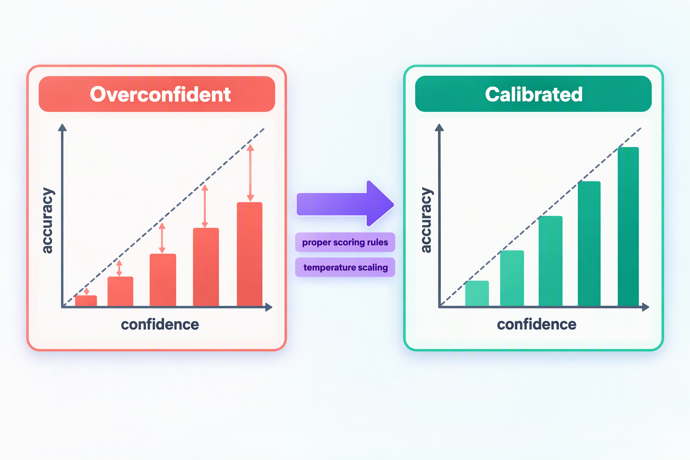
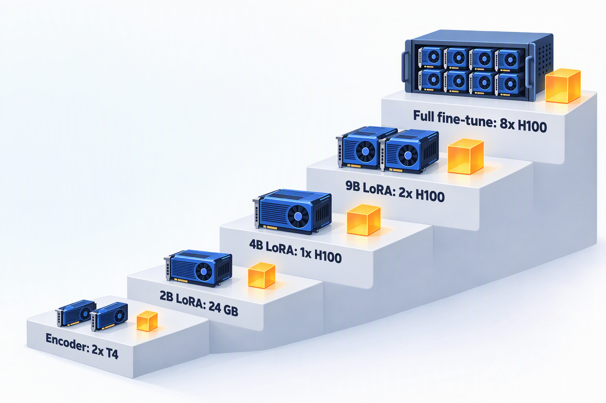

## 引言

过去一个月，我连续写了两篇决策模型的文章：[Jev vs Laya](/blog/2026/jev-vs-laya/) 对比了闭源的 Jev 和开源的 Laya，[Microsoft-Decision-1 详解](/blog/2026/microsoft-decision-1/) 又加入了微软。写完之后，被问得最多的问题是：**能不能自己训练一个？**

答案是可以，而且门槛比想象中低。看看第三方榜单 JevBench 就知道：截至 10 月中旬，开源权重榜上已经有 160 多个参与排名的系统，绝大多数出自社区和中小团队之手。排在前面的也不神秘：综合分第一的 H2O-Lightning-4B 是在阿里开源的 Qwen3.5-4B 上微调出来的，能力分第一的 Quyet-1.0-Large 则是 Gemma-4-31B 加一个适配器；微软的 Microsoft-Decision-1，底座同样是开源的 Qwen3.5-9B。

这说明一件事：**决策模型的核心竞争力不在模型结构，而在数据、训练目标和评测体系。** 这三样东西，普通团队完全可以自己掌握。

本文按一个真实项目的顺序，把训练一个“自己的 Jev”的全过程走一遍：

1. 原理：决策模型到底在学什么，为什么训练目标必须是“严格适当评分规则”
2. 数据：去哪里找，怎么统一格式、清洗、增强和切分
3. 算力：需要多少显存、多少 GPU 小时、多少钱
4. 底座：怎么选基础模型
5. 训练：从零写一套可以直接运行的 LoRA 训练脚本
6. 评测：用哪些指标打分，怎么和 JevBench 上的模型同场比较
7. 调优：分数不理想时，按什么思路改进

文中的脚本我都在 Qwen3.5-0.8B 上实际跑通过（CPU 冒烟测试，只用来验证代码正确性），文中引用的榜单和模型数据均来自公开资料，链接列在文末。

## 一、先想清楚：决策模型到底在学什么

### 1. 本质是一个“条件概率”

先回顾一下决策模型的接口：调用方给出一段状态（state）和一个问题，问题的候选答案由调用方提前定义好，模型返回每个候选答案的概率。三种问题原语都可以统一成同一件事：

| 原语 | 候选答案 | 本质 |
| --- | --- | --- |
| `choice` | 调用方定义的 K 个选项 | K 分类 |
| `noul` | 是 / 否 | 2 分类 |
| `score` | K 个有序等级 | 有序的 K 分类 |

所以，训练一个决策模型，就是让模型学会估计 `P(选项 | 状态, 问题)`。和普通的文本分类模型相比，它有两个关键区别：

* **类别不是固定的**：每次请求的问题和选项都不一样，模型必须读懂选项的含义，而不是记住一组固定的标签。这就是它需要“零样本泛化”能力的原因。
* **概率本身就是产品**：下游程序会直接拿概率做 `if` 判断，所以概率必须“诚实”，也就是校准过的。这决定了训练目标的选择，后面会专门讲。

### 2. 三条技术路线

目前社区的做法大致分成三类：

| 路线 | 代表 | 做法 | 优点 | 缺点 |
| --- | --- | --- | --- | --- |
| 编码器 + 决策头 | Laya | 在每个选项前放一个 `[MASK]`，经过双向编码器后，取这些位置的隐状态打分 | 极快，4 亿参数，T4 上单题 33～40 ms | 零样本能力弱，上下文短，必须针对任务微调 |
| 解码器 + 选项字母 | Quyet-1.0-Large、H2O-Lightning-4B | 把选项编号成 A、B、C……，模型读完提示词后，直接取下一个 token 在这些字母上的概率 | 复用大模型的知识和语言模型头，零样本能力强 | 参数量大，选项数受单 token 标签数量限制 |
| 解码器 + 决策头 | jiwo、ClassOne | 取解码器的隐状态，接一个单独训练的打分头 | 选项数和输出形式更灵活 | 打分头从零开始训练，更依赖数据 |

JevBench 的数据给出了很清楚的信号：

* 几个编码器路线的系统，零样本智能分都只有个位数（Laya 1.8、modernbert-jev v2 2.6、open-jev-deberta-v3-large 2.8），和随机猜测差不多；
* 完全不做决策微调、直接读取 Qwen3-4B-Instruct-2507 的 logits，智能分就有 34.0；
* 在 Qwen3.5-4B 上做过决策微调的 H2O-Lightning-4B 达到 60.0，接近 Jev 1.13.0 的 63.6；
* 更大的 Gemma-4-31B 底座（Quyet-1.0-Large）达到 73.4。

结论很明确：**如果目标是 Jev 那样的“零样本通才”，应该走解码器路线**，大模型预训练时学到的知识是零样本能力的来源，决策微调则把这些知识“对齐”到选项概率上；如果只服务一两个固定任务，对延迟要求极高，而且有足够的标注数据，Laya 这样的编码器路线依然是性价比最高的选择。

本文的主线是第二条路线：**解码器 + 选项字母**。它的推理过程是这样的：


1. 把状态、问题和带字母编号的选项拼成一段对话提示词，以助手回复的开头结束；
2. 模型做一次前向计算（只有预填充，没有逐 token 生成）；
3. 在最后一个位置（答案位）取出 A、B、C……这几个字母 token 的 logits，只在这 K 个 logits 上做 softmax，得到每个选项的概率。

H2O-Lightning-4B 的模型卡把这概括为“一次前向，一个输出 token”（one forward pass and one output token）。因为不生成文本，成本几乎只有输入 token；又因为输出空间被限定在 K 个字母上，模型不可能答出选项以外的东西。这条路线还有一个先天优势：大模型在选择题格式下给出的字母概率，本身就有不错的校准性（Kadavath 等人，2022），决策微调是在一个好的起点上继续打磨。

### 3. 训练目标：为什么必须是“严格适当评分规则”

决策模型输出的概率要直接进入程序的分支判断，所以我们要的不只是“答对”，还要**校准**：在所有给出 80% 把握的回答里，应该恰好有大约 80% 是对的。

**第一个坑：只奖励“答对”会毁掉校准。** 假设一道题的真实分布是 p（比如 70% 选 A、30% 选 B），模型报告的分布是 q。如果把模型当成策略，按 q 抽一个答案，答对得 1 分，期望奖励就是 `Σ p_k · q_k`，它对 q 是线性的，最优解是把全部概率押在最可能的选项上，也就是让 A 的概率等于 1。模型被训练成“永远 100% 确定”，准确率没变，概率却失去了意义。

**解决办法是用严格适当评分规则（strictly proper scoring rule）做目标。** 它的定义是：只有当模型报告的分布 q 等于真实分布 p 时，期望得分才能达到最大值，说真话是唯一的最优策略（经典论述见 Gneiting 和 Raftery 2007 年的论文）。常用的有四种：

```
记 q = (q_1, …, q_K) 为模型给出的分布，y 为标签（one-hot 或软标签）

对数评分（越大越好）     S_log(q, y) = Σ y_k · log q_k            就是负的交叉熵
Brier 分数（越小越好）   B(q, y)     = Σ (q_k − y_k)²
球面评分（越大越好）     S_sph(q, y) = Σ y_k · q_k / ‖q‖          取值 0～1，梯度比对数评分温和
排序概率分（越小越好）   RPS(q, y)   = Σ (Q_i − Y_i)² / (K − 1)   Q、Y 是累积分布，用于有序的 score
```

这里有一个经常被忽略的事实：**交叉熵本身就是严格适当的**（它就是对数评分）。那为什么用交叉熵训练出来的神经网络普遍过度自信？原因不在损失函数，而在于有限的训练数据：模型会把训练样本“背”下来，把它们的概率推向 1，到了没见过的数据上，自信程度就高于实际准确率（Guo 等人 2017 年的论文对此有系统的分析）。所以有两点要做到：

1. **训练时**：用严格适当评分规则做目标；标签本身有不确定性时（标注员意见不一、多个教师模型投票不一致），用软标签代替 one-hot，让模型学会“诚实地不确定”；不要训练过多 epoch。
2. **训练后**：在留出的开发集上做**温度缩放**（temperature scaling），即 `p = softmax(z / T)`，按问题类型拟合一个温度 T。它不改变排序，所以不影响准确率，只修正自信程度。



温度缩放的效果往往非常明显。Laya 的出厂检查点按“问题类型 × 选项数”重新拟合温度后，平均 ECE（期望校准误差）从 0.466 降到了 0.081。而 H2O-Lightning-4B 随模型发布的温度是 choice 0.75、noul 0.8、score 0.65，都小于 1，说明它的原始输出反而偏保守，需要“锐化”。方向因模型而异，只能实测，不能拍脑袋。

### 4. RLCD：Laya 公开的强化学习做法

Jev 把自己的训练方法称为 RLCD（Reinforcement Learning for Calibrated Decisions，面向校准决策的强化学习），但没有公开细节。Laya 沿用了这个名字，并公开了一个具体实现：

* **奖励**：三种严格适当评分的组合，`Reward = S_log + 0.5 × S_sph − RPS`，其中 RPS 只对有序的 score 题生效；
* **探索**：每道题对 logits 加 8 组高斯噪声（噪声在选项维度上减去均值，因为给所有 logits 加同一个常数不会改变 softmax），噪声的标准差从 1.0 逐步衰减到 0.3；
* **优势**：8 个样本的奖励减去组内均值、除以组内标准差，和 GRPO 的组内基线是同一个思路（GRPO 的原理可以参考我之前写的 [PPO vs GRPO](/blog/2026/ppo-vs-grpo/)）；
* **更新**：用高斯分布的对数密度做 REINFORCE 式的策略梯度，完全不使用交叉熵损失。

我的理解是：**当模型直接输出完整的概率分布时，评分规则本身就是可微的，直接对它求梯度（也就是把评分规则当损失函数）和用强化学习去估计这个梯度，在期望上指向同一个方向，前者方差更小、更省事。** 强化学习的形式真正不可替代的场景，是奖励无法对输出直接求导的时候，比如奖励来自多步 Agent 任务最终是否成功、用户的真实反馈，或者 Laya 处理的多轮销售对话：奖励是对话最终是否成交，需要用 TD(λ) 把这个结果分摊到每一轮。

为了验证这个判断，我用后文训练脚本里的 `reward()` 函数做了两个小实验：一是把目标分布设为 [0.7, 0.2, 0.1]，直接对组合评分做梯度上升，模型输出的分布最终收敛到 [0.7, 0.2, 0.1]，说明这个组合评分确实“只奖励说真话”；二是对同一组 logits，用 RLCD 的方式（2 万组扰动，σ = 0.05）估计梯度，它和直接求导得到的梯度方向几乎完全一致（余弦相似度 0.999）。

所以本文的训练脚本两种都支持：默认直接优化评分规则（`--objective proper`），也可以切换成 Laya 式的 RLCD（`--objective rlcd`），自己对比。

### 5. 从概率到动作：阈值由代价决定

概率校准好之后，“什么时候自动执行、什么时候转人工”就不必拍脑袋了。Laya 给它的 Act / Escalate 头设计了一个代价矩阵：判对 +1，判错 −3，转人工 −0.5。自动执行的期望收益是 `p × 1 + (1 − p) × (−3)`，它大于 −0.5 的条件是 `p > 0.625`。一般地：

```
自动执行的阈值 = (转人工的收益 − 判错的收益) / (判对的收益 − 判错的收益)
              = (−0.5 − (−3)) / (1 − (−3)) = 0.625
```

只要概率是校准的，这个阈值可以直接从业务代价算出来，单独训练一个“该不该执行”的头反而不是必需的（Laya 的 README 也坦承它的 Act 头目前几乎没有信号，建议直接用置信度做门控）。H2O-Lightning-4B 在 3474 道留出题上给出了阈值的实际效果：

| 置信度阈值 | 转交比例 | 其余题目的准确率 | 放行但答错（占全部题目） |
| --- | --- | --- | --- |
| 不设阈值 | 0% | 约 83% | 约 17% |
| 0.8 | 37.7% | 95.8% | 2.6% |
| 0.9 | 53.1% | 98.5% | 0.7% |

这张表就是你训练完之后要为自己的模型画出来的东西。

### 6. 全流程一览

把上面的原理落到工程上，一个完整的训练项目大致是这样的循环：

```
① 定义题目和验收标准：指标、阈值、上线门槛，先写下来再看结果
        │
② 找数据 → 统一格式 → 去重、去污染 → 按任务切分
        │
③ 零样本基线：直接读底座模型的选项字母概率，先知道起点在哪里
        │
④ LoRA 微调：选项随机乱序 + 严格适当评分规则（或 RLCD）
        │
⑤ 在开发集上拟合温度，在留出任务、公开集和私有封存集上打分
        │
⑥ 按切片做误差分析 → 补数据 → 回到 ④
        │
⑦ 合并权重，接入 /v1/systemone 接口，灰度上线，持续监控
```

接下来按这个顺序逐一展开。

## 二、数据：从哪里找，怎么准备

数据决定了决策模型的上限。H2O-Lightning-4B 在模型卡里总结的几条经验，几乎都和数据有关：留一份从不参与训练的封存评测集、上线标准先写下来再看结果、训练数据和所有评测集做精确和近似去重、按主题和题型找短板再补数据、标签只来自人工标注或多个独立强模型的一致意见。

### 1. 数据从哪里来

| 来源 | 例子 | 优点 | 注意事项 |
| --- | --- | --- | --- |
| 公开的人工标注数据集 | 意图：Banking77、CLINC150、MASSIVE（51 种语言）；主题：AG News、TNEWS；推理：BoolQ、MNLI、XNLI、OCNLI；情感与打分：SST-5、Yelp 评论星级、HelpSteer2；安全：毒性检测、提示词注入 | 标签可靠，数量大，覆盖面广 | 逐一核对许可证，不少学术数据集只允许研究用途；格式各异，需要改写成决策题 |
| 自己的业务数据 | 工单、邮件、审核记录、Agent 执行日志，加上人工复核的结论 | 和线上分布一致，价值最高 | 脱敏；早期标签可能有噪声，需要抽检 |
| 合成数据 | 用开源大模型批量生成状态和问题，再由多个独立的模型分别作答，只保留意见一致的样本，或把投票比例作为软标签 | 能快速补齐长尾场景和短板 | 只用一个模型打标，学到的就是那个模型的错误；部分商业 API 的条款限制用其输出训练竞争模型，使用前务必确认 |
| 程序生成的可验证数据 | 日期计算、计数、按规则判断（如“金额超过阈值且无审批则拒绝”）、游戏和模拟中的状态追踪 | 标签由代码算出，100% 正确，数量不受限 | 题目容易模板化，要在措辞和结构上多做变化 |

几个经验值得参考：

* **Laya 坚持“零合成”**：训练数据全部来自人工标注的公开数据集（客服意图、自然语言推理、内容安全、越狱与注入、评分细则打分、多轮对话结果等），理由是用模型生成的标签训练校准模型，只会把模型校准到“老师”的错误上。
* **H2O-Lightning-4B 的数据配比**：按场景分，文档、政策与规则 37%，数字、日期与概率 22%，游戏与模拟 12%，日常语言与知识 10%，客服与运营 10%，安全与护栏 7%，代码与工具调用 2%；按题型分，choice 54%、noul 29%、score 16%；超过 99% 是英文。训练分三个阶段：先广泛覆盖，再集中强化长文档和数字推理，最后把所有类型重新混合。
* **任务的多样性比单个任务的样本量更重要**：FLAN 系列研究发现，指令微调时覆盖的任务种类越多，模型在没见过的任务上表现越好，这一点对决策模型同样成立。在总量相同的情况下，覆盖更多不同的任务，通常比在少数几个任务上堆样本更有利于零样本泛化。

如果只是做某个垂直领域的专用模型，几千到几万条高质量标注就能有明显提升：Laya 的 typed-decisions 检查点用约 3 万道题微调，准确率从 0.362 提升到 0.766；社区有人用单张 16 GB 显卡把 Laya 微调成浏览器 Agent 的操作决策器，约 45 个候选元素中选对目标的比例从 0.10 提升到 0.66。

### 2. 统一的数据格式

建议直接沿用 Jev 的请求格式，每行一道决策题：

```json
{"task": "ticket_routing", "state": "Checkout returns HTTP 500 for every customer since 09:10.",
 "question": {"type": "choice", "instructions": "Which team should handle this ticket?",
              "criteria": {"billing": "Charges, invoices and refunds",
                           "engineering": "Bugs, errors and outages",
                           "support": "How-to and account questions"}},
 "answer": "engineering"}
{"task": "refund_check", "state": {"subject": "Charged twice", "body": "Please refund the duplicate."},
 "question": {"type": "noul", "instructions": "Does the customer ask for a refund?",
              "criteria": {"true": "yes, a refund is requested", "false": "no refund is requested"}},
 "answer": true}
{"task": "urgency", "state": "Payroll export fails and payroll runs today.",
 "question": {"type": "score", "instructions": "How urgent is this request?",
              "criteria": ["not urgent", "soon", "today", "blocking right now"]},
 "answer": 2}
{"task": "intent_soft", "state": "I was billed twice and the app keeps crashing.",
 "question": {"type": "choice", "instructions": "What is the main topic?",
              "criteria": {"billing": "payments", "technical": "bugs"}},
 "target": {"billing": 0.6, "technical": 0.4}}
```

几点约定：

* 为了便于阅读，上面的示例做了换行，实际文件中每条记录占一行（JSONL）；
* `answer` 对 choice 是选项名，对 noul 是布尔值，对 score 是等级下标；有不确定性的样本用 `target` 给出软标签；
* `task` 字段记录样本来自哪个任务，后面切分和按切片分析都要用到；
* 这个格式和 JevBench 公开题集的格式几乎一致（它用 `expected` 字段存答案），后面的评测脚本可以直接读取 JevBench 的公开题。

### 3. 清洗与增强

**清洗**要做三件事：

1. **去重**：先做规范化后的精确去重，再用 MinHash 之类的方法做近似去重，避免同一条数据换个标点就出现好几遍；
2. **去污染**：把所有评测集（自己的封存集、JevBench 公开题等）都和训练集做比对，有重叠的从训练集里删掉。JevBench 要求在公开题上训练过的模型必须主动声明，而且公开题成绩明显高于封存题的模型还会被扣分，“刷”公开题没有意义；
3. **配平**：给每个任务设上限，防止某个大数据集主导训练；同时控制题型、语言、选项数的分布。

**增强**的目标是让模型学会“看内容，而不是看形式”：

| 增强方式 | 要防止的问题 |
| --- | --- |
| 每次训练都随机打乱选项顺序 | 位置偏差：Laya 实测，5 个文字完全相同的选项，仅仅因为位置不同，logit 就从 +1.68 一路降到 −1.91 |
| 改写问题的措辞，选项名在有语义的词和中性标签之间切换 | 只认关键词，或被 `yes`、`true` 之类的选项名带偏 |
| state 在纯文本和嵌套 JSON 之间切换，字段名同义替换 | 只认识某一种输入格式 |
| 在 state 里加入无关字段和干扰段落 | 被无关内容稀释注意力 |
| 加入“无法判断”选项，并构造信息不足的样本 | 信息不够时也被迫硬选 |
| 构造否定问题对：同一状态分别问 Q 和“非 Q” | 两个概率之和不等于 1 |
| 在 state 中插入提示词注入文本，标签保持不变 | 被 state 里的指令劫持 |
| 从大量选项中随机抽取“正确答案 + 若干干扰项” | 选项数量单一，也解决了选项数超过字母数的问题 |

要注意顺序：**先切分，再增强**，而且增强只作用于训练集，否则同一道题的不同变体会同时出现在训练集和评测集里，评测分数就虚高了。


### 4. 切分：一定要按“任务”留出

决策模型最重要的能力是泛化到没见过的问题，所以评测集要分层次：

| 评测集 | 怎么来 | 回答的问题 |
| --- | --- | --- |
| dev（开发集） | 训练任务中随机留出 5% 左右 | 训练是否收敛，拟合温度 |
| held-out tasks（留出任务） | 整个任务都不参与训练 | 零样本泛化能力，最接近 Jev 的使用方式 |
| 公开基准 | JevBench 公开的 231 道题 | 和其他模型同场比较 |
| lockbox（封存集） | 自己写的、从不参与任何调参的题 | 最终上线前的一次性验收，防止对评测集过拟合 |

真实项目里，每种题型下面都应该有多个任务，留出整个任务之后，训练集里仍然有同题型的其他任务。

下面是一个最小的数据准备脚本，把 Banking77（意图，choice）、BoolQ（是否题，noul）、SST-5（情感，score）和 OCNLI（中文推理，choice）四个公开数据集改写成决策题，完成去重、去污染和按任务切分：

```python
# prepare_data.py
"""Turn a few public datasets into decision records, remove duplicates and eval overlap, split by task."""
import hashlib
import json
import random
from pathlib import Path

from datasets import load_dataset

random.seed(13)
SST5_LEVELS = ["very negative", "negative", "neutral", "positive", "very positive"]
OCNLI = {"entailment": "前提为真时，假设一定为真",
         "neutral": "前提为真时，假设可能为真也可能为假",
         "contradiction": "前提为真时，假设一定为假"}


def banking77():
    ds = load_dataset("mteb/banking77", split="train")
    intents = sorted(set(ds["label_text"]))
    for row in ds:
        # 77 intents do not fit 26 letters: show the gold intent among 9 random distractors
        shown = random.sample([i for i in intents if i != row["label_text"]], 9) + [row["label_text"]]
        random.shuffle(shown)
        yield {"task": "banking77", "state": row["text"],
               "question": {"type": "choice",
                            "instructions": "Which banking intent does the customer's message express?",
                            "criteria": {i: i.replace("_", " ") for i in shown}},
               "answer": row["label_text"]}


def boolq():
    for row in load_dataset("google/boolq", split="train"):
        yield {"task": "boolq", "state": row["passage"],
               "question": {"type": "noul", "instructions": row["question"].capitalize() + "?",
                            "criteria": {"true": "yes, according to the passage",
                                         "false": "no, according to the passage"}},
               "answer": row["answer"]}


def sst5():
    for row in load_dataset("SetFit/sst5", split="train"):
        yield {"task": "sst5", "state": row["text"],
               "question": {"type": "score", "instructions": "How positive is this movie review?",
                            "criteria": SST5_LEVELS},
               "answer": row["label"]}


def ocnli():
    ds = load_dataset("clue/clue", "ocnli", split="train")
    names = ds.features["label"].names
    for row in ds:
        if row["label"] >= 0:  # -1 marks unlabeled rows
            yield {"task": "ocnli", "state": {"前提": row["sentence1"], "假设": row["sentence2"]},
                   "question": {"type": "choice", "instructions": "假设和前提是什么关系？", "criteria": OCNLI},
                   "answer": names[row["label"]]}


def key(record):
    text = json.dumps([record["state"], record["question"]["instructions"]], ensure_ascii=False)
    return hashlib.sha1(" ".join(text.lower().split()).encode()).hexdigest()


def write(path, rows):
    with open(path, "w", encoding="utf-8") as f:
        f.writelines(json.dumps(r, ensure_ascii=False) + "\n" for r in rows)


def main():
    held_out_tasks = {"banking77"}  # whole tasks never trained on (choice is still covered by ocnli)
    banned = {key(json.loads(line)) for p in Path("eval").glob("*.jsonl")
              for line in open(p, encoding="utf-8")}  # JevBench public files, your lockbox, ...
    seen, train, dev, held_out = set(), [], [], []
    for source in (banking77, boolq, sst5, ocnli):
        rows = list(source())
        random.shuffle(rows)
        for r in rows[:20000]:  # cap every task so no single dataset dominates the mix
            k = key(r)
            if k in seen or k in banned:
                continue
            seen.add(k)
            if r["task"] in held_out_tasks:
                held_out.append(r)
            elif random.random() < 0.05:
                dev.append(r)
            else:
                train.append(r)
    random.shuffle(train)
    Path("data").mkdir(exist_ok=True)
    write("data/train.jsonl", train)
    write("data/dev.jsonl", dev)
    write("data/heldout_tasks.jsonl", held_out)
    print(f"train {len(train)}  dev {len(dev)}  held-out tasks {len(held_out)}")


if __name__ == "__main__":
    main()
```

把 JevBench 的公开题文件和自己的封存集放进 `eval/` 目录后运行，就会得到 `data/` 下的三个文件。我实际运行的结果是：训练集 36,044 条，开发集 1,917 条，留出任务（Banking77）9,993 条。这只是一个演示，真正的项目需要几十到几百个任务，但流程完全一样：**每加一个数据源，就是再写一个这样的转换函数。**

## 三、GPU 资源：到底需要多少卡

### 1. 显存怎么估

训练时的显存主要由三部分组成：模型权重、梯度和优化器状态、激活值。前两部分可以按“每个参数占多少字节”来估：

| 训练方式 | 每个参数约占 | 构成 |
| --- | --- | --- |
| 全参微调 | 16 字节 | bf16 权重 2 + bf16 梯度 2 + fp32 主权重 4 + AdamW 两个动量 8 |
| LoRA | 2 字节 | 冻结的 bf16 权重；适配器及其优化器状态通常不到 1 GB |
| QLoRA | 0.5～0.6 字节 | 冻结的 4-bit 权重 |

按这个规则，不含激活值的显存大约是：

| 底座 | 全参微调 | LoRA | QLoRA |
| --- | --- | --- | --- |
| Qwen3.5-0.8B | 约 13 GB | 约 1.6 GB | 约 0.5 GB |
| Qwen3.5-2B | 约 32 GB | 约 4 GB | 约 1.1 GB |
| Qwen3.5-4B | 约 64 GB | 约 8 GB | 约 2.2 GB |
| Qwen3.5-9B | 约 144 GB | 约 18 GB | 约 5 GB |
| Gemma-4-31B | 约 500 GB | 约 62 GB | 约 17 GB |

激活值和 batch 大小、序列长度成正比。开启梯度检查点后，主要剩下每一层边界的隐状态：以 Qwen3.5-4B（32 层，隐藏维度 2560）为例，一条 4K token 的样本约 `32 × 4096 × 2560 × 2 字节 ≈ 0.7 GB`，batch 为 4 时约 3 GB，再加上单层重算的峰值和 CUDA 自身的开销。所以 **4B 模型做 LoRA，单张 24 GB 的卡通常就能跑**（序列在 4K 以内、batch 不大的情况下），80 GB 的卡则可以放开 batch 和序列长度。

这里有一个决策模型特有的大坑：**语言模型头的 logits**。Qwen3.5 的词表有 248,320 个 token，如果像普通 SFT 那样对每个位置都算 logits，一条 4K token 的样本光 fp32 的 logits 就要 `4096 × 248320 × 4 字节 ≈ 4 GB`，反向传播时还要再来一份。而决策模型只需要最后一个位置的 logits，前向时传入 `logits_to_keep=1`，这部分就只剩 1 MB 左右。后面的训练脚本就是这么做的。

### 2. 时间怎么估

训练的计算量可以用一个经验公式估算：每个训练 token 约 `6 × 参数量` 次浮点运算（LoRA 加梯度检查点：前向 2N、重算 2N、反向 2N；全参微调加梯度检查点约为 8N）。举个例子，用 Qwen3.5-4B 做 LoRA，20 万道题、平均每题 600 token、训练 2 个 epoch：

```
训练 token 数  ≈ 200,000 × 600 × 2 = 2.4e8
训练计算量    ≈ 6 × 4e9 × 2.4e8 ≈ 5.8e18 FLOPs
H100 实际吞吐 ≈ 989 TFLOPS（bf16 稠密峰值）× 35% 利用率 ≈ 350 TFLOPS
训练时间      ≈ 5.8e18 / 3.5e14 ≈ 16,500 秒 ≈ 4.6 小时
```

同样的任务在 A100 上大约要 3 倍时间。实际利用率和序列长度、padding 比例、算子实现都有关系，要以自己的 profiler 数据为准。Qwen3.5 是“Gated DeltaNet 线性注意力 + 门控全注意力”的混合架构，训练前一定要装上 `flash-linear-attention` 和 `causal-conv1d`，否则会退回到纯 PyTorch 实现，慢很多（加载模型时会打印提示）。

### 3. 推荐配置



| 场景 | 底座与训练方式 | 推荐硬件 | 说明 |
| --- | --- | --- | --- |
| 编码器路线 | ModernBERT-large / mmBERT + 决策头 | 2 张 T4（Kaggle 免费额度）或任意 16 GB 显卡 | Laya 的官方 Notebook：约 3 万道题、4 个 epoch，耗时 4～5 小时 |
| 快速验证 | Qwen3.5-0.8B / 2B + LoRA | 单张 24 GB（RTX 4090、L4、A10） | 跑通流程、做数据实验 |
| 主力方案 | Qwen3.5-4B + LoRA | 1 张 H100 / A100 80 GB | 性价比最高的档位，短序列时 24 GB 也能跑 |
| 进阶 | Qwen3.5-9B + LoRA | 1～2 张 H100 | 长上下文训练时用 2 张 |
| 全参微调 | 4B～9B 全参 | 8 张 H100（FSDP 或 ZeRO-3） | 数据量很大、追求极致效果时 |

成本方面，按 H100 按需价格每小时 2～3 美元估算（JevBench 的 GPU 成本计算器默认按 H100 PCIe 每小时 2.89 美元），一次 4B 的 LoRA 训练大约 15 美元。真正花钱的是迭代：一个项目通常要跑几十轮“改数据、重训、评测”，GPU 总花费在几百美元量级。**算力不是最贵的，数据和评测才是。**

部署的成本更低：H2O-Lightning-4B 的 bf16 权重约 9.1 GB，在一张 32 GB 的 RTX PRO 4500 上用 vLLM 服务，标准题单次判断的 p50 约 30 ms；按 JevBench 计算器的估算，在 RTX 5090 上自托管，每千次决策约 0.008 美元，大约是 Jev 在 JevBench 上实测成本（每千次 0.032 美元）的四分之一。

## 四、基础模型怎么选

### 1. 选择标准

1. **零样本底子**：优先选指令版（经过对齐的对话模型），它们本来就会做选择题，起点高；Base 版需要更多数据才能追上。JevBench 专门放了几个“底座对照组”（不做任何决策微调，直接读 logits），能直接看出不同底座的起点。
2. **语言**：中文场景优先考虑 Qwen；注意 H2O-Lightning-4B 的训练数据 99% 以上是英文，直接拿来处理中文要先自测。
3. **尺寸与延迟**：决策模型的定位是几十毫秒级的快速判断，4B 左右是目前延迟、成本和能力的甜点。
4. **上下文长度**：JevBench 里有 23 道 7.7 万～8.1 万 token 的超长题，Jev 和不少模型因为超出上下文而拒答，按答错计分。Qwen3.5 原生支持 262K，但序列越长，训练的显存和时间成本上涨得越快。
5. **许可证**：Qwen3.5 全系列、Gemma 4、ModernBERT 都是 Apache 2.0，mmBERT 是 MIT，商用比较省心。
6. **生态**：训练要有 Transformers 和 PEFT 支持，部署要有 vLLM、SGLang、llama.cpp 支持；另外，选项字母必须各自是一个独立的 token（训练脚本里有断言检查）。

### 2. 候选清单

| 底座 | 规模 | 许可证 | 适合 | 社区代表作 |
| --- | --- | --- | --- | --- |
| Qwen3.5-0.8B / 2B | 0.8B / 2B | Apache 2.0 | 端侧、超低延迟、流程验证 | jiwo 0.8b、ClassOne Qwen 3.5 2B |
| Qwen3.5-4B | 4B | Apache 2.0 | 主力推荐，中文友好 | H2O-Lightning-4B、Kahn1 4B |
| Qwen3.5-9B | 9B | Apache 2.0 | 更强的零样本能力 | Microsoft-Decision-1、ClassOne Qwen 3.5 9B |
| Gemma-4-12B-it | 12B | Apache 2.0 | 多语言，能力与成本平衡 | decider-12b、torchcast-decision-12b |
| Gemma-4-31B-it / Qwen3.5-27B | 27B～31B | Apache 2.0 | 冲击榜单头部 | Quyet-1.0-Large、deck-31B |
| ModernBERT-large / mmBERT | 0.3B～0.4B | Apache 2.0 / MIT | 编码器路线，单一任务极速推理 | Laya |

### 3. 我的建议

* **起步用 Qwen3.5-4B（指令版）+ LoRA**：中文能力好，社区已经证明它能做到接近 Jev 的水平，单卡就能训练和部署；
* **先在 0.8B / 2B 上把流程跑通**：数据格式、评测脚本、阈值策略都在小模型上验证完，再换大底座，可以省掉大量试错成本；
* **想冲击更高的能力分，再上 9B 到 31B**：收益是真实的（Quyet-1.0-Large 的智能分比 H2O-Lightning-4B 高 13 分以上），但训练和推理成本也会成倍增加；
* **使用 Qwen3.5 时关闭思考模式**：它默认会先输出思考过程，构造提示词时要传 `enable_thinking=False`，让助手回复的第一个 token 就是答案字母。

## 五、训练脚本：一步步写出来

这一节给出一套完整、可以直接运行的代码。它刻意保持精简，没有依赖任何专门的训练框架，方便读懂每一步在做什么。

### 1. 准备环境

```bash
pip install torch transformers peft accelerate datasets fastapi uvicorn
# GPU 机器上再装 Qwen3.5 线性注意力层的加速算子
pip install flash-linear-attention causal-conv1d
```

项目结构如下：

```
my-jev/
├── prepare_data.py      # 数据准备（上一节）
├── decision_format.py   # 提示词渲染与一次前向打分，训练、评测、服务共用
├── train.py             # LoRA 训练
├── evaluate.py          # 打分测试与温度拟合
├── serve.py             # /v1/systemone 服务
├── eval/                # JevBench 公开题、自己的封存集
└── data/                # prepare_data.py 的输出
```

### 2. 共用模块：把一道题变成一次前向

训练、评测和线上服务必须用**完全相同**的提示词格式，否则训练出来的概率到了线上就不再准确。所以先把这部分抽成一个共用模块：

```python
# decision_format.py
"""Shared by training, evaluation and serving: render a decision as a prompt and read option probabilities."""
import json
import string

import torch
from transformers import AutoModelForCausalLM, AutoTokenizer

LETTERS = string.ascii_uppercase  # up to 26 options per question
SYSTEM = ("You are a decision model. Read the state and the question, "
          "then answer with the letter of exactly one option.")


def load(base, dtype=torch.bfloat16):
    tok = AutoTokenizer.from_pretrained(base)
    tok.padding_side = "left"  # every row then ends at its answer slot
    model = AutoModelForCausalLM.from_pretrained(base, dtype=dtype)  # Qwen3.5 loads text-only here
    ids = [tok.encode(c, add_special_tokens=False) for c in LETTERS]
    assert all(len(i) == 1 for i in ids), "every option letter must be a single token"
    return tok, model, torch.tensor([i[0] for i in ids])


def options(question):
    """[(key, description)] in the caller's order; noul is shown as yes / no."""
    kind, crit = question["type"], question.get("criteria")
    if kind == "noul":
        crit = crit or {}
        return [("yes", crit.get("true", "")), ("no", crit.get("false", ""))]
    if kind == "score":
        return [(str(i), desc) for i, desc in enumerate(crit)]
    return list(crit.items()) if isinstance(crit, dict) else [(c, "") for c in crit]


def target(record, opts):
    """Target distribution over opts: a soft label if the record has one, else one-hot."""
    keys = [k for k, _ in opts]
    if "target" in record:  # e.g. {"billing": 0.7, "technical": 0.3}
        dist = [float(record["target"].get(k, 0.0)) for k in keys]
    else:
        ans = record.get("answer", record.get("expected"))
        if record["question"]["type"] == "noul":
            ans = "yes" if ans in (True, "yes", "true") else "no"
        dist = [1.0 if k == str(ans) else 0.0 for k in keys]
    if sum(dist) <= 0:
        raise ValueError(f"answer is not one of the options: {record.get('id', record['question'])}")
    return [d / sum(dist) for d in dist]


def prompt(tok, record, order, max_state_tokens=6000):
    """Chat prompt whose next token is the answer letter; slot s shows option order[s]."""
    q, opts, state = record["question"], options(record["question"]), record["state"]
    if not isinstance(state, str):
        state = json.dumps(state, ensure_ascii=False, indent=1)
    ids = tok.encode(state, add_special_tokens=False)
    if len(ids) > max_state_tokens:  # cut the state, never the options or the answer slot
        state = tok.decode(ids[:max_state_tokens]) + "\n[truncated]"
    lines = [f"{LETTERS[s]}. {opts[i][0]}" + (f": {opts[i][1]}" if opts[i][1] else "")
             for s, i in enumerate(order)]
    user = (f"<state>\n{state}\n</state>\n\nQuestion ({q['type']}): {q['instructions']}\n"
            "Options:\n" + "\n".join(lines) + "\n\nAnswer with the letter of one option.")
    messages = [{"role": "system", "content": SYSTEM}, {"role": "user", "content": user}]
    return tok.apply_chat_template(messages, tokenize=False, add_generation_prompt=True,
                                   enable_thinking=False)


def option_logits(model, tok, letter_ids, prompts, ks, device):
    """One forward pass for a batch: logits of the shown option letters at the answer slot."""
    enc = tok(prompts, return_tensors="pt", padding=True, add_special_tokens=False).to(device)
    out = model(input_ids=enc.input_ids, attention_mask=enc.attention_mask, logits_to_keep=1)
    z = out.logits[:, -1, letter_ids[: max(ks)].to(device)].float()
    mask = torch.arange(z.shape[1], device=device)[None, :] < torch.tensor(ks, device=device)[:, None]
    return z.masked_fill(~mask, -1e4), mask
```

几个关键点：

* **左侧 padding**：一个 batch 里的提示词长短不一，左侧补齐之后，每一行的最后一个位置都是答案位，配合 `logits_to_keep=1`，语言模型头只需要算一个位置。Qwen3.5 有线性注意力层，我专门验证过：同一道题单独计算和放进左侧补齐的 batch 里计算，logits 的最大差异只有 6×10⁻⁵；
* **只加载文本部分**：Qwen3.5 是原生多模态模型，但用 `AutoModelForCausalLM` 加载时得到的是纯文本的 `Qwen3_5ForCausalLM`，不会带上视觉编码器，省显存，LoRA 也不会挂到视觉层上；
* **只在 K 个字母上做 softmax**：取出 A、B、C……对应的 logits，多余的槽位填一个很小的值，模型的输出永远落在合法选项里；
* **state 过长时只截断 state**：问题、选项和答案位必须完整保留；
* **noul 统一渲染成“yes / no”两个选项**，返回的 P(yes) 就是 noul 的答案；score 的各个等级按顺序排列，便于计算 RPS；
* **断言每个字母都是单独的 token**：换其他底座时，这一行能第一时间发现问题。在 Qwen3.5 的分词器上，A 到 Z 都是单个 token，而且在答案位后面追加一个字母，恰好多出一个 token。

### 3. 训练主脚本

```python
# train.py
"""LoRA fine-tuning of a decision model with strictly proper scoring rules, or Laya-style RLCD."""
import argparse
import json
import math
import random

import torch
from accelerate import Accelerator
from peft import LoraConfig, get_peft_model
from torch.utils.data import DataLoader
from transformers import get_cosine_schedule_with_warmup

from decision_format import load, option_logits, options, prompt, target


def reward(z, mask, y, ordinal):
    """Laya's composite of strictly proper scores: log + 0.5 * spherical - RPS (RPS for score only)."""
    logq = z.log_softmax(-1)
    q = logq.exp()
    s_log = (y * logq).sum(-1)                      # log score = minus cross-entropy
    s_sph = (y * q).sum(-1) / q.norm(dim=-1)        # spherical score, bounded in [0, 1]
    k = mask.sum(-1).clamp(min=2)
    rps = ((q.cumsum(-1) - y.cumsum(-1)) ** 2).sum(-1) / (k - 1)  # ranked probability score
    return s_log + 0.5 * s_sph - ordinal * rps


def rlcd_loss(z, mask, y, ordinal, sigma, group=8):
    """Policy gradient over Gaussian-perturbed logits with a group-mean baseline, as Laya describes RLCD."""
    m = mask.float()
    eps = torch.randn(group, *z.shape, device=z.device) * m
    eps = (eps - eps.sum(-1, keepdim=True) / m.sum(-1, keepdim=True)) * m  # softmax ignores a common shift
    sample = z.detach() + eps
    with torch.no_grad():
        r = reward(sample, mask, y, ordinal)            # [group, batch]
        adv = (r - r.mean(0)) / (r.std(0) + 1e-6)
    logp = -(((sample - z) ** 2) * m).sum(-1) / (2 * sigma**2)  # Gaussian log-density up to a constant
    return -(adv * logp).mean()


class Collate:
    def __init__(self, tok, max_state_tokens):
        self.tok, self.max_state_tokens = tok, max_state_tokens

    def __call__(self, records):
        prompts, ks, ys, ordinal = [], [], [], []
        for r in records:
            opts = options(r["question"])
            order = list(range(len(opts)))
            if r["question"]["type"] != "score":  # score levels keep their order, RPS relies on it
                random.shuffle(order)
            y = target(r, opts)
            prompts.append(prompt(self.tok, r, order, self.max_state_tokens))
            ys.append([y[i] for i in order])
            ks.append(len(opts))
            ordinal.append(float(r["question"]["type"] == "score"))
        y = torch.zeros(len(records), max(ks))
        for row, t in enumerate(ys):
            y[row, : len(t)] = torch.tensor(t)
        return {"prompts": prompts, "ks": ks, "y": y, "ordinal": torch.tensor(ordinal)}


def main():
    ap = argparse.ArgumentParser()
    ap.add_argument("--base", default="Qwen/Qwen3.5-4B")
    ap.add_argument("--train", default="data/train.jsonl")
    ap.add_argument("--out", default="out/my-jev")
    ap.add_argument("--objective", choices=["proper", "rlcd"], default="proper")
    ap.add_argument("--epochs", type=int, default=2)
    ap.add_argument("--lr", type=float, default=1e-4)
    ap.add_argument("--batch-size", type=int, default=4)
    ap.add_argument("--grad-accum", type=int, default=8)
    ap.add_argument("--lora-r", type=int, default=32)
    ap.add_argument("--max-state-tokens", type=int, default=3000)
    ap.add_argument("--mixed-precision", default="bf16")
    args = ap.parse_args()

    acc = Accelerator(mixed_precision=args.mixed_precision, gradient_accumulation_steps=args.grad_accum)
    tok, model, letter_ids = load(args.base)
    model.gradient_checkpointing_enable(gradient_checkpointing_kwargs={"use_reentrant": False})
    model = get_peft_model(model, LoraConfig(
        r=args.lora_r, lora_alpha=2 * args.lora_r, lora_dropout=0.05, target_modules="all-linear"))
    if acc.is_main_process:
        model.print_trainable_parameters()

    records = [json.loads(line) for line in open(args.train, encoding="utf-8")]
    loader = DataLoader(records, batch_size=args.batch_size, shuffle=True,
                        collate_fn=Collate(tok, args.max_state_tokens))
    opt = torch.optim.AdamW([p for p in model.parameters() if p.requires_grad], lr=args.lr, weight_decay=0.0)
    total = args.epochs * math.ceil(len(loader) / args.grad_accum)
    sched = get_cosine_schedule_with_warmup(opt, max(1, int(0.03 * total)), total)
    model, opt, loader, sched = acc.prepare(model, opt, loader, sched)

    step, n_batches = 0, args.epochs * len(loader)
    for epoch in range(args.epochs):
        model.train()
        for batch in loader:
            with acc.accumulate(model):
                z, mask = option_logits(model, tok, letter_ids, batch["prompts"], batch["ks"], acc.device)
                if args.objective == "rlcd":
                    sigma = 1.0 - 0.7 * step / n_batches  # exploration decays from 1.0 to 0.3
                    loss = rlcd_loss(z, mask, batch["y"], batch["ordinal"], sigma)
                else:
                    loss = -reward(z, mask, batch["y"], batch["ordinal"]).mean()
                acc.backward(loss)
                if acc.sync_gradients:
                    acc.clip_grad_norm_(model.parameters(), 1.0)
                opt.step()
                sched.step()
                opt.zero_grad()
            step += 1
            if step % 20 == 0:
                acc.print(f"epoch {epoch + 1} step {step}/{n_batches} loss {loss.item():.4f}")
        acc.wait_for_everyone()
        if acc.is_main_process:
            acc.unwrap_model(model).save_pretrained(f"{args.out}/epoch{epoch + 1}")
    acc.end_training()


if __name__ == "__main__":
    main()
```

这段代码做了这几件事：

1. **训练目标**：`reward()` 就是前面介绍的 Laya 组合评分（对数评分 + 0.5 × 球面评分 − RPS），默认的 `--objective proper` 直接把它的相反数当损失；`--objective rlcd` 则按 Laya 的方式，用 8 组高斯扰动和组内基线做策略梯度，探索噪声从 1.0 衰减到 0.3。因为加了球面评分，choice 和 noul 题的损失下限是 −0.5（完全确定且答对），日志里出现负数是正常的；RLCD 的损失则是策略梯度的代理目标，数值本身没有意义，两种目标都要以评测指标为准；
2. **选项乱序**：`Collate` 每次取 batch 都重新打乱 choice 和 noul 的选项顺序，标签跟着一起换位，这是对抗位置偏差最简单有效的办法；score 题保持等级顺序；
3. **LoRA**：`target_modules="all-linear"` 会覆盖注意力、Gated DeltaNet 和 MLP 中的所有线性层。在 Qwen3.5-0.8B 上，r=8 时可训练参数约 541 万，只占 0.71%；
4. **省显存**：开启梯度检查点，只计算答案位的 logits；
5. **单卡、多卡同一份代码**：Accelerate 负责设备、混合精度和梯度累积，多卡时自动切换成数据并行。

### 4. 启动训练

```bash
# 单卡：有效 batch = 4 × 8 = 32 道题
python train.py --base Qwen/Qwen3.5-4B --train data/train.jsonl --out out/my-jev

# 8 卡数据并行：有效 batch = 4 × 2 × 8 = 64 道题
accelerate launch --num_processes 8 train.py --base Qwen/Qwen3.5-4B \
  --train data/train.jsonl --out out/my-jev --grad-accum 2

# 对比实验：换成 Laya 式的 RLCD
python train.py --base Qwen/Qwen3.5-4B --train data/train.jsonl --out out/my-jev-rlcd --objective rlcd
```

每个 epoch 结束会保存一份 LoRA 适配器（`out/my-jev/epoch1`、`epoch2`……），挑哪一份由下一节的评测决定。超参数可以从这里起步：

| 参数 | 起点 | 说明 |
| --- | --- | --- |
| 学习率 | LoRA 1e-4，全参 1e-5 | 余弦衰减，3% 步数预热 |
| LoRA rank / alpha | 32 / 64 | 数据量大、任务多时可以加到 64 |
| 有效 batch | 32～64 道题 | `batch-size × grad-accum × GPU 数` |
| epoch | 1～3 | 以留出任务的 log loss 为准，开始变差就停 |
| state 截断长度 | 3000 token | 长文档任务单独加大，并在训练数据里放足长样本 |
| 选项顺序 | 每个 batch 重新打乱 | score 题保持等级顺序 |

我在 Qwen3.5-0.8B 上用 CPU 跑过这份脚本的冒烟测试（几十道题、两种训练目标各跑一遍），确认能正常训练和保存。真正的训练请在 GPU 上进行。

## 六、打分测试：怎么知道模型好不好

### 1. 看哪些指标

只看准确率是远远不够的。一个合格的决策模型评测，至少要包含下面这些指标：

| 指标 | 含义 | 怎么看 |
| --- | --- | --- |
| 准确率 | 概率最高的选项是否正确 | 一定要和“永远猜最常见答案”的基线一起看 |
| 去随机准确率 | `(准确率 − 随机猜中率) / (1 − 随机猜中率)` | JevBench 的智能分就是这个思路，0 相当于瞎猜，100 为全对 |
| 对数损失 | 正确答案概率取对数的负值的均值 | 训练目标本身，越小越好，对“自信地答错”惩罚最重 |
| Brier 分数 | 概率与标签的平方误差之和 | 越小越好，比对数损失更稳健 |
| ECE | 按置信度分成 10 个区间，置信度与准确率之差的加权平均 | 校准的核心指标，越接近 0 越好 |
| RPS | score 题累积分布的误差 | 等级题专用，差一级比差三级惩罚小 |
| 选项倒序翻转率 | 把选项顺序倒过来，答案发生变化的比例 | 位置偏差的直接度量 |
| 阈值曲线 | 不同置信度阈值下的转交比例和放行准确率 | 用来确定上线阈值，也就是前面 H2O 的那张表 |
| 延迟 | 单题 p50 / p95 | 决策模型的生命线 |

位置偏差绝不是小问题。学术界早有研究表明，大模型做选择题时会偏好特定的选项位置和选项字母（Zheng 等人，2023）。JevBench 也记录过一个例子：open-alternative-jev 在“判断回答是否合格”这类题上，按作者给的选项顺序（`A. yes, B. no`）准确率是 72%，把两个选项倒过来就只剩 21%。除了脚本里的倒序翻转率，上线前最好再补几项一致性检查：同一问题换种问法答案是否一致、问题和它的否定形式概率之和是否接近 1、state 里插入注入文本后答案是否被带偏。

### 2. 评测脚本

```python
# evaluate.py
"""Evaluate a decision model: accuracy, chance-corrected accuracy, calibration, order robustness, latency."""
import argparse
import json
import statistics
import time

import torch
from peft import PeftModel

from decision_format import load, option_logits, options, prompt, target


@torch.no_grad()
def predict(model, tok, letter_ids, records, batch_size=8, reverse=False):
    """Logits over each record's options, in the caller's order."""
    result = []
    for i in range(0, len(records), batch_size):
        chunk, orders = records[i : i + batch_size], []
        for r in chunk:
            order = list(range(len(options(r["question"]))))
            if reverse and r["question"]["type"] != "score":
                order.reverse()
            orders.append(order)
        prompts = [prompt(tok, r, o) for r, o in zip(chunk, orders)]
        z, _ = option_logits(model, tok, letter_ids, prompts, [len(o) for o in orders], model.device)
        for row, order in enumerate(orders):
            logits = torch.empty(len(order))
            logits[order] = z[row, : len(order)].cpu()  # slot s showed option order[s]
            result.append(logits)
    return result


def ece(conf, correct, bins=10):
    groups = {}
    for c, ok in zip(conf, correct):
        groups.setdefault(min(int(c * bins), bins - 1), []).append((c, ok))
    return sum(len(g) / len(conf) * abs(statistics.mean(o for _, o in g) - statistics.mean(c for c, _ in g))
               for g in groups.values())


def summary(rows):
    conf = [p.max().item() for _, p, _ in rows]
    correct = [float(p.argmax() == y.argmax()) for _, p, y in rows]
    acc = statistics.mean(correct)
    chance = statistics.mean(1 / len(p) for _, p, _ in rows)
    out = {"n": len(rows), "accuracy": acc, "chance_corrected": (acc - chance) / (1 - chance),
           "log_loss": statistics.mean(-(y * p.clamp_min(1e-12).log()).sum().item() for _, p, y in rows),
           "brier": statistics.mean(((p - y) ** 2).sum().item() for _, p, y in rows),
           "ece": ece(conf, correct)}
    ordinal = [(p, y) for kind, p, y in rows if kind == "score"]
    if ordinal:
        out["rps"] = statistics.mean((((p.cumsum(0) - y.cumsum(0)) ** 2).sum() / (len(p) - 1)).item()
                                     for p, y in ordinal)
    return out


def metrics(records, logits, temps):
    rows = []
    for r, z in zip(records, logits):
        kind = r["question"]["type"]
        p = (z / temps.get(kind, 1.0)).softmax(-1)
        rows.append((kind, p, torch.tensor(target(r, options(r["question"])))))
    report = {"all": summary(rows)}
    for kind in ("choice", "noul", "score"):
        if any(row[0] == kind for row in rows):
            report[kind] = summary([row for row in rows if row[0] == kind])
    return report


def fit_temperatures(records, logits):
    """One temperature per question type, chosen to minimise log loss (fit on dev data only)."""
    grid, temps = [round(0.3 + 0.05 * i, 2) for i in range(55)], {}
    for kind in ("choice", "noul", "score"):
        pairs = [(z, torch.tensor(target(r, options(r["question"]))))
                 for r, z in zip(records, logits) if r["question"]["type"] == kind]
        if pairs:
            temps[kind] = min(grid, key=lambda t: sum(-(y * (z / t).log_softmax(-1)).sum().item()
                                                      for z, y in pairs))
    return temps


@torch.no_grad()
def latency_ms(model, tok, letter_ids, records, n=50):
    times = []
    for r in records[:n]:
        k = len(options(r["question"]))
        text = prompt(tok, r, list(range(k)))
        if torch.cuda.is_available():
            torch.cuda.synchronize()
        start = time.perf_counter()
        option_logits(model, tok, letter_ids, [text], [k], model.device)
        if torch.cuda.is_available():
            torch.cuda.synchronize()
        times.append((time.perf_counter() - start) * 1000)
    times.sort()
    return {"p50": times[len(times) // 2], "p95": times[min(len(times) - 1, int(0.95 * len(times)))]}


def main():
    ap = argparse.ArgumentParser()
    ap.add_argument("--base", default="Qwen/Qwen3.5-4B")
    ap.add_argument("--adapter", help="LoRA directory; omit it to score the raw base model")
    ap.add_argument("--data", nargs="+", required=True)
    ap.add_argument("--fit-temperature", help="fit temperatures on --data (dev only) and save them here")
    ap.add_argument("--temperatures", help="temperatures fitted earlier")
    ap.add_argument("--batch-size", type=int, default=8)
    args = ap.parse_args()

    tok, model, letter_ids = load(args.base)
    if args.adapter:
        model = PeftModel.from_pretrained(model, args.adapter).merge_and_unload()
    model.to("cuda" if torch.cuda.is_available() else "cpu").eval()
    records = [json.loads(line) for path in args.data for line in open(path, encoding="utf-8")]

    logits = predict(model, tok, letter_ids, records, args.batch_size)
    temps = json.load(open(args.temperatures)) if args.temperatures else {}
    if args.fit_temperature:
        temps = fit_temperatures(records, logits)
        json.dump(temps, open(args.fit_temperature, "w"), indent=2)
    flipped = predict(model, tok, letter_ids, records, args.batch_size, reverse=True)
    flips = [bool(a.argmax() != b.argmax())
             for r, a, b in zip(records, logits, flipped) if r["question"]["type"] != "score"]

    report = metrics(records, logits, temps)
    report["flip_rate_reversed_options"] = sum(flips) / max(1, len(flips))
    report["temperatures"] = temps
    report["latency_ms"] = latency_ms(model, tok, letter_ids, records)
    print(json.dumps(report, indent=2))


if __name__ == "__main__":
    main()
```

典型的用法分三步：

```bash
# 1) 零样本基线：不加适配器，直接读底座模型的字母概率，先知道起点
python evaluate.py --base Qwen/Qwen3.5-4B --data data/dev.jsonl data/heldout_tasks.jsonl

# 2) 在开发集上评测训练好的模型，并按题型拟合温度
python evaluate.py --base Qwen/Qwen3.5-4B --adapter out/my-jev/epoch2 \
  --data data/dev.jsonl --fit-temperature out/my-jev/temperatures.json

# 3) 带上温度，在留出任务和 JevBench 公开题上打分（温度只能在开发集上拟合）
python evaluate.py --base Qwen/Qwen3.5-4B --adapter out/my-jev/epoch2 \
  --temperatures out/my-jev/temperatures.json --data data/heldout_tasks.jsonl
python evaluate.py --base Qwen/Qwen3.5-4B --adapter out/my-jev/epoch2 \
  --temperatures out/my-jev/temperatures.json --data eval/easy.jsonl eval/original.jsonl eval/hard.jsonl
```

作为示例，下面是 Qwen3.5-0.8B 原始模型（不加适配器）在 JevBench 公开的 easy 和 original 两组、共 120 道题上的结果（节选，保留三位小数）。这是在我的 Mac 上用 CPU 跑的，延迟没有参考意义，就不列出来了：

```json
{
  "all":    {"n": 120, "accuracy": 0.642, "chance_corrected": 0.488, "log_loss": 1.326, "brier": 0.523, "ece": 0.108},
  "choice": {"n": 72,  "accuracy": 0.694, "chance_corrected": 0.614, "ece": 0.117},
  "noul":   {"n": 36,  "accuracy": 0.583, "chance_corrected": 0.167, "ece": 0.220},
  "score":  {"n": 12,  "accuracy": 0.500, "chance_corrected": 0.333, "rps": 0.151},
  "flip_rate_reversed_options": 0.620
}
```

几个值得注意的地方：

* noul 题的准确率只有 58.3%，去掉随机猜中的部分只剩 16.7%，基本是在猜；
* **选项倒序翻转率高达 62%**：只是把选项顺序倒过来，六成以上题目的答案就变了。我还单独试了一道题：state 是“结账页面对所有客户返回 HTTP 500”，问题是“是否有生产系统宕机”，选项按 yes、no 排列时 P(yes) 是 0.18，换成 no、yes 排列就变成了 0.45。小模型的位置偏差比想象中严重得多，这正是训练时要不断打乱选项、评测时一定要报告这个指标的原因；
* 作为对照，H2O-Lightning-4B 在同样这 120 道题上答对了 119 道。两者规模不同，差距不能全部归功于微调，但足以说明决策微调要补的课有多少。

### 3. 和 JevBench 上的模型同场比较

JevBench 的 GitHub 仓库公开了 231 道题（`datasets/public/` 下的 easy 48 道、original 72 道、hard 111 道），格式和本文的数据格式一致，`evaluate.py` 可以直接读取。作为参照，H2O-Lightning-4B 在这 231 道题上答对 205 道（88.7%）：easy 48/48，original 71/72，hard 86/111。

不过要注意三点：

1. **公开题只是参考**：榜单分数基于每期 1500 道题（1200 道不公开的封存题加 300 道公开题，智能分里两部分各占一半），还做了去随机、分难度加权和公开 / 封存差距惩罚，公开题上的准确率不能直接换算成榜单分数；
2. **绝不能拿公开题训练**：JevBench 要求在公开题上训练过的模型必须主动声明，`prepare_data.py` 里的去污染就是为此准备的；
3. **想上榜就提交**：在 JevBench 网站提交模型后，会由维护者在他们自己的 GPU 上跑完整的封存题。

如果想完全按 JevBench 官方的方式测，可以先把模型包装成和 Jev 一样的 HTTP 接口，再用官方的评测工具去调用它。

### 4. 服务化：兼容 Jev 的 /v1/systemone

```python
# serve.py
"""A minimal /v1/systemone server (Jev wire format) in front of the fine-tuned model."""
import json
import os

import torch
from fastapi import FastAPI, HTTPException
from peft import PeftModel

from decision_format import LETTERS, load, option_logits, options, prompt

BASE = os.environ.get("BASE_MODEL", "Qwen/Qwen3.5-4B")
ADAPTER = os.environ.get("ADAPTER", "out/my-jev/epoch2")
TEMPS = json.load(open(os.environ["TEMPERATURES"])) if os.environ.get("TEMPERATURES") else {}

tok, model, letter_ids = load(BASE)
model = PeftModel.from_pretrained(model, ADAPTER).merge_and_unload()
model.to("cuda" if torch.cuda.is_available() else "cpu").eval()
app = FastAPI()


@app.post("/v1/systemone")
@torch.no_grad()
def systemone(body: dict):
    questions = body.get("questions")
    if not isinstance(questions, dict) or not 0 < len(questions) <= 32:
        raise HTTPException(422, "questions must be an object with 1 to 32 entries")
    names, prompts, ks = list(questions), [], []
    for name in names:
        q = questions[name]
        try:
            k = len(options(q))
            ok = q["type"] in ("choice", "noul", "score") and isinstance(q["instructions"], str)
        except (KeyError, TypeError, AttributeError):
            ok = False
        if not ok or not 2 <= k <= len(LETTERS):
            raise HTTPException(422, f"{name}: malformed question or unsupported option count")
        prompts.append(prompt(tok, {"state": body.get("state", ""), "question": q}, list(range(k))))
        ks.append(k)

    z, _ = option_logits(model, tok, letter_ids, prompts, ks, model.device)
    answers = {}
    for row, name in enumerate(names):
        q, k = questions[name], ks[row]
        p = (z[row, :k] / TEMPS.get(q["type"], 1.0)).softmax(-1).tolist()
        if q["type"] == "noul":
            answers[name] = {"type": "noul", "noul": p[0]}  # P(yes)
        elif q["type"] == "score":
            answers[name] = {"type": "score", "score": sum(i * x for i, x in enumerate(p)),
                             "probabilities": {str(i): x for i, x in enumerate(p)}}
        else:
            probs = {key: x for (key, _), x in zip(options(q), p)}
            best = max(probs, key=probs.get)
            answers[name] = {"type": "choice", "choice": best, "probabilities": probs,
                             "confidence": (k * probs[best] - 1) / (k - 1)}
    used = sum(len(ids) for ids in tok(prompts, add_special_tokens=False).input_ids)
    return {"answers": answers, "usage": {"input_tokens": used, "output_tokens": 0}}
```

启动服务，然后用 curl 验证一下：

```bash
ADAPTER=out/my-jev/epoch2 TEMPERATURES=out/my-jev/temperatures.json \
  uvicorn serve:app --host 127.0.0.1 --port 8741

curl -s http://127.0.0.1:8741/v1/systemone -H 'Content-Type: application/json' -d '{
  "state": "Checkout returns HTTP 500 for every customer since 09:10.",
  "questions": {
    "team": {"type": "choice", "instructions": "Which team should handle this?",
             "criteria": {"billing": "charges and refunds", "engineering": "bugs and outages"}},
    "outage": {"type": "noul", "instructions": "Is a production system down?"}
  }
}'
```

返回结构沿用 Jev 的格式：每个答案都带 `type`，choice 返回 `choice`、`probabilities` 和按 Jev 公式 `(K·p_max − 1)/(K − 1)` 计算的 `confidence`，score 返回期望等级和以等级下标为键的概率，noul 直接返回 P(yes)，`usage` 里只有输入 token。这正是 JevBench 官方评测工具（`typesafe` 适配器）解析的字段，所以可以直接拿它来测，已有的 Jev 客户端通常也只需要改一下 `baseUrl`：

```bash
git clone https://github.com/fstandhartinger/jevbench && cd jevbench
python -m jevbench.cli run \
  --tasks datasets/public/easy.jsonl,datasets/public/original.jsonl,datasets/public/hard.jsonl \
  --adapter typesafe --endpoint http://127.0.0.1:8741 --key-env '' --model my-jev \
  --cost-basis self_hosted_gpu --reserve-usd 0 --delay-s 0 \
  --results RUN/results.jsonl --raw-dir RUN/raw --ledger RUN/ledger.jsonl --manifest RUN/manifest.json

# 汇总成绩
python -m jevbench.cli summarize \
  --tasks datasets/public/easy.jsonl,datasets/public/original.jsonl,datasets/public/hard.jsonl \
  --results RUN/results.jsonl --public-export RUN/summary.json
```

这个服务只是为了评测和演示：它一次处理一个请求，没有认证。正式上线时，推荐像 H2O-Lightning-4B 那样把合并后的模型交给 vLLM（连续批处理、前缀缓存），前面放一个很薄的协议转换层，并加上认证、限流和请求大小限制，不要直接暴露在公网上。

## 七、调整思路：分数不理想怎么办

### 1. 先有基线，再按切片找问题

动手调参之前，先确认两件事：一是零样本基线（不微调、直接读底座的字母概率）是多少，二是“永远猜最常见答案”能拿多少分。训练后的模型必须和这两个数字比，否则很容易被虚高的准确率骗到。

然后按切片拆开看：题型、任务、语言、选项数、state 长度、置信度区间。总分掩盖的问题，往往在切片里一目了然。H2O 把这叫作“找短板”（gap hunting）：按主题和题型和其他系统对比，跑对抗性题集，然后针对性地补充经过验证的新数据。

### 2. 症状与对策

| 症状 | 可能的原因 | 对策 |
| --- | --- | --- |
| 训练任务上很好，留出任务上很差 | 过拟合了训练任务的措辞和模板 | 增加任务种类和问法；减少 epoch、降低学习率；用留出任务的 log loss 做早停 |
| 准确率还行，但 ECE 很高 | 训练过头导致过度自信，或标签有噪声 | 温度缩放；减少 epoch；有争议的样本改用软标签 |
| 选项倒序后答案改变 | 位置偏差 | 训练时每步打乱选项；推理时用多种顺序取平均（Laya 实测可把顺序导致的答案变化从 16.3% 降到 6.1%）；或改用选项之间互不可见的并行布局 |
| noul 总是偏向“是”或“否” | 标签词偏置、正反样本不均衡 | 平衡正反样本；构造“问题 + 否定问题”成对的数据；检查 `criteria` 的措辞是否带有倾向 |
| score 误差大 | 有序数据少，等级描述模糊 | 增加有序打分数据，提高 RPS 的权重；每个等级写清楚判定标准 |
| 选项一多就不准 | 选项超过字母数，或选项彼此相似 | 先用 embedding 或分组淘汰缩小候选（Laya 的分组淘汰把 BANKING77 从 0.430 提到 0.610）；或拆成“粗分类 + 细分类”两级问题 |
| 长文档准确率下降 | 训练时没见过长样本，或被截断 | 加一个专门的长文档训练阶段（H2O 的第二阶段就是这么做的）；检查截断比例，调大 `max_state_tokens` |
| 计数、日期、算术题出错 | 语言模型的固有短板 | 补充程序生成的可验证数据；更根本的办法是把计算交给代码，只把语义判断留给模型 |
| 中文等非英语表现差 | 训练数据以英文为主 | 补充对应语言的数据；选多语言能力更强的底座；分语言看指标 |
| 微调后零样本能力反而下降 | 灾难性遗忘 | 降低学习率和 LoRA rank；混入少量通用指令数据；对比微调前后在留出任务上的分数 |
| 延迟太高 | 底座太大，提示词太长 | 换更小的底座；精简 state；开启前缀缓存；做 FP8 量化（H2O 实测 FP8 版本只少答对 3 道题，差异在统计上不显著） |

### 3. 让迭代形成闭环


最后是几条流程上的建议，它们比任何一个超参数都重要：

1. **上线标准先写下来**：比如“封存集上的去随机准确率不低于上一版，温度缩放后 ECE 不高于 0.05，选项倒序翻转率不高于 5%，p95 延迟不超过 100 ms”。先定标准再看结果，才能避免“看着结果改标准”。
2. **封存集只在发版时用一次**：日常调参只看开发集和留出任务，封存集一旦被反复使用，它就变成了另一个开发集。
3. **每次只改一个变量**：数据、超参数、底座同时改，就无法判断哪一个起了作用。
4. **固定版本，持续监控**：底座或数据变化之后，温度和阈值都要重新标定；上线后持续记录概率分布并抽样复核，一旦分布漂移就回到飞轮的起点。

## 总结

把全文浓缩成几句话：

1. **路线**：想要 Jev 那样的零样本通才，走“解码器 + 选项字母”，从 Qwen3.5-4B + LoRA 起步；只服务固定任务、追求极致速度，编码器路线依然划算。
2. **目标**：用严格适当评分规则训练，再用温度缩放校准。RLCD 是其中一种实现方式，而不是魔法。
3. **数据**：任务的多样性、标签的质量、严格的去污染和按任务切分，比模型结构重要得多。
4. **算力**：4B 模型的一次 LoRA 训练，单张 H100 几个小时、十几美元，钱主要花在一轮又一轮的迭代上。
5. **评测**：准确率之外还要看校准、位置偏差、阈值曲线和延迟；用 JevBench 公开题对标，用自己的封存集验收。

Jev 定义了“决策模型”这个品类，而短短一个月里，开源社区已经复刻出了上百个替代品，其中最好的一批在榜单上已经和 Jev 不相上下。训练一个自己的决策模型，已经从“能不能做到”变成了“值不值得做”。如果你有自己的数据、有合规要求，或者对延迟和成本格外敏感，答案多半是值得的。

## 参考资料

* [JevBench：开源权重决策模型榜单](https://benchmarkheaven.com/jev-models)
* [JevBench：评测方法说明](https://benchmarkheaven.com/jev-models/methodology)
* [JevBench：评测工具与公开题集（GitHub）](https://github.com/fstandhartinger/jevbench)
* [H2O-Lightning-4B 模型卡](https://huggingface.co/h2oai/h2o-lightning-4b)
* [Laya GitHub 仓库](https://github.com/NandhaKishorM/laya)
* [Nandakishor M：I Built Non-Autoregressive Decision Models a Year Ago. Then a Frontier Lab Called It a "Breakthrough".](https://dev.to/nandakishor_m_6cc0adfde9f/i-built-non-autoregressive-decision-models-a-year-ago-then-a-frontier-lab-called-it-a-18me)
* [Qwen3.5-4B 模型卡](https://huggingface.co/Qwen/Qwen3.5-4B)
* [Gneiting & Raftery：Strictly Proper Scoring Rules, Prediction, and Estimation（2007）](https://doi.org/10.1198/016214506000001437)
* [Guo et al.：On Calibration of Modern Neural Networks（2017）](https://arxiv.org/abs/1706.04599)
* [Kadavath et al.：Language Models (Mostly) Know What They Know（2022）](https://arxiv.org/abs/2207.05221)
* [Zheng et al.：Large Language Models Are Not Robust Multiple Choice Selectors（2023）](https://arxiv.org/abs/2309.03882)
* [Wei et al.：Finetuned Language Models Are Zero-Shot Learners（2021）](https://arxiv.org/abs/2109.01652)
* [Hu et al.：LoRA: Low-Rank Adaptation of Large Language Models（2021）](https://arxiv.org/abs/2106.09685)
* [Jev vs Laya：闭源与开源 System One 决策模型的对比与选型](/blog/2026/jev-vs-laya/)
* [Microsoft-Decision-1 详解：微软入局决策模型，与 Jev、Laya 的三方对比](/blog/2026/microsoft-decision-1/)
* [玩转大语言模型：大语言模型（LLM）微调主流方式和使用场景全面解析对比](/blog/2025/llm-fine-tuning/)
* [PPO vs GRPO：两种主流 LLM 强化学习范式的对比与选择](/blog/2026/ppo-vs-grpo/)
